# Manual de usuario — SIT · UNTRM

**Sistema de Información para la Sistematización de los Procesos de Acompañamiento de Tutoría Universitaria**
Universidad Nacional Toribio Rodríguez de Mendoza de Amazonas · Dirección de Bienestar Universitario (DBU)
Versión del documento: 1.0 (octubre de 2026) · Software: 0.4.1

Este manual explica, para cada tipo de persona que usa el sistema, **qué puede hacer y cómo hacerlo**. Las imágenes son del sistema con datos de demostración (personas y casos ficticios). Los nombres entre comillas o en *cursiva*
son los que aparecen en pantalla. Si necesita instalar o mantener el sistema, vea `docs/MANUAL_TECNICO.md`.

## Contenido

1. [Antes de empezar](#1-antes-de-empezar)
2. [Tutorado (estudiante)](#2-tutorado-estudiante)
3. [Docente tutor](#3-docente-tutor)
4. [Coordinador de escuela](#4-coordinador-de-escuela)
5. [Profesional de servicio](#5-profesional-de-servicio)
6. [Vicerrectorado](#6-vicerrectorado)
7. [Administrador DBU](#7-administrador-dbu)
8. [Preguntas frecuentes](#8-preguntas-frecuentes)
9. [Glosario](#9-glosario)

## 1. Antes de empezar

### 1.1 Qué ve cada persona

Cada persona entra con su cuenta institucional y ve **solo** el menú y la información que le corresponde. No es un error que a usted no le aparezca una opción
que otro compañero sí tiene: depende de su rol.

| Rol | Menú |
|---|---|
| Tutorado | Panel de inicio · Mis sesiones · Solicitar tutoría · Evaluar tutoría |
| Docente tutor | Panel de inicio · Tutorados · Entrevista inicial · Expediente · Sesiones · Seguimiento · Derivar caso · Solicitudes de tutoría · Casos derivados · Horarios y asistencia · Informe semestral |
| Coordinador | Panel de inicio · Tutorados · Asignación · Pedir listas · Carga masiva · Expediente · Solicitudes de tutoría · Plan semestral · Horarios y asistencia · Indicadores · Resultados de evaluación · Sugerencias de estudiantes |
| Profesional de servicio | Panel de inicio · Casos derivados |
| Vicerrectorado | Panel de inicio · Informe consolidado · Indicadores |
| Administrador DBU | Todo lo anterior, más Seguimiento DBU, Usuarios y roles, Catálogos, Parámetros, Identidad visual, Bitácora de auditoría y Evaluación de tutoría |

*Nombres en pantalla:* el sistema muestra **Estudiante** (rol Tutorado), **Docente** (Docente tutor), **Administrador** (Administrador DBU) y, para el Profesional de servicio, su especialidad (p. ej. «Profesional de Psicología»). Son los mismos roles de la tabla; solo cambia cómo se escriben junto a su nombre, en el perfil y en la lista de usuarios.

### 1.2 Entrar al sistema

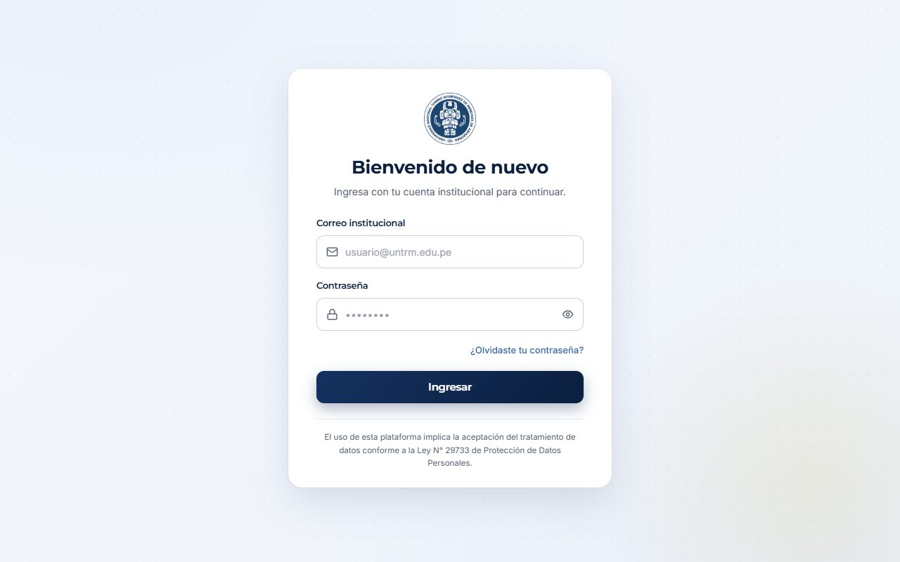
*Figura: Pantalla de ingreso.*

1. Abra la dirección del sistema que le indicó la DBU.
2. Escriba su **correo institucional** y su **contraseña**, y pulse *Ingresar*.
3. Llegará a su *Panel de inicio*, con un resumen de su trabajo y accesos rápidos a las tareas más frecuentes.

Tras **5 intentos fallidos** la cuenta se bloquea 15 minutos. Si la cuenta fue desactivada, pida a la DBU que la reactive.

### 1.3 Olvidé mi contraseña

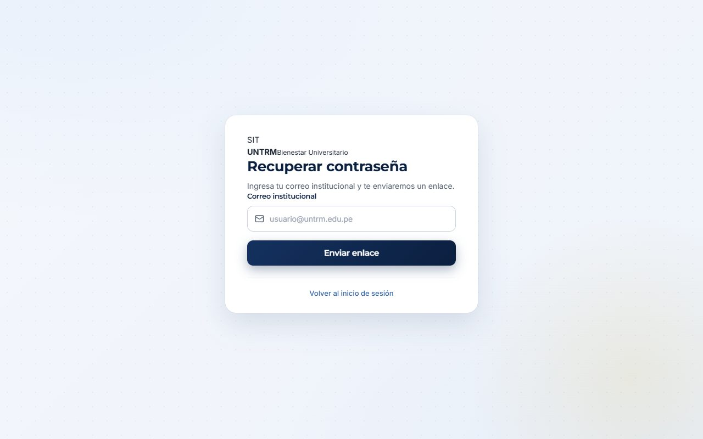
*Figura: Pantalla para recuperar la contraseña.*

1. En la pantalla de ingreso pulse *¿Olvidaste tu contraseña?* y escriba su correo.
2. Recibirá un mensaje con un enlace. **El enlace sirve una sola vez** y vence en 60 minutos.
3. Abra el enlace, escriba la nueva contraseña (mínimo 8 caracteres) y confirme.

Por seguridad, el sistema responde lo mismo exista o no el correo: si no llega el mensaje, revise la carpeta de correo no deseado o pida ayuda a la DBU.

### 1.4 Mi perfil y cambio de contraseña

Pulse su nombre en la esquina superior derecha. Allí puede actualizar su teléfono y foto, y en *Contraseña actual / Nueva contraseña / Confirmar nueva contraseña*
cambiar su clave con *Actualizar contraseña*. Al cambiarla se cierran sus otras sesiones abiertas.

### 1.5 Avisos (campana)

La campana de la parte superior muestra sus avisos (nueva solicitud, cambio de estado de un caso, nueva derivación…). Pulsar un aviso **abre directamente**
el caso o la solicitud correspondiente. *Marcar todas como leídas* limpia la lista.

**También le llegan por correo.** Cada aviso nuevo se envía además a su **correo institucional**, para que no tenga que estar dentro del sistema para enterarse. Al registrar una solicitud de tutoría, **quien la pide recibe además una constancia** (en la campana y por correo) de que quedó registrada, aunque la haya registrado su tutor a su nombre. El correo es solo un aviso: **no trae datos del caso ni de la persona atendida** (por confidencialidad); trae un enlace que abre el sistema, donde debe iniciar sesión para ver el detalle. Si no esperaba el mensaje, puede ignorarlo; no responda al correo (es automático). Si no le llegan, revise la carpeta de correo no deseado y avise a la DBU.

### 1.6 Cierre de sesión por inactividad

Si pasan **15 minutos sin actividad**, aparece un aviso con una cuenta regresiva de 60 segundos. Pulse el botón para seguir conectado; si no, la sesión se
cierra sola. Mientras trabaja, la sesión se renueva sin que usted haga nada. Use siempre *Salir* al terminar, sobre todo en equipos compartidos.

### 1.7 Confidencialidad

Los datos de los tutorados son **confidenciales** (Ley N.° 29733). No comparta capturas, impresiones o archivos descargados fuera de las personas
involucradas en el proceso.

## 2. Tutorado (estudiante)

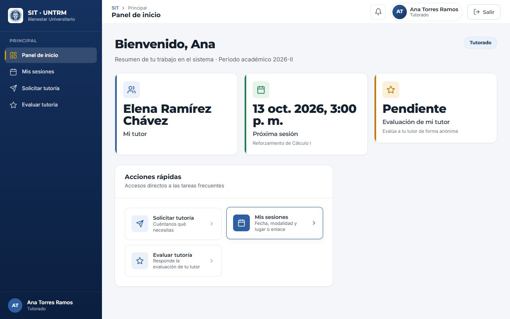
*Figura: Panel de inicio del tutorado.*

### 2.1 Ver mis sesiones

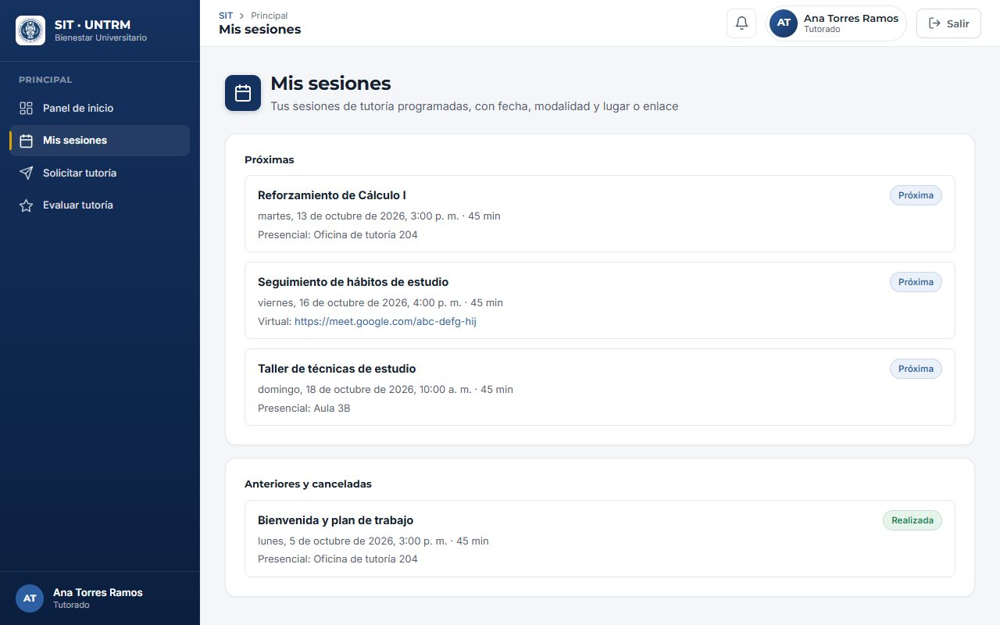
*Figura: «Mis sesiones»: fecha, modalidad y lugar o enlace.*

*Mis sesiones* lista las sesiones de tutoría programadas por su tutor, con **fecha, modalidad y lugar o enlace**. Cada una muestra su estado:
*Próxima*, *Cancelada* (con el motivo) o realizada. Si la sesión es virtual, el enlace aparece como vínculo solo cuando empieza con `https://` o `http://`.

En una sesión grupal usted ve únicamente su propia participación, no la de sus compañeros.

### 2.2 Solicitar tutoría

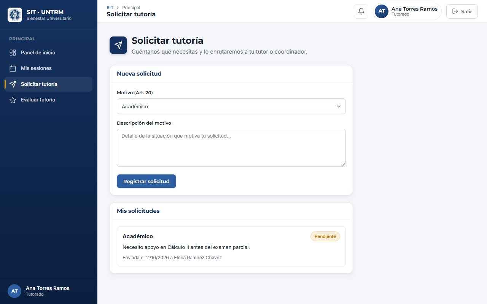
*Figura: «Solicitar tutoría» y el historial «Mis solicitudes».*

1. Entre a *Solicitar tutoría*.
2. En *Motivo (Art. 20)* elija el tipo: **Académico, Psicológico, Social o Salud**.
3. En *Descripción del motivo* explique brevemente su situación.
4. Pulse *Registrar solicitud*. Verá «Solicitud registrada y enrutada a tu tutor» (o «al coordinador de tu escuela» si aún no tiene tutor asignado).

Debajo, en *Mis solicitudes*, ve el historial con el estado de cada una: **Pendiente** → **En atención** → **Atendida**. Cuando su tutor la atiende
verá también **su respuesta** (por ejemplo, fecha y lugar de la sesión) y recibirá un aviso en la campana.

### 2.3 Evaluar a mi tutor

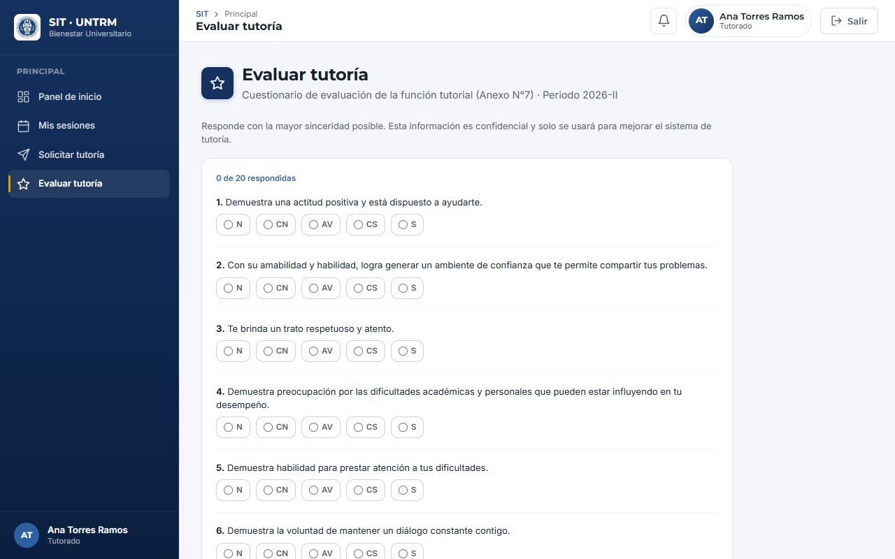
*Figura: Cuestionario de evaluación de la tutoría.*

La evaluación está disponible solo cuando la DBU la habilita para su escuela.

1. Entre a *Evaluar tutoría*.
2. Responda los **20 ítems** del cuestionario con la escala: **N** Nunca · **CN** Casi nunca · **AV** A veces · **CS** Casi siempre · **S** Siempre.
   El contador muestra «x de 20 respondidas»; el botón *Enviar evaluación* se activa cuando completa todas.
3. Opcionalmente escriba *Me gustaría* y *No me gusta*.
4. Pulse *Enviar evaluación*.

Solo se puede responder **una vez por periodo**. Sus respuestas son **anónimas**: quienes ven los resultados solo ven promedios y comentarios sin su nombre.

## 3. Docente tutor

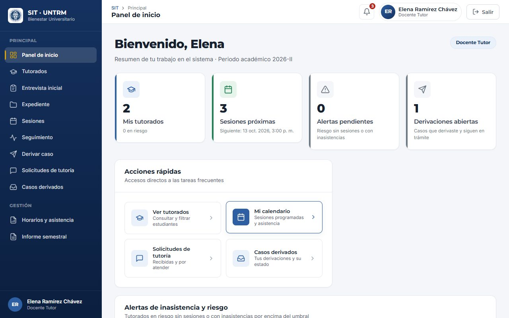
*Figura: Panel de inicio del docente tutor.*

### 3.1 Mis tutorados

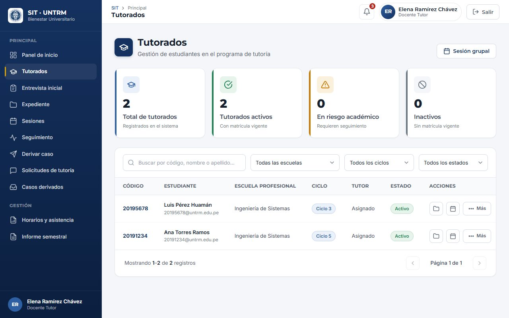
*Figura: Lista de tutorados con sus acciones.*

*Tutorados* muestra a los estudiantes que usted tiene asignados, con su código, escuela, ciclo y estado. Puede buscar por código, nombre o apellido y filtrar por
escuela, ciclo y estado. En cada fila:

- 📁 **Ver expediente**: línea de tiempo completa del acompañamiento.
- 📅 **Programar sesión**.
- **Más**: *Solicitar tutoría*, *Registrar entrevista inicial*, *Registrar seguimiento*, *Derivar caso* y *Marcar en riesgo*/*Quitar riesgo* (con motivo opcional).

Usted solo ve a **sus** tutorados; no puede abrir el expediente de un estudiante de otro tutor.

### 3.2 Entrevista inicial (Anexo 3)

1. Menú *Entrevista inicial* → elija al tutorado con *Registrar entrevista*.
2. Complete los datos de filiación, marque los motivos (académico, personal-emocional, vocacional), y escriba *Aspectos tratados* y *Acuerdos*.
3. Guarde. La entrevista aparece en el expediente.

### 3.3 Programar sesiones

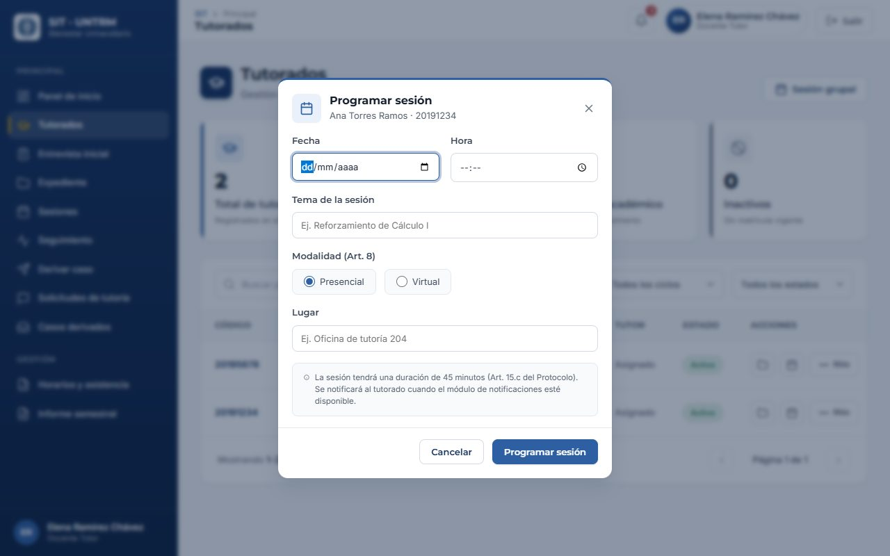
*Figura: Formulario «Programar sesión de tutoría».*

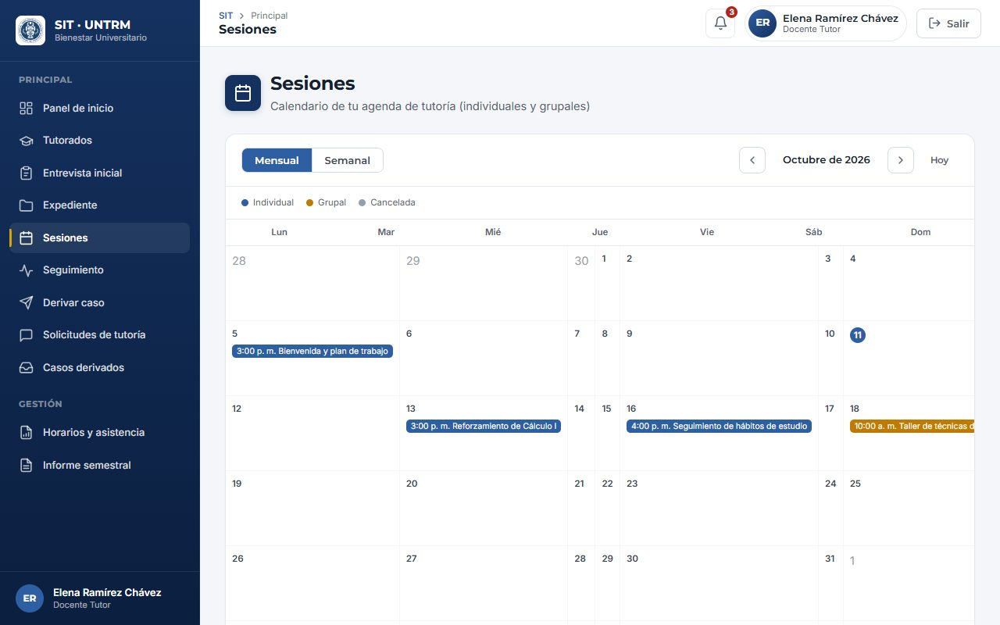
*Figura: Calendario mensual de «Sesiones».*

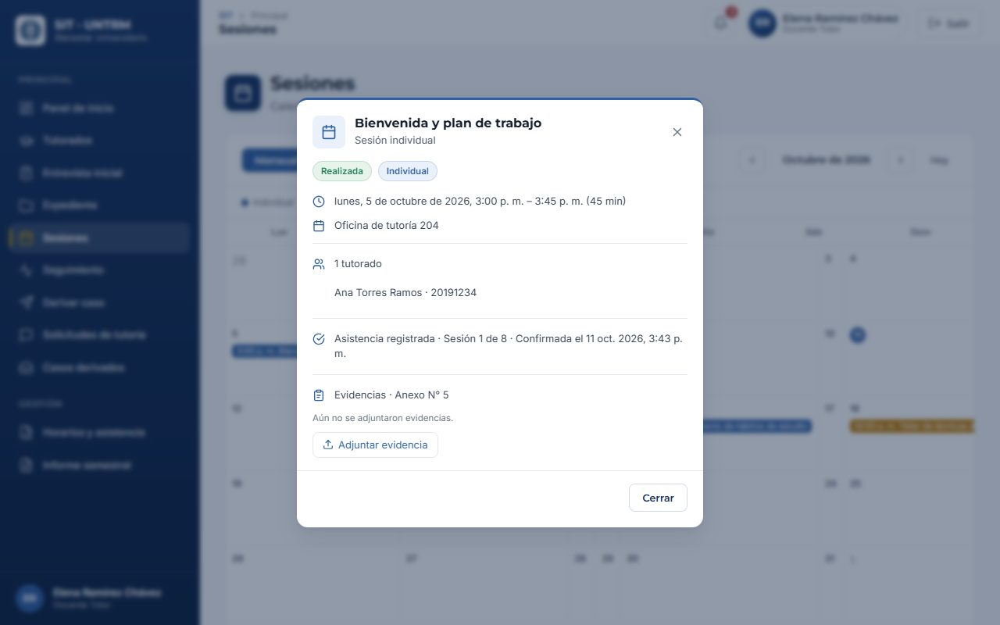
*Figura: Detalle de una sesión.*

1. En *Tutorados*, pulse **Programar sesión** en la fila del estudiante (sesión individual), o *Sesión grupal* en la parte superior para varios tutorados.
2. Indique **fecha, hora y tema**, y la modalidad:
   - **Presencial**: escriba el *Lugar*.
   - **Virtual**: pegue el *Enlace de videollamada* (debe comenzar con `https://` o `http://`).
3. Pulse *Programar sesión*. El estudiante la ve de inmediato en *Mis sesiones*.

La duración es de 45 minutos (la DBU puede ajustarla). *Sesiones* muestra su **calendario mensual**; pulse una sesión para ver su detalle.

**Reprogramar o cancelar:** abra la sesión desde *Sesiones* y use *Reprogramar* o *Cancelar sesión*. **El motivo es obligatorio**; queda en el historial y el
estudiante lo ve.

### 3.4 Registrar la asistencia (Anexo 4)

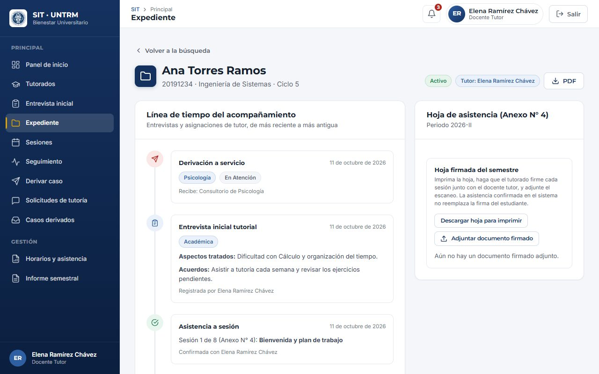
*Figura: Expediente del tutorado, con la hoja de asistencia (Anexo N.° 4).*

Cuando la sesión **ya empezó**, ábrala desde *Sesiones*:

- **Individual:** pulse *Registrar asistencia* si el estudiante asistió. La sesión recibe su número (1, 2, 3…). El tope es de **8 sesiones por tutorado en cada
  semestre**: al llegar a 8 el sistema no permite una novena. Si no asistió, pulse *Marcar inasistencia*.
- **Grupal:** marque quién asistió y quién no. Si nadie asistió, la sesión queda «sin asistentes» y no cuenta como realizada.

La numeración **vuelve a empezar en 1** cada semestre.

**Hoja de asistencia imprimible:** en el *Expediente* del tutorado, la tarjeta *Hoja de asistencia (Anexo N° 4)* permite descargarla en PDF. Imprímala, haga que
el estudiante y usted la firmen, y **adjunte el escaneo** en *Hoja firmada del semestre* (queda con autor, fecha y huella de verificación).

### 3.5 Seguimiento (Anexo 5)

*Seguimiento* → elija al tutorado → escriba el *motivo*, los *acuerdos* y, si fue con un docente de asignatura, su nombre, curso y ciclo. Aparece en el expediente.

### 3.6 Derivar un caso a un servicio (Anexo 6)

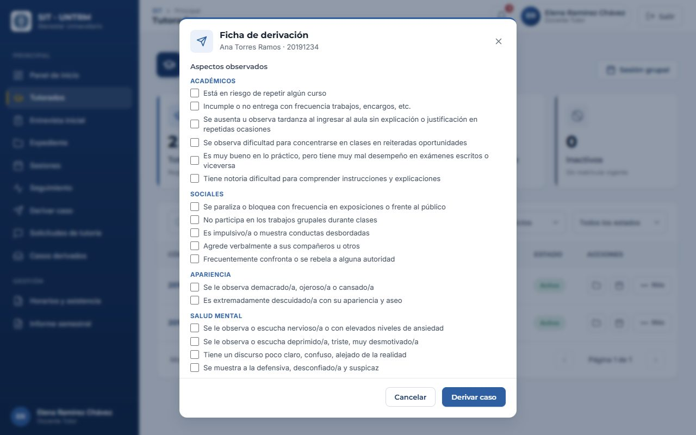
*Figura: Ficha de derivación.*

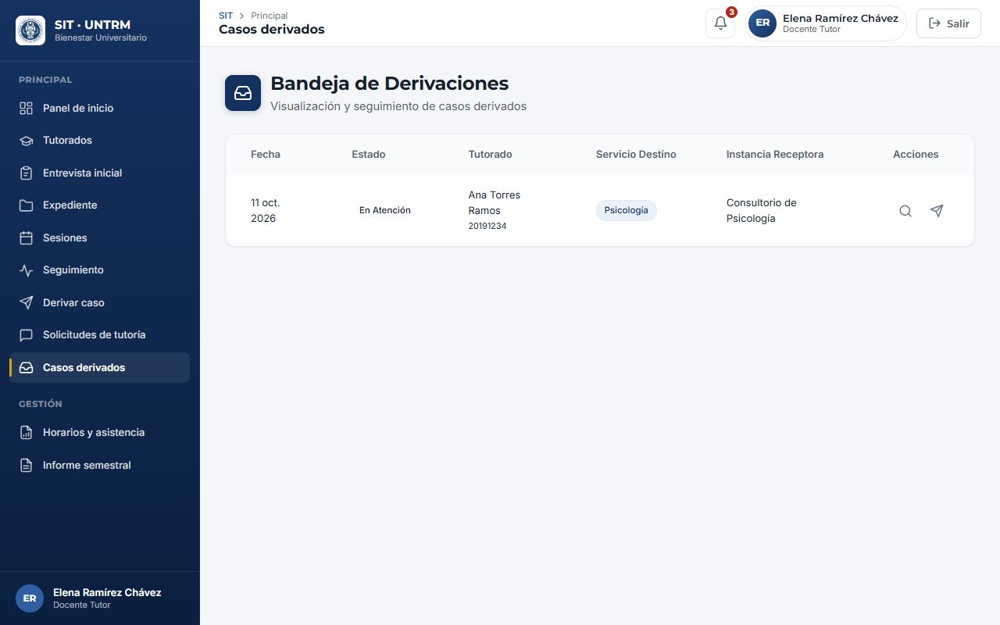
*Figura: «Casos derivados» del tutor.*

1. Menú *Derivar caso* → pulse **Derivar caso: [nombre]** en el estudiante.
2. En la *Ficha de derivación* marque los **aspectos observados** (académicos, sociales, apariencia, salud mental), escriba el *motivo* y elija el
   **servicio**: Escuela Profesional, Psicopedagogía, Psicología, Asistencia Social o Salud. El sistema **sugiere un servicio** según los aspectos marcados.
   Opcionalmente indique la instancia o profesional que recibe.
3. Pulse *Derivar caso*. El profesional de ese servicio recibe un aviso.

**Seguimiento del caso:** en *Casos derivados* ve sus derivaciones con su estado (**Enviado → Recibido → En atención → Atendido → Cerrado**). Con el icono de la
lupa abre el detalle y con el otro icono descarga la **constancia** (PDF).

**Constancia firmada:** imprima la constancia, fírmela (usted y el profesional que recibe) y adjunte el escaneo en *Constancia firmada (Anexo N° 6)* dentro del detalle.
La ven usted, el servicio de destino y la DBU, nadie más.

> Las **notas internas** que escribe el servicio al atender el caso **no se muestran** al tutor que derivó: usted ve el estado y el historial, no el contenido clínico.

### 3.7 Solicitudes de tutoría

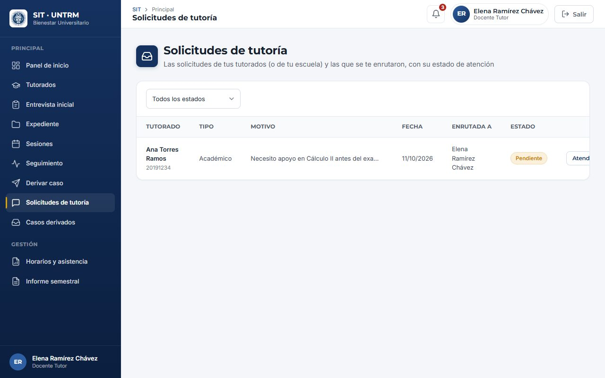
*Figura: Bandeja de «Solicitudes de tutoría».*

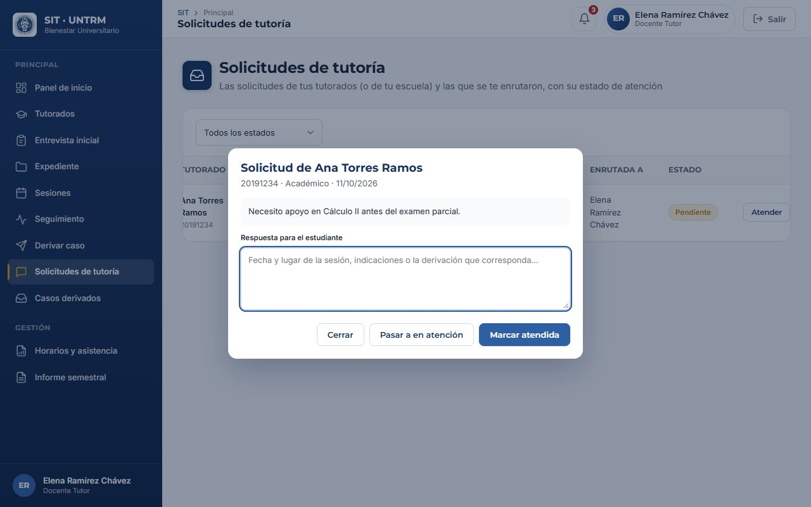
*Figura: Cuadro «Atender solicitud de tutoría».*

*Solicitudes de tutoría* lista las solicitudes de sus tutorados. Para atender una:

1. Pulse *Atender* en su fila. Se abre la solicitud.
2. Si la va a trabajar, pulse *Pasar a en atención*.
3. Escriba la **respuesta para el estudiante** (por ejemplo «Te espero el jueves a las 3 pm en la oficina 204») y pulse *Marcar atendida*.
   **No se puede marcar atendida sin respuesta**, y el estado nunca retrocede.

El estudiante ve la respuesta y recibe un aviso.

### 3.8 Horarios y asistencia (Art. 15.d)

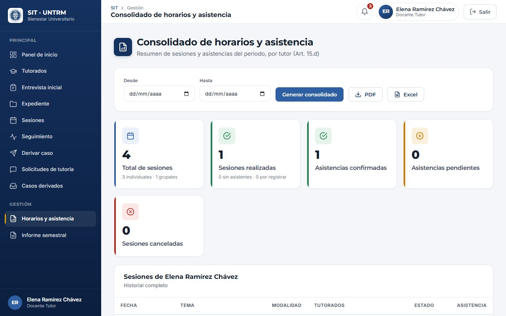
*Figura: Consolidado de «Horarios y asistencia».*

*Horarios y asistencia* genera su consolidado de sesiones (programadas, realizadas, canceladas, asistencias confirmadas y pendientes). Puede acotar por fechas
con *Generar consolidado* y exportarlo con los botones **PDF** o **Excel**.

### 3.9 Informe semestral (Anexo 9)

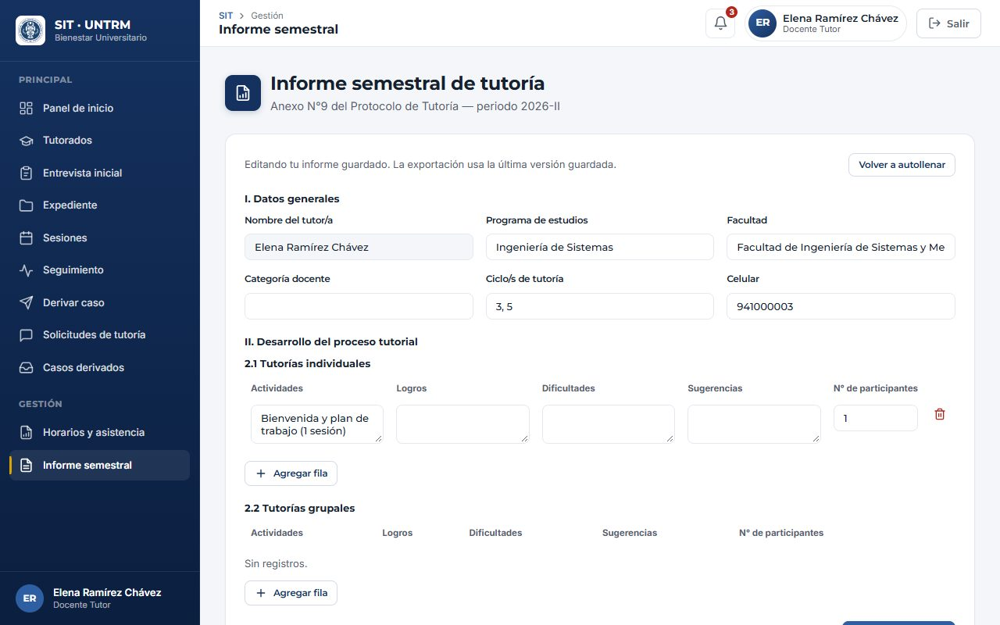
*Figura: Informe semestral autollenado.*

*Informe semestral* trae un **borrador autollenado** con sus sesiones y seguimientos del periodo. Revíselo, complete logros, dificultades y sugerencias, y pulse
*Guardar informe*; después *Exportar PDF*. Con *Volver a autollenar* recupera el borrador del sistema.

## 4. Coordinador de escuela

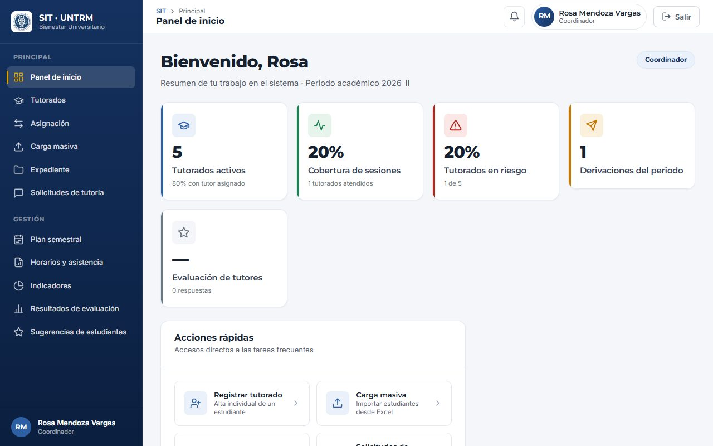
*Figura: Panel de inicio del coordinador.*

Además de ver los tutorados **de su escuela** (nunca de otras), el coordinador:

### 4.1 Asignar tutores

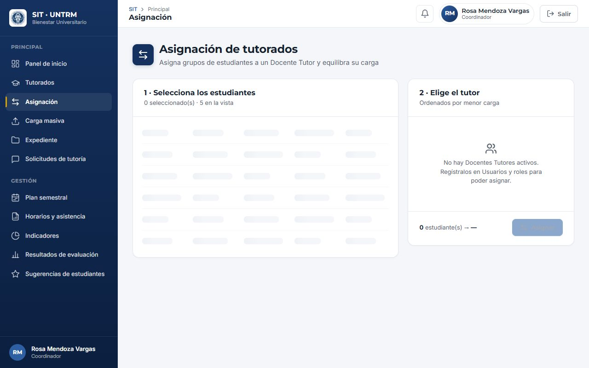
*Figura: Asignación de tutorados.*

- *Asignación*: elija a los estudiantes sin tutor (paso 1) y el docente tutor (paso 2; la lista se ordena de menor a mayor carga) para asignarlos en grupo.
- **Reasignación individual:** en *Tutorados*, menú *Más* → *Reasignar tutor*; indique el motivo. Queda en el historial de asignaciones.

### 4.2 Registrar y cargar tutorados

- *Tutorados* → *Nuevo tutorado*: código universitario, ciclo, nombres, apellidos, escuela y, opcionalmente, correo y teléfono.
- *Carga masiva*: descargue la plantilla Excel con *Descargar plantilla*, complétela y súbala; el sistema muestra un **reporte del resultado** (estudiantes nuevos, estudiantes que **continúan** y filas con error). La carga es **del periodo vigente**: cada estudiante cargado queda matriculado en él (un estudiante que ya existía de un periodo anterior no da error: se actualiza su ciclo y se matricula de nuevo). **Quien no figura en la carga del periodo vigente solo puede consultar su historial: no puede solicitar tutoría ni evaluar.** Sin un periodo vigente no se puede cargar.
- *Pedir listas*: al iniciar el periodo, pida a la escuela la lista de estudiantes. Elija la escuela y, si no hay un correo configurado, escríbalo ahí mismo (se puede cambiar cuando quien lo recibía deje de responder); marque los ciclos (o ninguno para todos), agregue observaciones y pulse *Enviar pedido*. Sale un correo formal a nombre suyo, con copia a su correo y la **plantilla Excel adjunta**; las respuestas le llegan a usted. Queda un historial con lo pedido y a quién, para marcarlo como recibido cuando llegue el archivo, que se carga en *Carga masiva*.
- Para que un estudiante pueda entrar al sistema hay que **vincular su cuenta** de portal (*Más* → *Vincular cuenta*).

### 4.3 Solicitudes de tutoría

*Solicitudes de tutoría* muestra las solicitudes de los estudiantes de su escuela (incluidas las que llegan al coordinador porque el estudiante no tiene tutor).
Se atienden igual que el tutor (sección 3.7). Si la escuela no tuviera coordinador, la solicitud llega a la DBU: nunca se pierde.

### 4.4 Plan de trabajo semestral (Anexo 8)

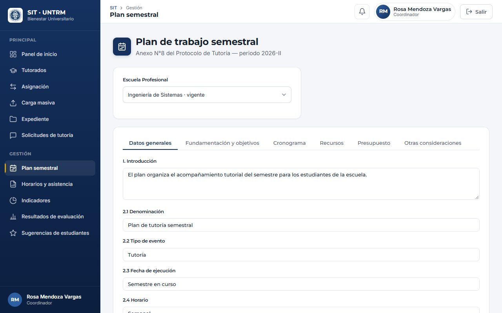
*Figura: Plan semestral y resolución de aprobación.*

1. *Plan semestral* muestra el plan de **su escuela** (si tuviera varias, elija en el selector).
2. Complete las secciones (datos generales, objetivos, metodología, programación, recursos, presupuesto, actividades operativas) y pulse *Guardar plan*. Queda como **Borrador**.
3. En *Resolución de aprobación* pulse *Adjuntar resolución* y suba el **PDF de la resolución**. El plan pasa a **Plan vigente**.
4. Si necesita cambiar un plan aprobado, edítelo y pulse *Guardar como nueva revisión*. El sistema pide confirmación: **la versión aprobada se conserva**
   (en *Versiones aprobadas anteriores* puede descargar su resolución y su PDF) y la nueva revisión queda **pendiente de resolución** hasta que adjunte la que la apruebe.

### 4.5 Indicadores, resultados y exportaciones

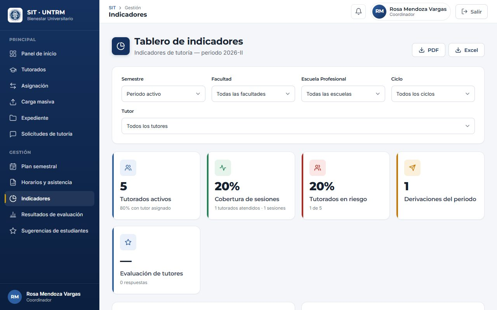
*Figura: Tablero de indicadores.*

- *Indicadores*: tablero de cobertura, riesgo, sesiones por mes y derivaciones por servicio de su escuela, con botones **PDF** y **Excel**.
- *Resultados de evaluación* y *Sugerencias de estudiantes*: promedios por tutor e ítem y comentarios abiertos, **siempre agregados y anónimos**.
- *Horarios y asistencia*: consolidado de un tutor de su escuela (elija el tutor); exportable en PDF y Excel.

## 5. Profesional de servicio

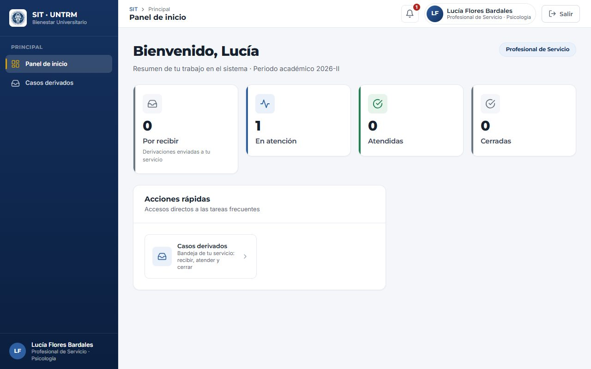
*Figura: Panel de inicio del profesional de servicio.*

Aplica a Psicología, Psicopedagogía, Asistencia Social, Salud y Escuela Profesional. Usted ve **solo los casos derivados a su servicio**.

### 5.1 Recibir y abrir un caso

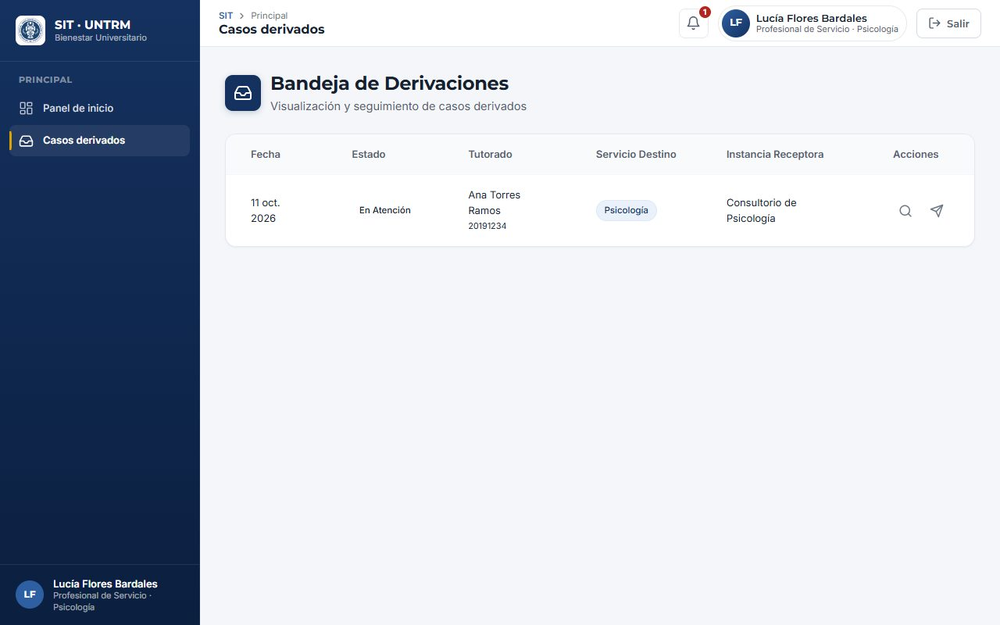
*Figura: Bandeja de «Casos derivados» del servicio.*

Cuando un tutor deriva un caso a su servicio, aparece un aviso en la campana: *Nueva derivación recibida*. Al pulsarlo se abre **ese caso**. También puede entrar por
*Casos derivados*, donde ve la bandeja con fecha, estado, servicio e instancia receptora.

### 5.2 Atender el caso

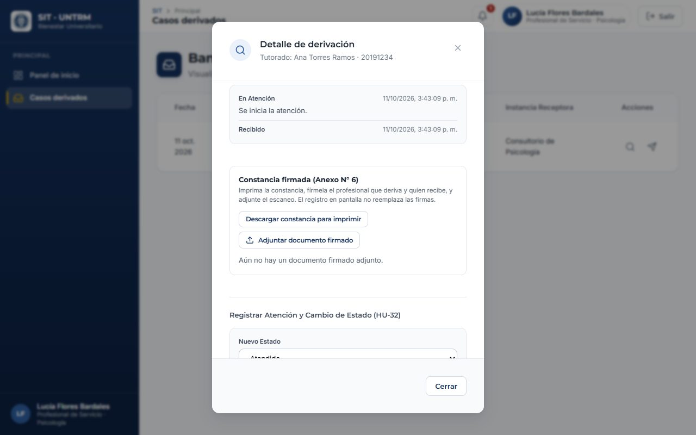
*Figura: Detalle de la derivación y registro de atención.*

En el detalle del caso, la sección *Registrar Atención y Cambio de Estado* permite avanzar el estado:

| Paso | Cómo | Qué exige |
|---|---|---|
| Recibido | Elija *Recibido* en *Nuevo Estado* y pulse *Guardar Cambios* | — |
| En atención | *En Atención* → *Guardar Cambios* | — |
| Atendido | *Atendido* → *Registrar Atención* | **Observaciones obligatorias** |
| Cerrado | *Cerrado* → *Cerrar Caso Derivado* | **Observaciones obligatorias** |

El estado **solo avanza**: no se puede volver a uno anterior ni repetirlo. Las *Observaciones / Detalles de Atención* son **internas**: las ven su servicio y la DBU, no el tutor
que derivó (él ve el estado y las fechas). Un caso **Cerrado** ya no se modifica.

### 5.3 Constancia y documento firmado

Desde el detalle puede descargar la constancia (Anexo N.° 6) y **adjuntar el escaneo firmado** en *Constancia firmada*. Queda con autor, fecha y huella.

## 6. Vicerrectorado

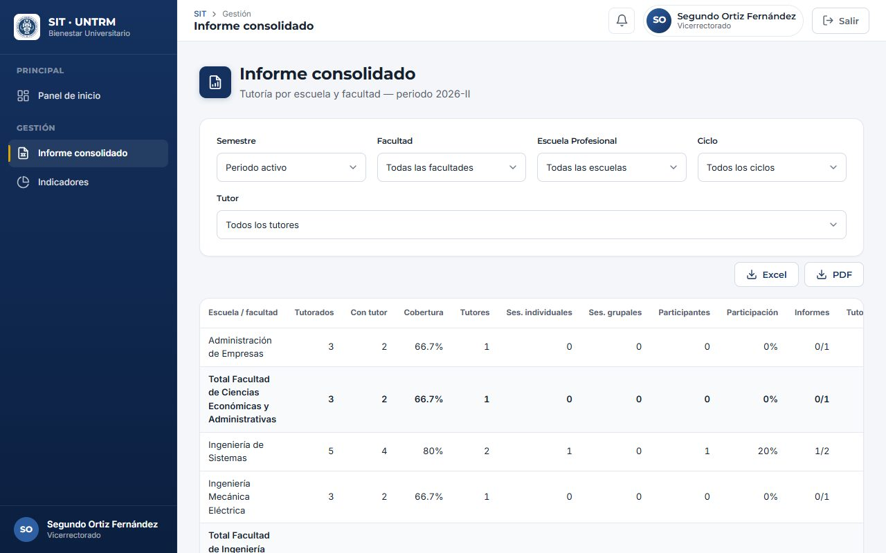
*Figura: Informe consolidado por escuela y facultad.*

Perfil de **solo lectura**.

- *Informe consolidado*: cifras por escuela y facultad (tutorados, con tutor, cobertura, tutores, sesiones individuales y grupales, participantes, informes). Filtros por *Semestre,
  Facultad, Escuela profesional, Ciclo y Tutor*. Botones **Excel** y **PDF**.
- *Indicadores*: tablero con tutorados activos, cobertura de sesiones, tutorados en riesgo, derivaciones del periodo y evaluación de tutores, más gráficos por mes, servicio y escuela.
  También exportable.
- Para consultar un semestre ya cerrado, elija el semestre en el filtro: **las cifras de un semestre cerrado no cambian** aunque después se reasignen o desactiven estudiantes.

Las cifras del consolidado, del tablero y del panel de inicio coinciden entre sí.

### 6.1 Sedes
Vicerrectorado (y la DBU) configuran en **Sedes** (menú Gestión) las sedes de la universidad (*Sede Central, Sede Bagua, Sede Utcubamba*) y **la sede de cada escuela profesional**: una escuela pertenece a una sola sede. Se puede agregar una sede, desactivarla o activarla de nuevo; una sede inactiva no se puede asignar a una escuela. Los cambios quedan en la bitácora. Este perfil no ve datos de estudiantes.

## 7. Administrador DBU

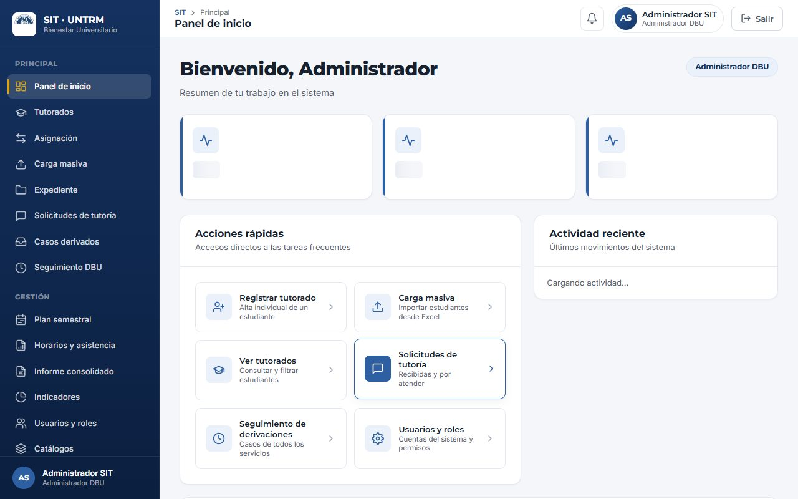
*Figura: Panel de inicio del administrador.*

El administrador tiene acceso a todo. Además de lo descrito para los demás roles (sección 3 a 6), administra:

### 7.1 Usuarios y roles

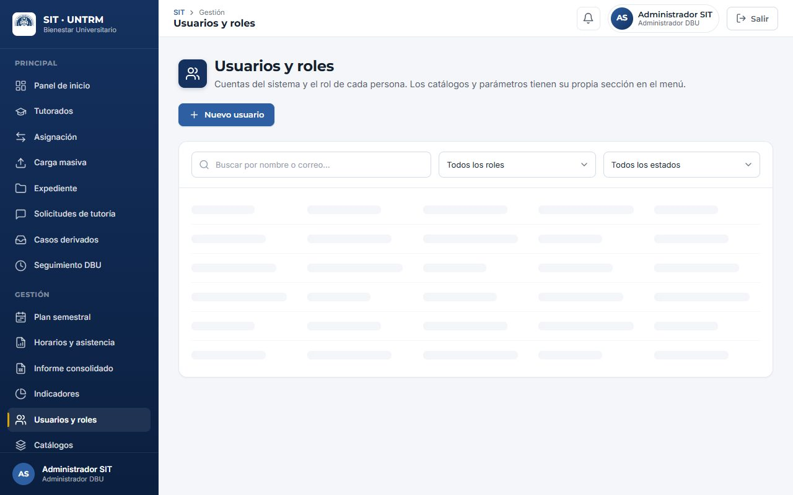
*Figura: Lista de usuarios.*

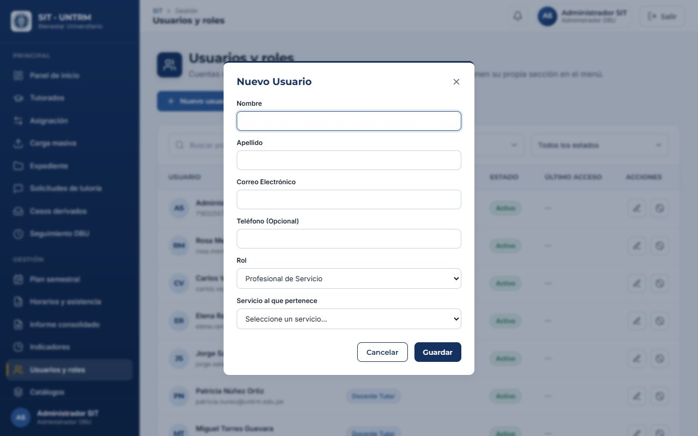
*Figura: Alta de un Profesional de Servicio: el servicio es obligatorio.*
*Usuarios y roles*: alta de cuentas (*Nuevo Usuario*: nombre, apellido, correo, teléfono y rol), cambio de rol y **activar/desactivar** (una persona desactivada pierde el acceso de inmediato, aunque tenga la sesión abierta).

**Profesionales de servicio:** al elegir el rol *Profesional de Servicio* aparece el campo obligatorio *Servicio al que pertenece* (Escuela Profesional, Psicopedagogía, Psicología, Asistencia Social o Salud). **De ese servicio depende qué casos derivados ve y recibe**: sin él no vería ninguno, por eso el sistema no deja guardar sin elegirlo. En la tabla de usuarios aparece junto al rol (por ejemplo, «Profesional de Servicio · Psicología»).

Al crear la cuenta **no se genera ninguna clave**: el sistema envía al correo de la persona una **invitación con un enlace de un solo uso** (vale 72 horas) para que cree su propia contraseña, y muestra ese mismo enlace a quien administra por si el correo no sale. La cuenta queda como *Pendiente de activación* hasta que se use el enlace; antes no hay forma de entrar. Si el enlace se pierde, vence o ya se usó, use el botón *Emitir invitación nueva* de esa fila (el enlace anterior deja de servir). No comparta el enlace: quien lo abra primero crea la contraseña.

### 7.2 Catálogos maestros

*Figura: Catálogos maestros.*
*Catálogos*: pestañas **Facultades, Escuelas, Periodos, Ciclos, Servicios y Motivos**. Use *Nueva …* → *Crear*; *Editar*; *Desactivar/Activar*; *Eliminar* (con confirmación; lo que ya está en uso solo se puede desactivar).
El **periodo académico activo** determina el semestre en curso para reportes y numeración de asistencias; al activar otro, el anterior queda **cerrado** con su corte de matrícula.

### 7.3 Parámetros del sistema

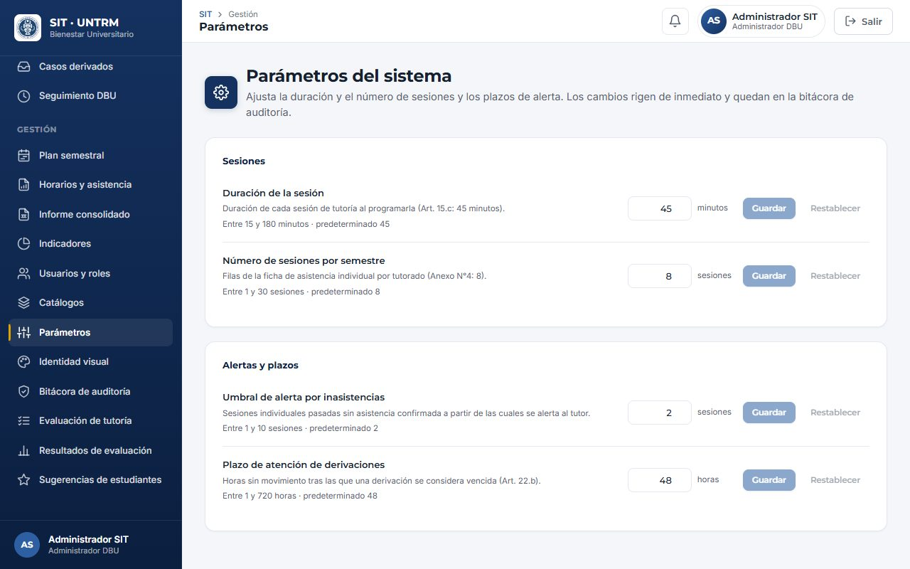
*Figura: Parámetros del sistema.*
*Parámetros*: duración de la sesión (45 min), número de sesiones por semestre (8), umbral de alerta por inasistencias (2) y plazo de atención de derivaciones (48 h). En el grupo *Seguridad de acceso*: cierre de sesión por inactividad (15 min), intentos fallidos antes del bloqueo (5) y duración del bloqueo (15 min); el plazo de inactividad rige desde el siguiente inicio de sesión de cada persona y el servidor lo hace valer también al renovar la sesión. Los cambios rigen de inmediato (salvo lo indicado) y quedan en la bitácora.

### 7.4 Identidad visual

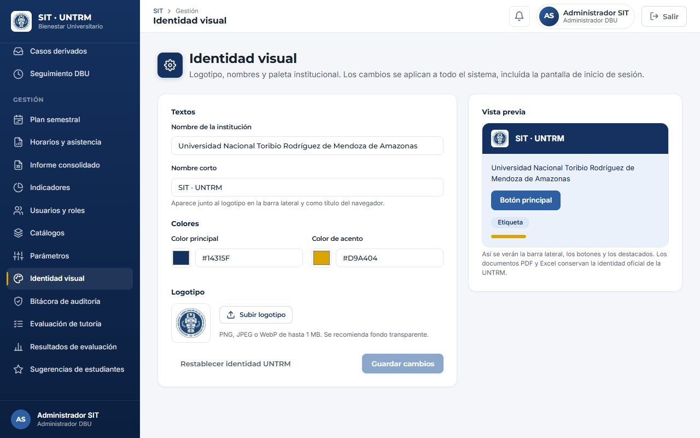
*Figura: Identidad visual.*
*Identidad visual*: nombre de la institución, **nombre corto** (barra lateral y título del navegador), colores y logotipo (PNG, JPEG o WEBP de hasta 1 MB). *Guardar cambios* lo aplica a todo el sistema;
*Restablecer identidad UNTRM* vuelve a la original.

### 7.5 Evaluación de tutoría

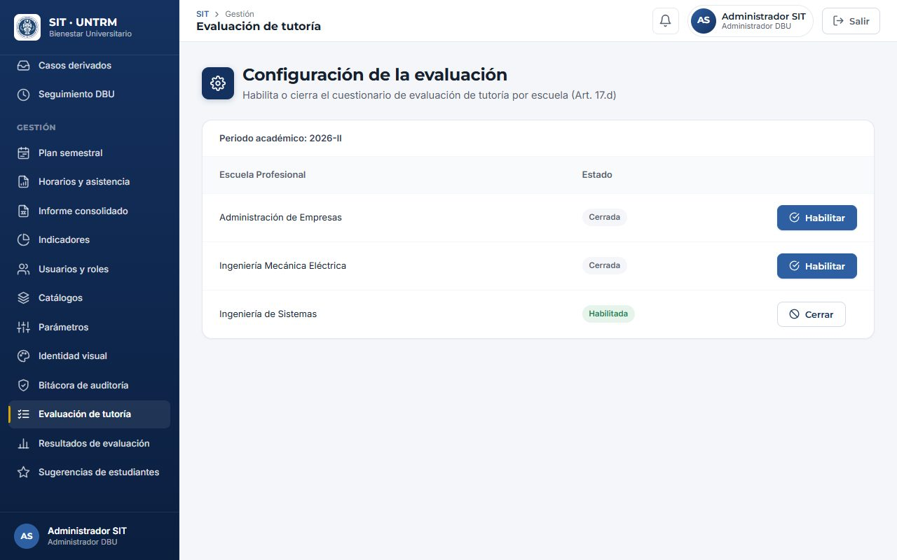
*Figura: Habilitación de la evaluación por escuela.*
*Evaluación de tutoría* lista las escuelas con su estado (*Habilitada* / *Cerrada*). Pulse *Habilitar* o *Cerrar* para abrir o cerrar la evaluación a los estudiantes de esa escuela.

### 7.6 Seguimiento DBU y Bitácora

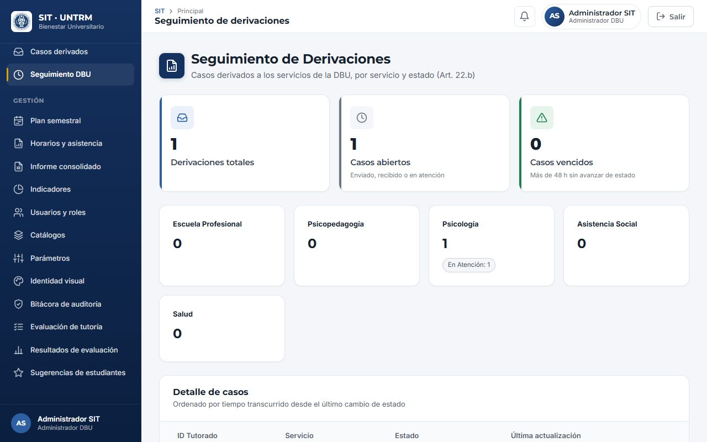
*Figura: Seguimiento de derivaciones por la DBU.*

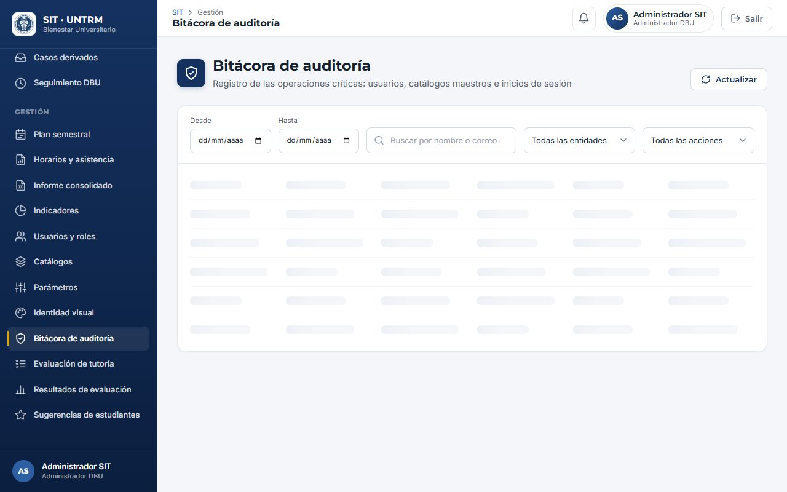
*Figura: Bitácora de auditoría.*
- *Seguimiento DBU*: todos los casos derivados por servicio y estado, con el plazo de atención.
- *Bitácora de auditoría*: registro de las operaciones críticas (inicios de sesión, cambios de usuarios y catálogos, adjuntos, cambios de estado) y de los **accesos a información sensible**: quién consultó o descargó un expediente, entrevistas, seguimientos, red de apoyo, derivaciones y documentos firmados, cuándo y desde qué IP, incluidos los intentos rechazados. La bitácora no guarda el contenido consultado. Se puede filtrar y no se puede modificar desde el sistema.

### 7.7 Cierre de periodo
Al terminar el periodo académico, vaya a **Cierre de periodo** (menú Gestión). La pantalla muestra el periodo vigente con un **resumen** de lo ocurrido: estudiantes, tutores, sesiones (individuales, grupales, canceladas, con asistencia), solicitudes, derivaciones, respuestas de evaluación e informes semestrales, y avisa qué quedará abierto (solicitudes, derivaciones y sesiones próximas).

1. Pulse **Cerrar periodo** y **escriba el nombre exacto del periodo** como confirmación.
2. El sistema guarda el resumen, congela la matrícula del periodo y lo deja **cerrado**. Nada se borra.
3. Desde ese momento la tutoría está en **solo lectura** para todas las personas: se puede consultar el historial, pero **no se registran** sesiones, asistencias, entrevistas, seguimientos, derivaciones ni solicitudes, y los estudiantes ven un aviso y no pueden solicitar tutoría. Siguen disponibles la administración (usuarios, catálogos, cargas de estudiantes y asignaciones) y los informes.
4. Para el reporte completo del periodo use **Informe consolidado**, **Indicadores** y **Resultados de evaluación**, eligiendo ese periodo.
5. Para empezar el siguiente, cree el periodo nuevo en *Catálogos → Periodos* y márquelo vigente. **Solo puede haber un periodo vigente**: el catálogo no deja abrir otro mientras el anterior no esté cerrado, ni apagar el vigente sin cerrarlo.

Si cerró por error, **Reabrir periodo** (en el mismo periodo cerrado) lo devuelve a vigente; solo es posible si no hay otro vigente. El cierre y la reapertura quedan en la bitácora. La numeración de asistencias reinicia en 1 en el periodo nuevo.

### 7.8 Docentes tutores por escuela
Al crear o editar un usuario con rol **Docente**, la DBU debe elegir su **escuela profesional**; de ella salen su facultad y su sede. Un docente tutor **solo puede tutorear estudiantes de su escuela** (un docente de Mecánica Eléctrica no puede tutorear a estudiantes de Sistemas):

- En *Asignación de tutorados* solo se ofrecen los tutores de la escuela de los estudiantes elegidos (si se eligen estudiantes de varias escuelas, ninguno aplica: asigne por escuela).
- En *Reasignar* solo aparecen tutores de la escuela del tutorado.
- Si se intenta de otra forma, el sistema lo rechaza con el aviso «El tutor pertenece a otra escuela».
- Los docentes creados antes de esta regla quedan sin escuela hasta que la DBU se la indique (editando el usuario); mientras tanto no se bloquean.

### 7.8.1 Importar docentes desde Excel
En **Usuarios y roles → Importar docentes** la DBU da de alta a varios docentes tutores a la vez. Descargue la plantilla (nombres, apellidos, correo, teléfono y **escuela**), complétela con la lista que entrega la facultad y súbala. Cada fila crea la cuenta del docente con su escuela y le envía el enlace de un solo uso para crear su contraseña. El resultado indica cuántos se crearon y, fila por fila, los que no se pudieron cargar (correo inválido o ya registrado, escuela que no existe…). Si el correo no pudo salir, la pantalla muestra el enlace de ese docente una sola vez para entregarlo por un medio privado. Volver a subir el mismo archivo no duplica cuentas.

### 7.9 Tutores por ciclo
En **Tutores por ciclo** (menú Principal; DBU y coordinación de la escuela) se elige, para el periodo vigente, **el tutor de cada ciclo** de una escuela. Solo aparecen los docentes de esa escuela.

1. Elija la escuela y, en cada ciclo, el docente. Al elegirlo, los estudiantes **matriculados** de ese ciclo que no tenían tutor pasan a él; si cambia el tutor del ciclo, quienes seguían con el anterior se mueven (queda en el historial de asignaciones). Un tutor puesto a mano por la coordinación no se toca.
2. Los estudiantes que se **carguen después** (carga masiva o alta manual) en ese ciclo quedan con el tutor del ciclo.
3. **Un docente atiende un solo ciclo.** Si intenta ponerlo en otro, el sistema avisa y ofrece **registrar una excepción**: escriba el motivo (p. ej. «aceptó por correo asumir el ciclo 8»). Queda marcada como *Excepción* y en la bitácora. Un docente no puede atender más de dos ciclos.
4. **Quitar** deja el ciclo sin tutor; los estudiantes conservan el que ya tienen (para cambiarlo, use la reasignación).

## 8. Preguntas frecuentes

**No me aparece una opción del menú.** Depende de su rol. Si cree que le falta acceso, pida a la DBU revisar su rol.

**«Ya respondiste el cuestionario de este periodo».** La evaluación se responde una sola vez por periodo.

**«La evaluación no está disponible por ahora».** La DBU aún no la habilitó para su escuela, o ya se cerró.

**No puedo registrar la asistencia.** La sesión debe haber empezado; además, el tutorado no puede superar 8 asistencias individuales en el semestre.

**No puedo marcar atendida una solicitud.** Escriba antes la respuesta para el estudiante.

**No puedo cambiar un caso a un estado anterior.** Los estados solo avanzan; para *Atendido* y *Cerrado* hacen falta observaciones.

**Un estudiante no ve el menú de tutorado.** Su cuenta de portal debe estar vinculada a su registro de estudiante (*Más → Vincular cuenta*).

**La página me pide entrar de nuevo.** La sesión se cerró por inactividad o porque la contraseña fue cambiada o la cuenta desactivada.

**Veo «Demasiados intentos».** Espere unos minutos e inténtelo de nuevo.

## 9. Glosario

| Término | Significado |
|---|---|
| DBU | Dirección de Bienestar Universitario |
| Tutorado | Estudiante que recibe tutoría |
| Anexo 3 | Entrevista inicial tutorial |
| Anexo 4 | Hoja de asistencia a la tutoría individual (8 sesiones por semestre) |
| Anexo 5 | Ficha de seguimiento del tutor |
| Anexo 6 | Ficha y constancia de derivación a un servicio |
| Anexo 7 | Cuestionario de evaluación de la función tutorial |
| Anexo 8 | Plan de trabajo semestral |
| Anexo 9 | Informe semestral del tutor |
| Derivación | Envío de un caso a un servicio especializado (Escuela, Psicopedagogía, Psicología, Asistencia Social, Salud) |
| Solicitud de tutoría | Pedido de un estudiante o docente para recibir tutoría (Art. 19–20) |
| Periodo / semestre | Ciclo académico activo (por ejemplo, 2026-II) |
| Corte de matrícula | Foto de los tutorados activos al cerrar un semestre; hace que sus informes no cambien |
