# Diagramas de diseño del SIT UNTRM

**Estado:** actual (implementado), salvo lo marcado como *propuesto* o *pendiente*. **Referencia:** `develop` al 19/11/2026 (`v1.0.0-beta.4`). **Formato:** Mermaid; las figuras de casos de uso, entidad-relación y clases se generan con scripts desde las fuentes (`docs/diagramas/casos-de-uso/*.puml`, `server/prisma/schema.prisma`, `server/src/domain/entities`); las de esta página están dibujadas a mano a partir del código y de las pantallas, y cada una dice de dónde sale.

## DOC-D01 · Contexto del sistema

**Propósito:** personas, sistema y servicios externos, con sus límites. **Fuente:** roles en `server/prisma/seed` y `docs/MANUAL_TECNICO.md` (modelo de roles); correo y respaldo en `docs/MANUAL_TECNICO.md`.

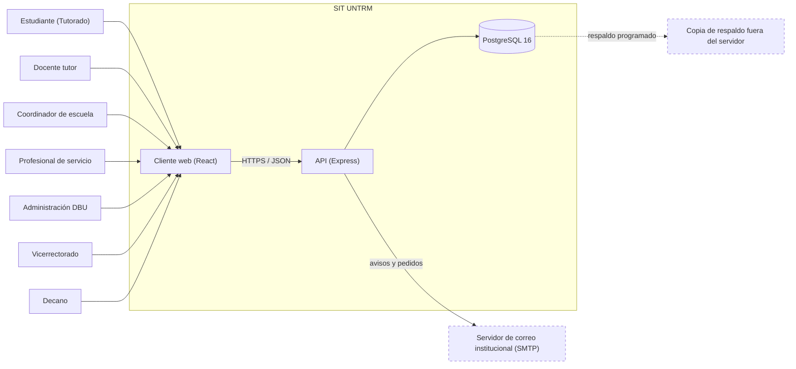

Las líneas punteadas indican servicios cuya entrega institucional sigue pendiente de TI.

## DOC-D05a · Actividades: de la solicitud de tutoría a la atención o la derivación

**Propósito:** recorrido de una necesidad de acompañamiento. **Fuente:** estados de `TutoringRequest` y `StudentReferral` (`server/src/domain/entities`) y el manual de usuario (secciones del tutor).

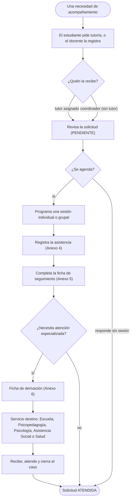

## DOC-D05b · Actividades: preparación y cierre del periodo

**Propósito:** ciclo de un periodo académico en el sistema. **Fuente:** `docs/MANUAL_USUARIO.md` (Periodo académico) y `PeriodLifecycleUseCases.ts`.

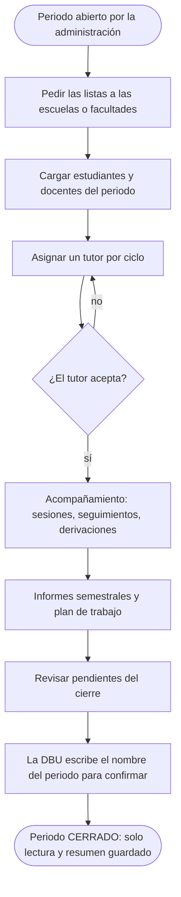

## DOC-D06a · Secuencia: inicio de sesión

**Propósito:** autenticación con renovación de sesión. **Fuente:** `docs/MANUAL_TECNICO.md` (seguridad) y las rutas de autenticación.

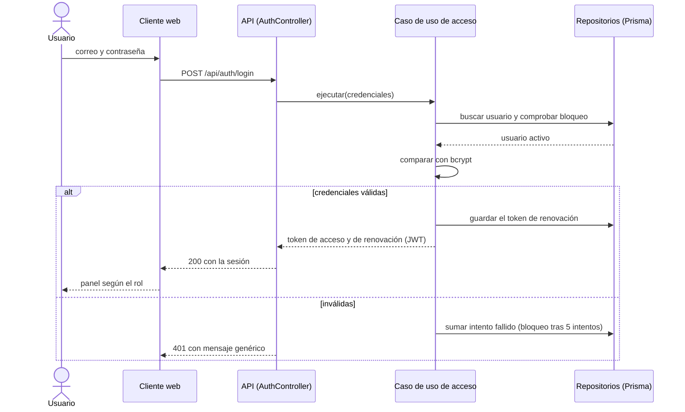

## DOC-D06b · Secuencia: solicitud de tutoría y aviso por correo

**Propósito:** cómo viaja una solicitud y su aviso. **Fuente:** `TutoringRequest`, `Notification` y `EmailOutbox` en `schema.prisma`; `EmailOutboxWorker` en `server/src/infrastructure/services`.

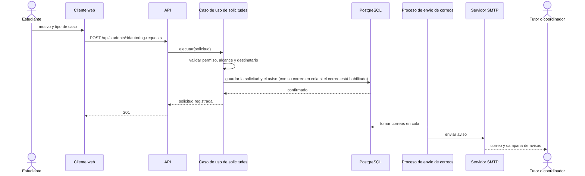

## DOC-D07a · Estados de la solicitud de tutoría

**Fuente:** `TUTORING_REQUEST_STATUSES` en `server/src/domain/entities/TutoringRequest.ts` y `UpdateTutoringRequestStatusUseCase.ts` (avanza sin retroceder; al atenderla se deja una respuesta).

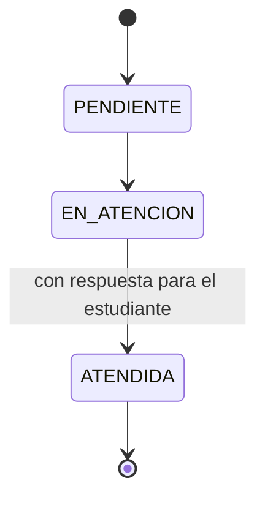

## DOC-D07b · Estados de la derivación

**Fuente:** `ReferralStatus` y la regla de avance en `referralAccess.ts`: el estado solo avanza; se puede saltar una etapa, no retroceder.

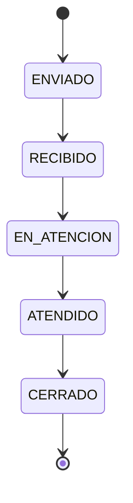

## DOC-D07c · Estados del trámite de certificación (demostración)

**Fuente:** `server/src/domain/certification/certificateWorkflow.ts` y `certificateStatus.ts`. Los estados `PENDIENTE_DE_FIRMA`, `FIRMADO_INCORPORADO` y `ENTREGADO` existen en el modelo pero **ningún certificado de demostración puede alcanzarlos**; esperan la plantilla oficial.

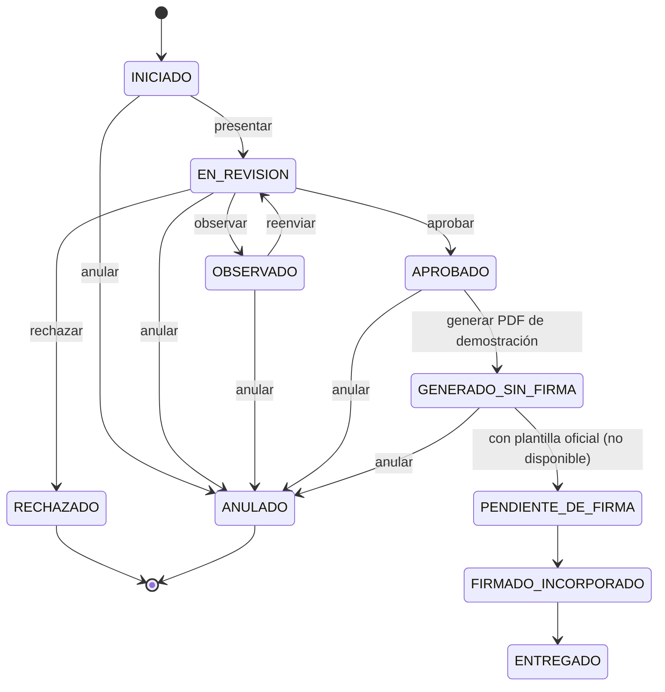

## DOC-D07d · Estados del periodo académico

**Fuente:** `stateOf` en `server/src/application/use-cases/periods/PeriodLifecycleUseCases.ts`. Solo se puede cerrar el vigente, escribiendo su nombre; solo se reabre un cerrado si no hay otro vigente.

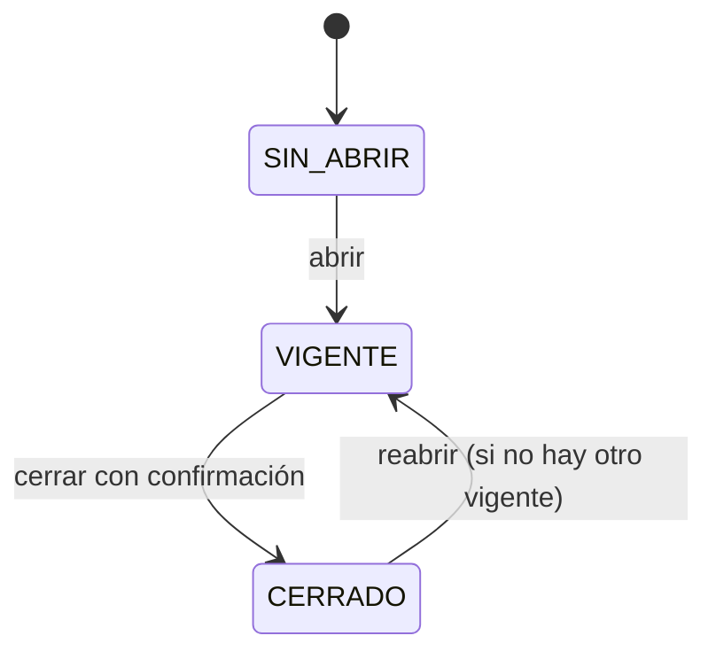

## DOC-D08 · Componentes

**Fuente:** `docs/MANUAL_TECNICO.md` (arquitectura) y las carpetas `server/src` y `client/src`.

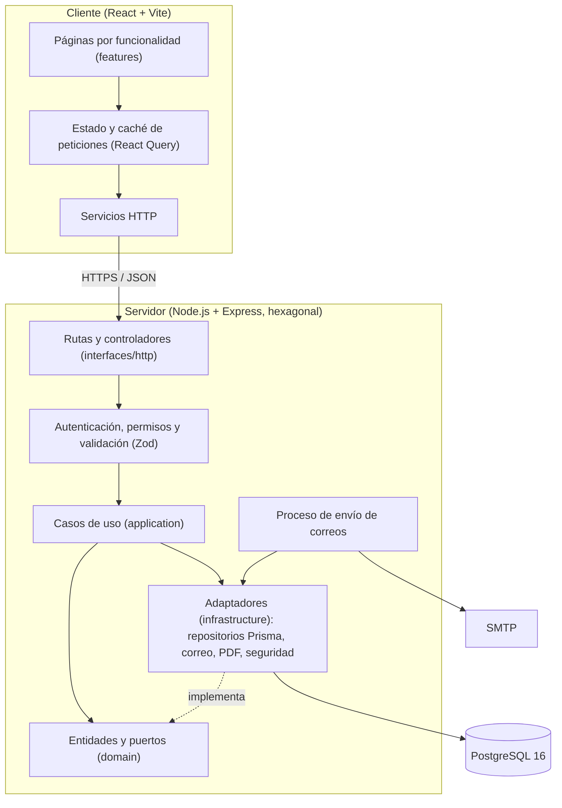

## DOC-D09 · Despliegue

**Fuente:** `docker-compose.yml` (desarrollo), `docker-compose.prod.yml` (producción) y `docs/MANUAL_TECNICO.md`. El entorno institucional con HTTPS y correo **no está entregado** (pendiente de TI): lo que se muestra de producción es la definición del repositorio, no un despliegue realizado.

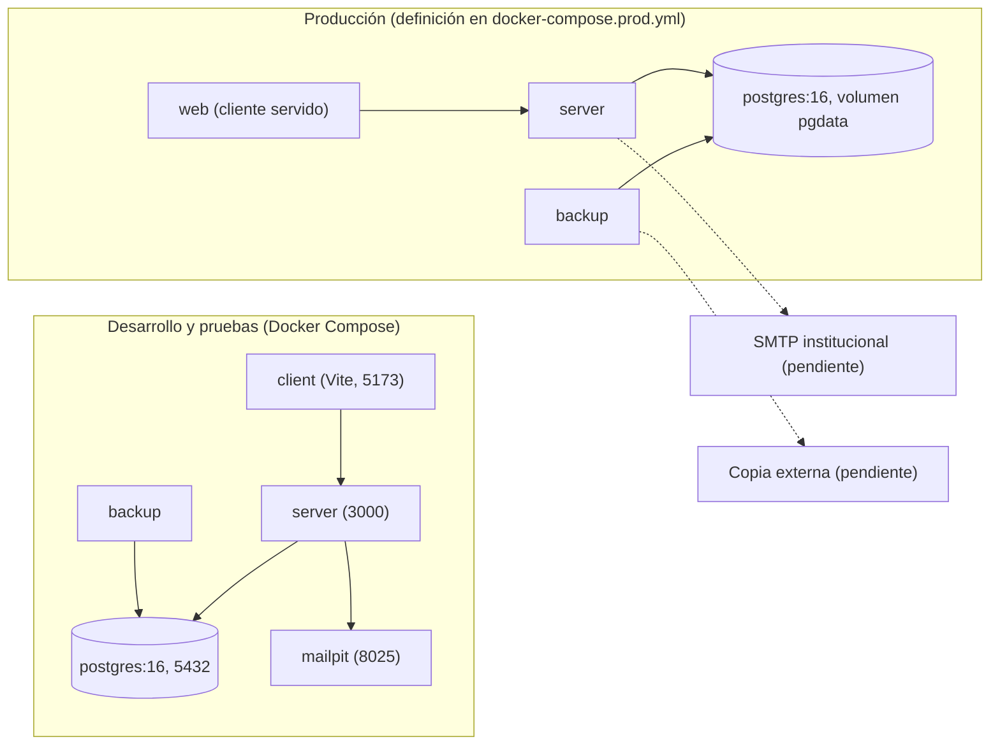
