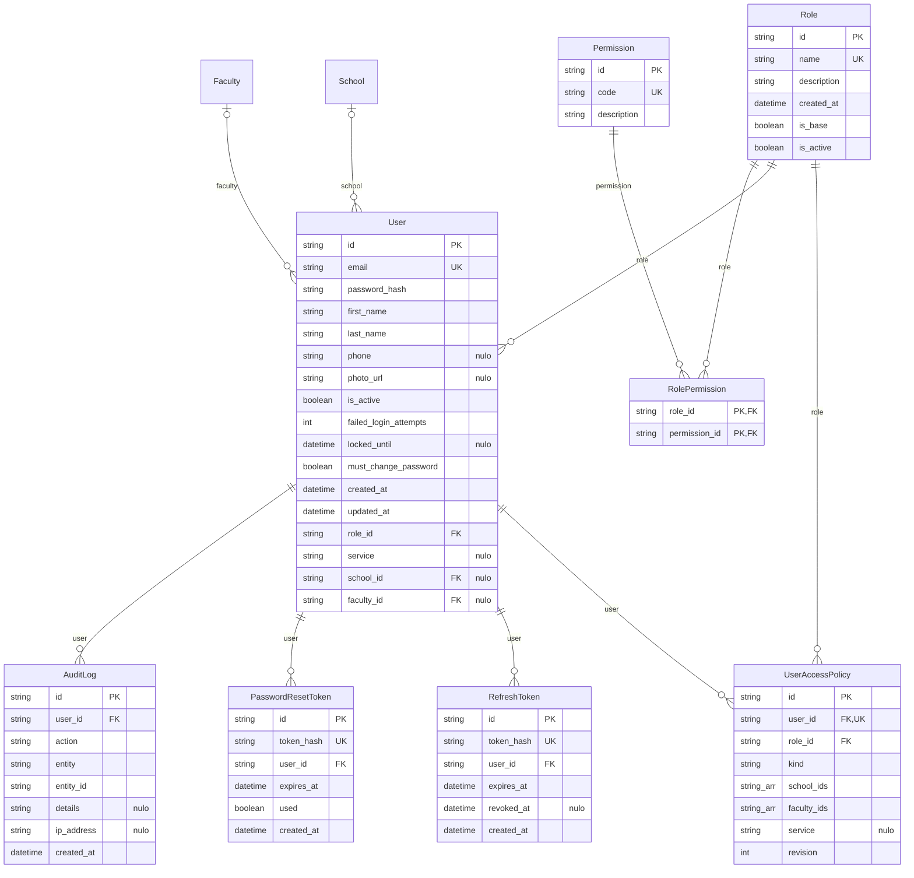
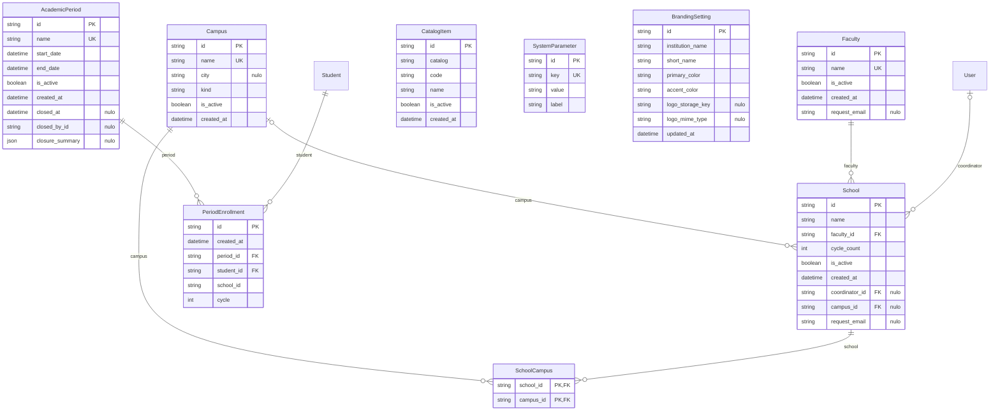
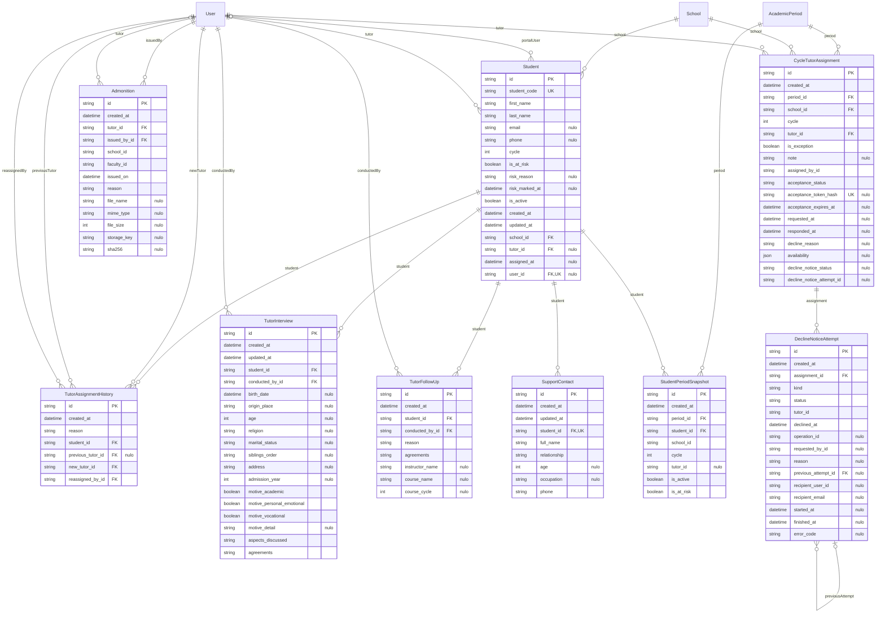
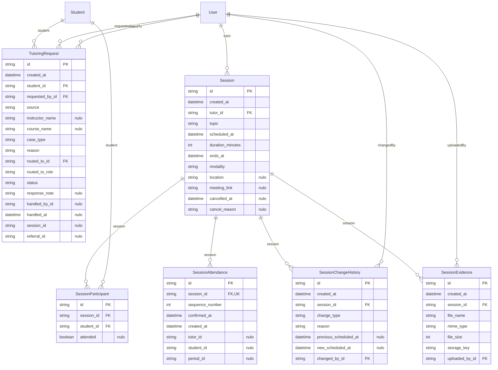
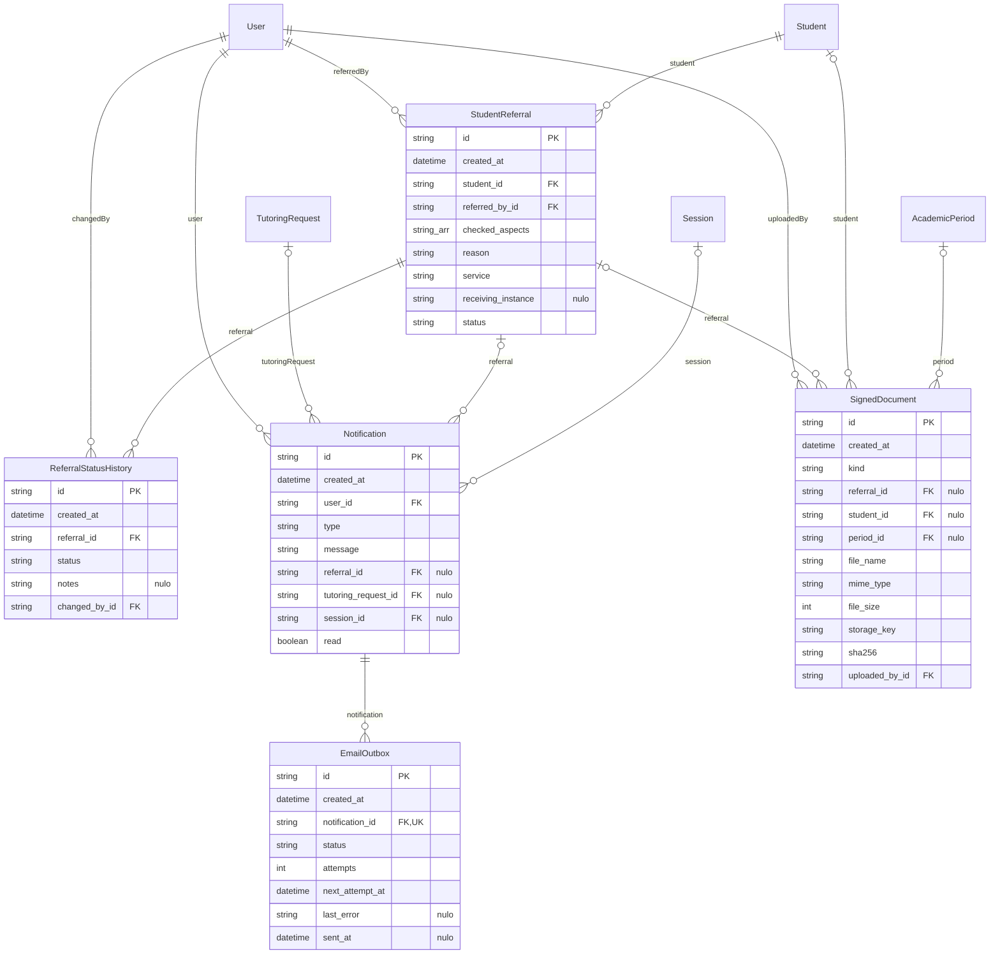
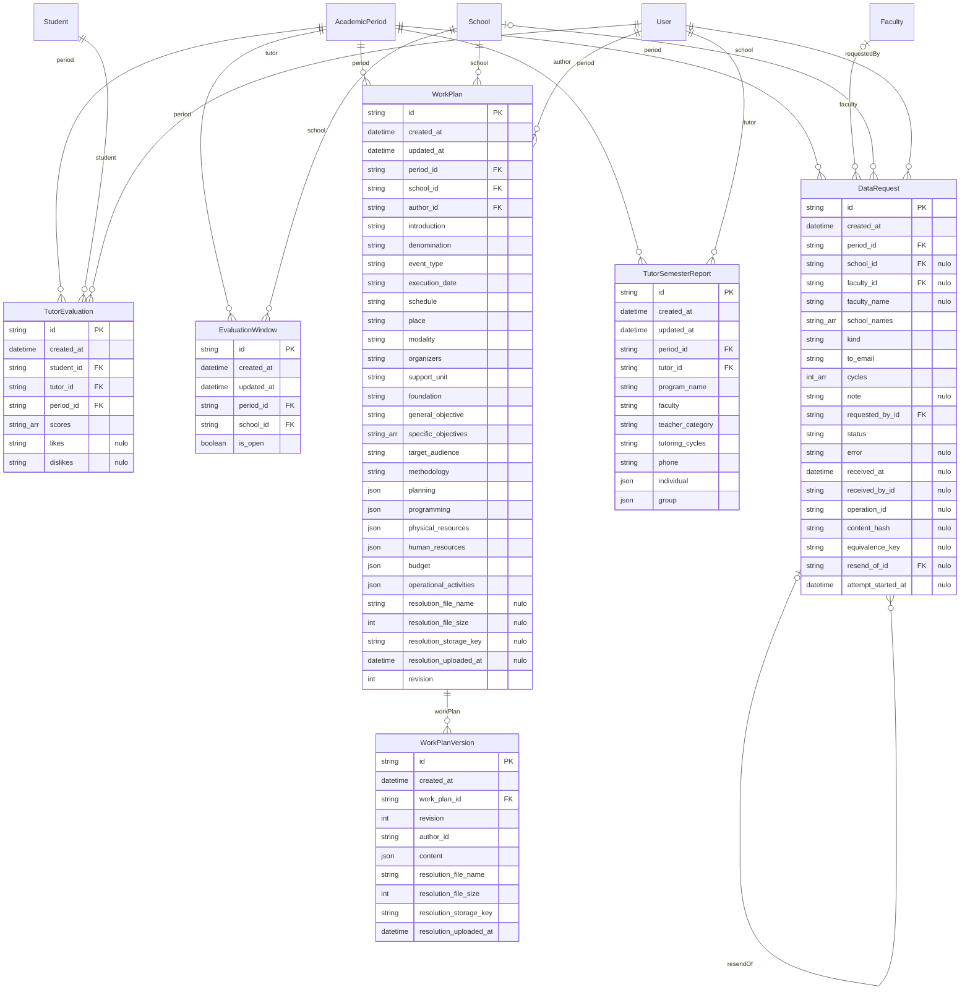
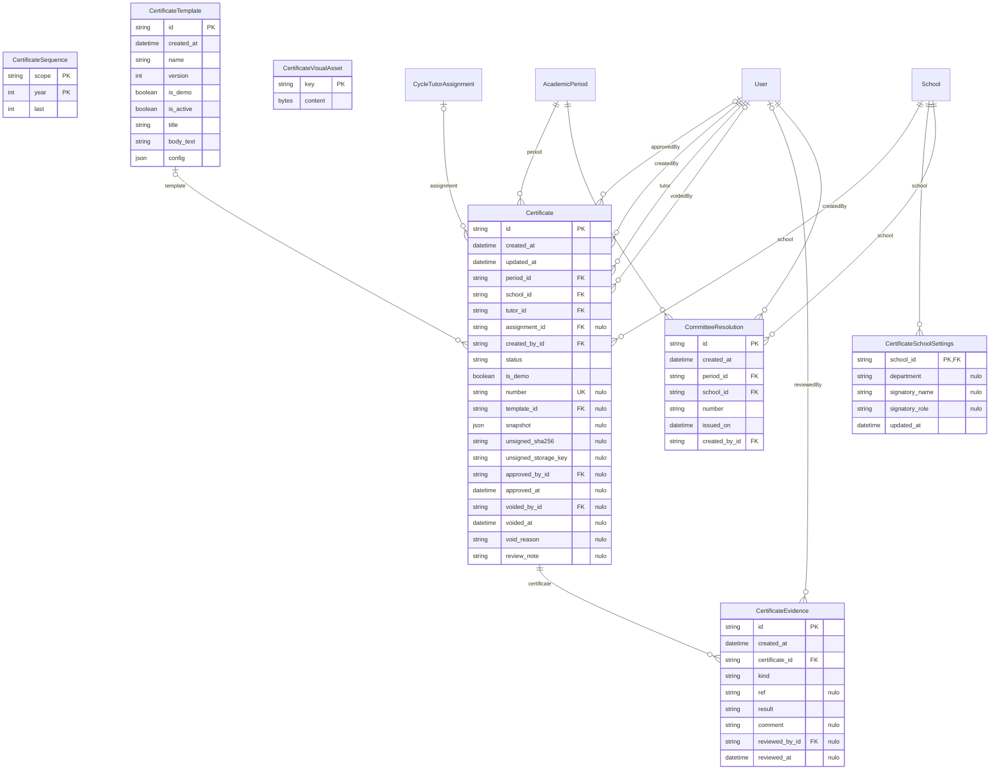

# Diagramas entidad-relación por módulo

**Fuente:** `server/prisma/schema.prisma` (50 tablas, 92 relaciones). **Referencia:** commit `37278bb`. **Estado:** actual (implementado). Generado con `generar_er.py`; no se edita a mano.

**Cómo leerlos.** Cada recuadro es una tabla con sus columnas reales; `PK` es la clave primaria, `FK` una clave foránea, `UK` una columna única y `"nulo"` una columna que admite nulo. `||--o{` es «uno a muchos» obligatorio; `|o--o{` es «uno a muchos» donde la clave foránea puede ser nula. Una tabla de otro módulo aparece solo con el nombre cuando una relación la cruza.

**Qué no es.** No es el diagrama de clases del dominio (ese se elabora aparte, por módulo). Tampoco muestra restricciones únicas compuestas ni índices.

| ID | Módulo | Tablas |
| --- | --- | --- |
| ER-01 | Acceso, cuentas y auditoría | 8 |
| ER-02 | Estructura académica y configuración | 9 |
| ER-03 | Estudiantes y acompañamiento del tutor | 9 |
| ER-04 | Solicitudes y sesiones de tutoría | 6 |
| ER-05 | Derivaciones, avisos y documentos | 5 |
| ER-06 | Evaluación, planes, informes y pedidos de listas | 6 |
| ER-07 | Certificación del docente tutor (demostración) | 7 |

## ER-01 · Acceso, cuentas y auditoría

| Modelo | Tabla |
| --- | --- |
| `User` | `users` |
| `Role` | `roles` |
| `UserAccessPolicy` | `user_access_policies` |
| `Permission` | `permissions` |
| `RolePermission` | `role_permissions` |
| `RefreshToken` | `refresh_tokens` |
| `PasswordResetToken` | `password_reset_tokens` |
| `AuditLog` | `audit_logs` |

## ER-02 · Estructura académica y configuración

| Modelo | Tabla |
| --- | --- |
| `Faculty` | `faculties` |
| `Campus` | `campuses` |
| `School` | `schools` |
| `SchoolCampus` | `school_campuses` |
| `AcademicPeriod` | `academic_periods` |
| `PeriodEnrollment` | `period_enrollments` |
| `CatalogItem` | `catalog_items` |
| `SystemParameter` | `system_parameters` |
| `BrandingSetting` | `branding_settings` |

## ER-03 · Estudiantes y acompañamiento del tutor

| Modelo | Tabla |
| --- | --- |
| `Student` | `students` |
| `TutorAssignmentHistory` | `tutor_assignment_history` |
| `TutorInterview` | `tutor_interviews` |
| `TutorFollowUp` | `tutor_follow_ups` |
| `SupportContact` | `support_contacts` |
| `StudentPeriodSnapshot` | `student_period_snapshots` |
| `CycleTutorAssignment` | `cycle_tutor_assignments` |
| `DeclineNoticeAttempt` | `decline_notice_attempts` |
| `Admonition` | `admonitions` |

## ER-04 · Solicitudes y sesiones de tutoría

| Modelo | Tabla |
| --- | --- |
| `TutoringRequest` | `tutoring_requests` |
| `Session` | `sessions` |
| `SessionParticipant` | `session_participants` |
| `SessionAttendance` | `session_attendances` |
| `SessionChangeHistory` | `session_change_history` |
| `SessionEvidence` | `session_evidences` |

## ER-05 · Derivaciones, avisos y documentos

| Modelo | Tabla |
| --- | --- |
| `StudentReferral` | `student_referrals` |
| `ReferralStatusHistory` | `referral_status_history` |
| `Notification` | `notifications` |
| `EmailOutbox` | `email_outbox` |
| `SignedDocument` | `signed_documents` |

## ER-06 · Evaluación, planes, informes y pedidos de listas

| Modelo | Tabla |
| --- | --- |
| `TutorEvaluation` | `tutor_evaluations` |
| `EvaluationWindow` | `evaluation_windows` |
| `WorkPlan` | `work_plans` |
| `WorkPlanVersion` | `work_plan_versions` |
| `TutorSemesterReport` | `tutor_semester_reports` |
| `DataRequest` | `data_requests` |

## ER-07 · Certificación del docente tutor (demostración)

| Modelo | Tabla |
| --- | --- |
| `Certificate` | `certificates` |
| `CertificateEvidence` | `certificate_evidences` |
| `CertificateSequence` | `certificate_sequences` |
| `CertificateTemplate` | `certificate_templates` |
| `CommitteeResolution` | `committee_resolutions` |
| `CertificateVisualAsset` | `certificate_visual_assets` |
| `CertificateSchoolSettings` | `certificate_school_settings` |

