# Anexo G. Evidencia visual del ensayo técnico

Capturas tomadas durante el ensayo técnico de los recorridos de los roles (13 a 17/11/2026), con datos ficticios, sobre un entorno aislado. Son evidencia de la ejecución de guiones automatizados por el equipo de desarrollo; **no** son resultados de un piloto con usuarios. Las capturas del manual de usuario están en el Anexo D.

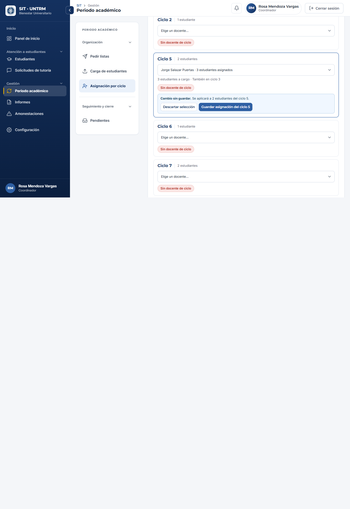

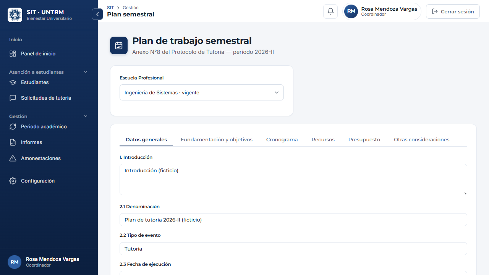

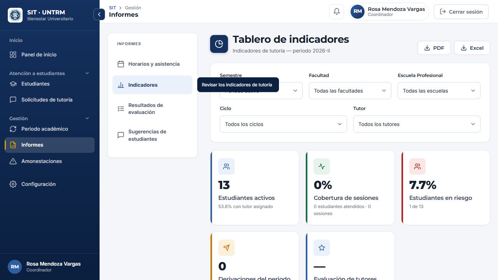

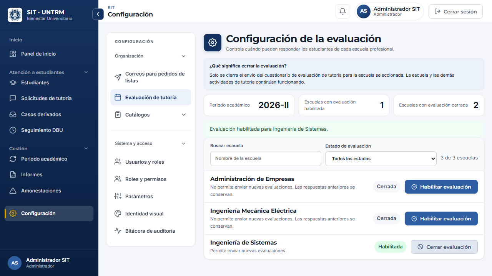

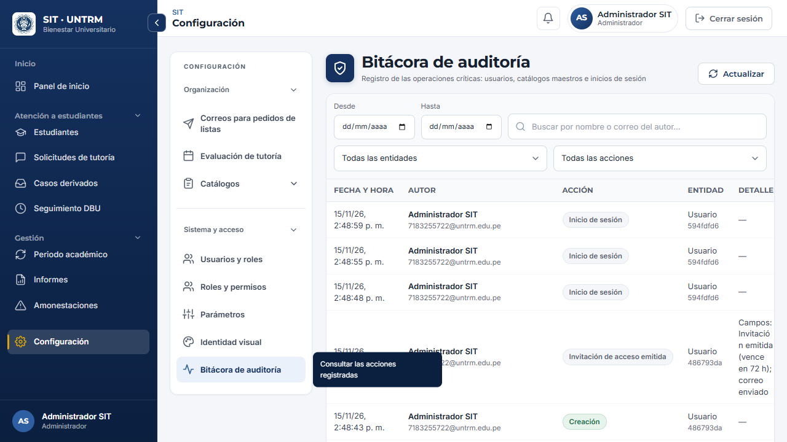

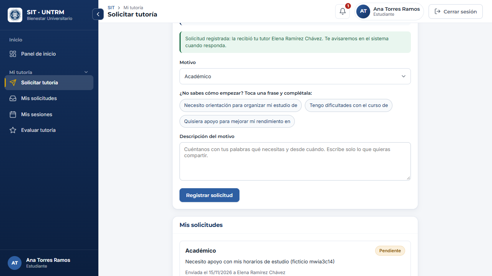

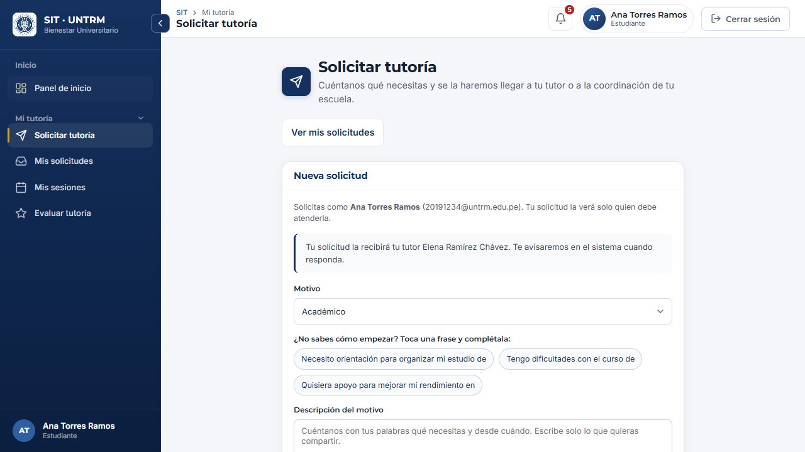

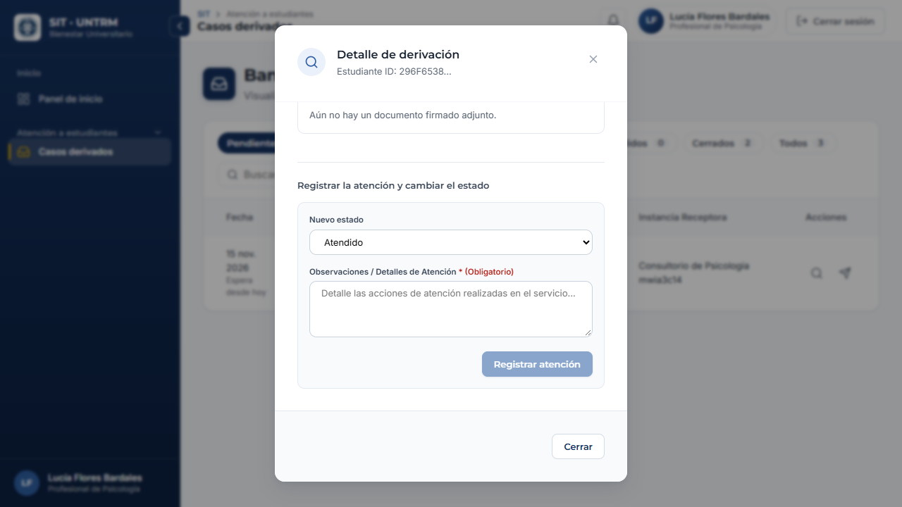

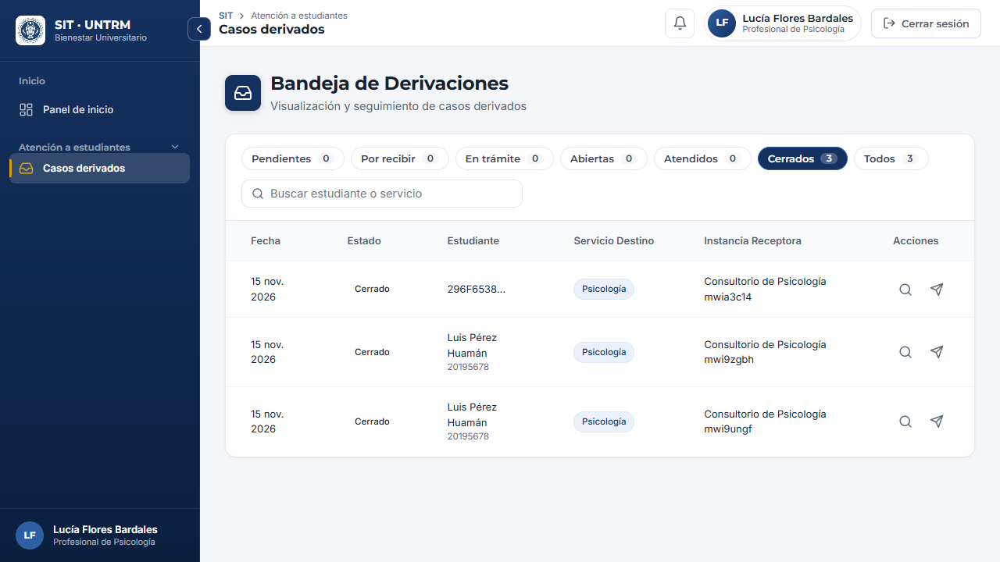

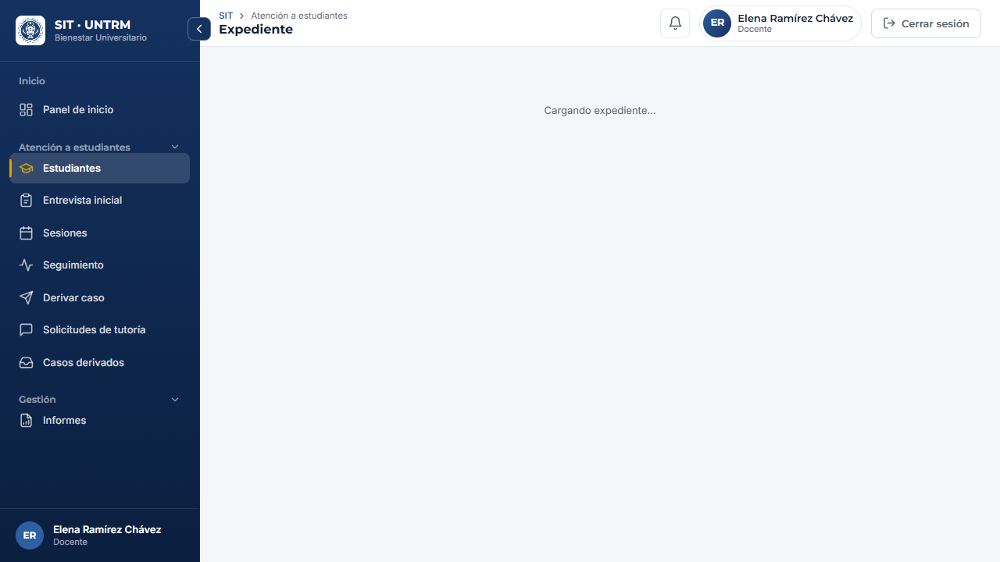

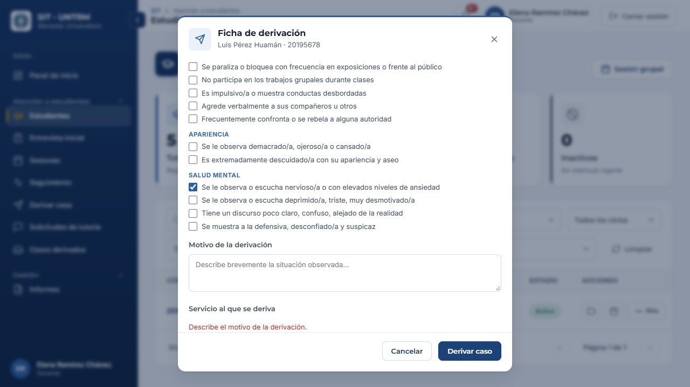

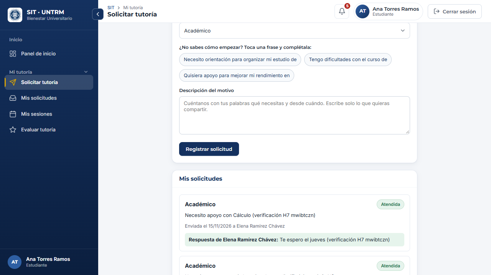

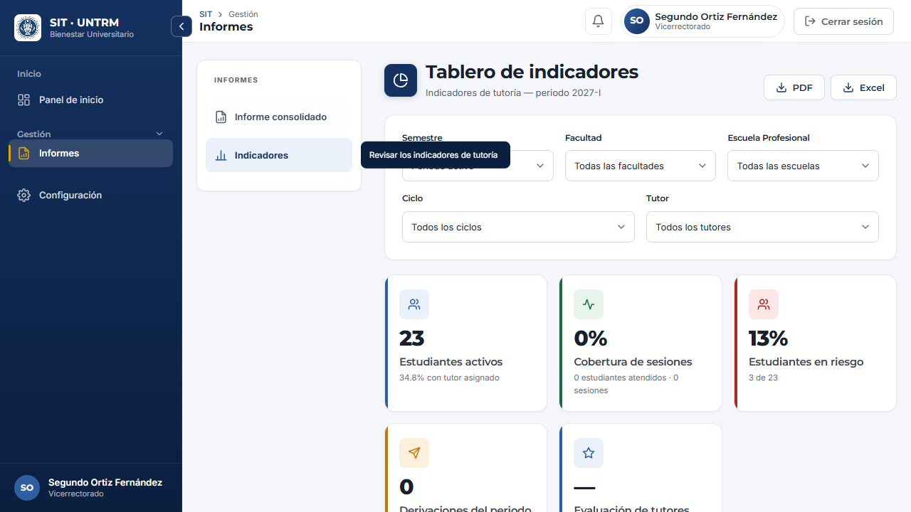

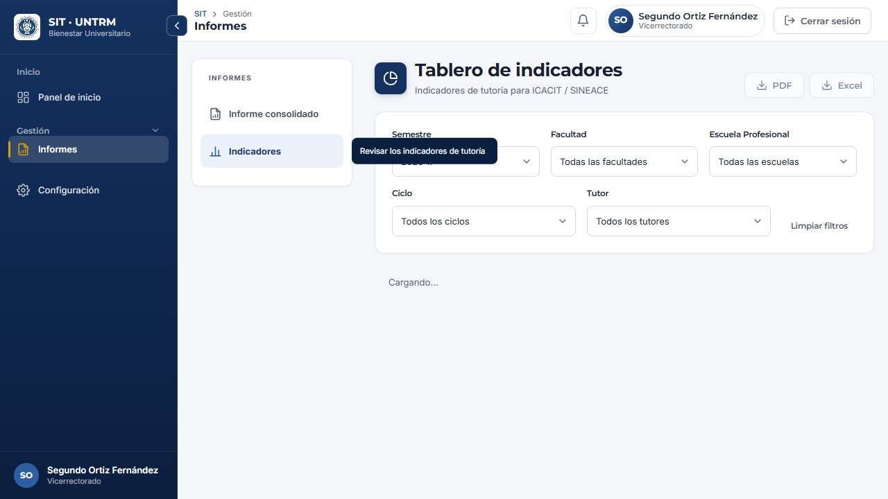
