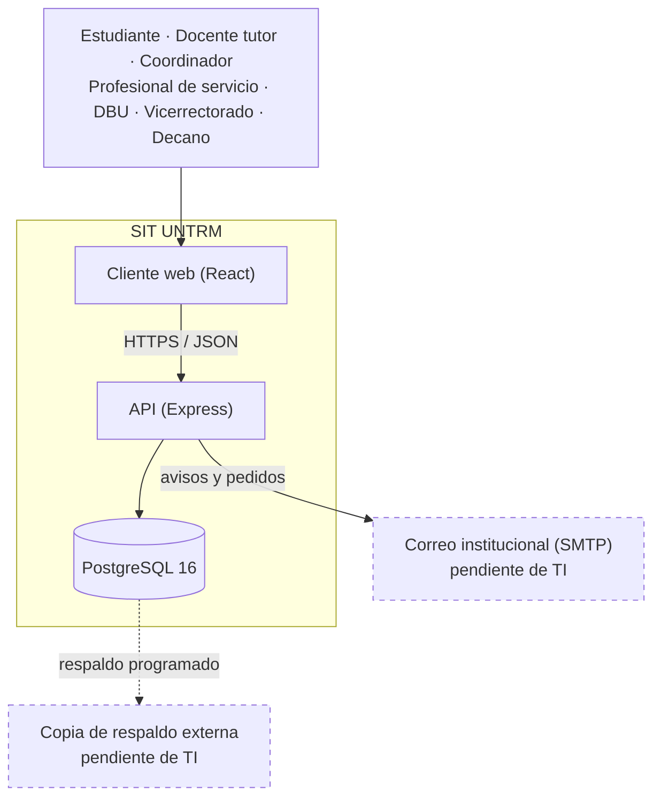
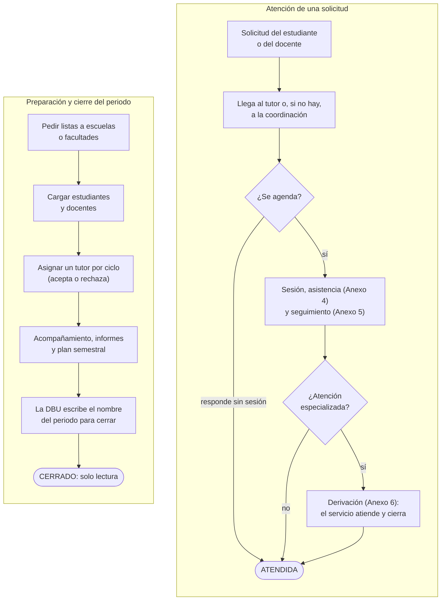
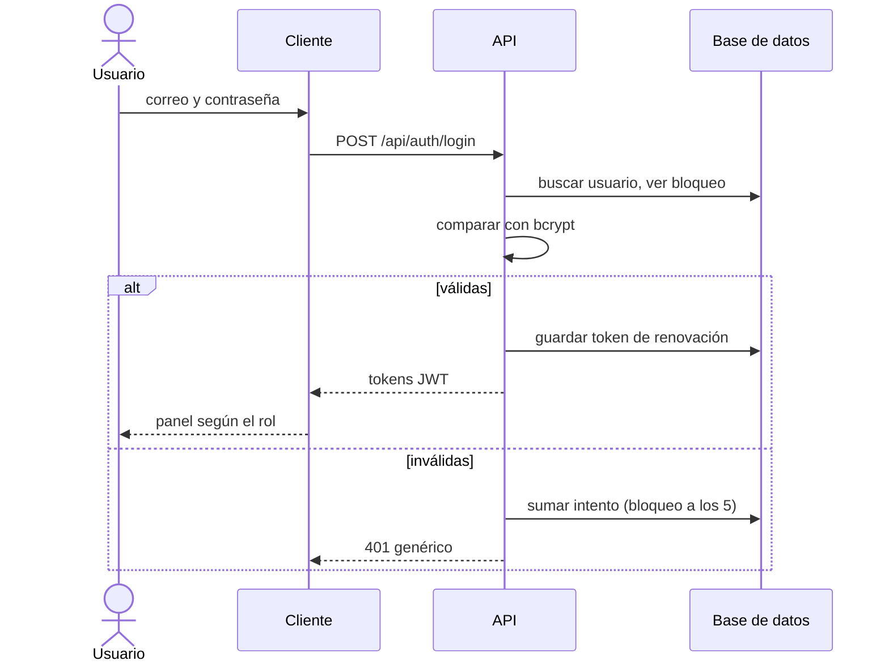
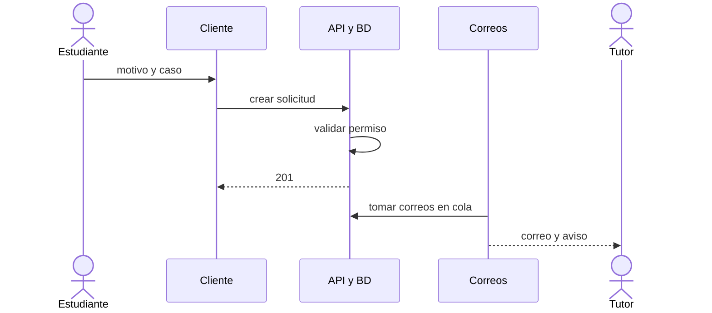

# Diagramas compactos para el informe impreso

Versiones más cortas de los diagramas de `docs/diagramas/DIAGRAMAS_DISENO.md` (mismas fuentes y mismo contenido esencial), con menos texto por nodo para que se lean bien al ancho de una hoja. `renderizar_diagramas.py` las convierte en `figuras/dc-*.png`.

## dc-d01 · Contexto

## dc-d05 · Actividades

## dc-d06a · Secuencia del inicio de sesión

## dc-d06b · Secuencia de una solicitud y su aviso

