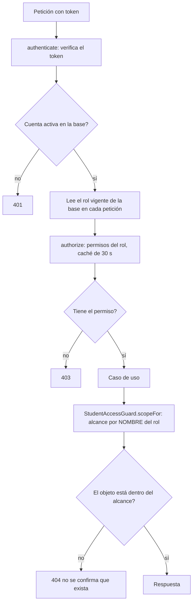

# Matriz de roles, permisos y alcance — sistema actual

**Estado de este documento: IMPLEMENTADO** (lo que hace el código hoy, corte `c2e0460`). Las secciones «Propuesto» y «Pendiente de decisión» están separadas al final y **no** describen el sistema actual. Fuente de verdad: este archivo (entregable 3 del levantamiento); la documentación integral del informe debe **referenciarlo** y no repetir la matriz. Etiquetas: [README](README.md).

## 1. Roles sembrados (implementado)

7 roles, creados por `server/src/infrastructure/bootstrap/seedBase.ts` (idempotente). Cada usuario tiene **un solo rol**. El **Administrador DBU** recibe todos los permisos (`Object.keys` de la lista).

## 2. Permisos por rol (implementado)

Generada con un script a partir de `seedBase.ts` (no es una transcripción manual). Un «✓» significa que el rol tiene ese permiso en la seed; **los permisos no se editan desde la aplicación**.

| Permiso | Descripción (de la seed) | Administrador DBU | Coordinador | Docente Tutor | Tutorado | Profesional de Servicio | Vicerrectorado | Decano |
|---|---|:-:|:-:|:-:|:-:|:-:|:-:|:-:|
| `admin:system` | Administrar sistema | ✓ |  |  |  |  |  |  |
| `admonitions:read` | Ver las amonestaciones a docentes tutores | ✓ | ✓ |  |  |  |  | ✓ |
| `admonitions:write` | Registrar amonestaciones a docentes tutores | ✓ |  |  |  |  |  | ✓ |
| `audit:read` | Consultar bitácora | ✓ |  |  |  |  |  |  |
| `branding:manage` | Configurar la identidad visual institucional | ✓ |  |  |  |  |  |  |
| `campuses:manage` | Administrar las sedes de la universidad y la sede de cada escuela | ✓ |  |  |  |  | ✓ |  |
| `catalogs:manage` | Administrar los catálogos maestros | ✓ |  |  |  |  |  |  |
| `consolidated-reports:read` | Ver el informe consolidado por escuela y facultad | ✓ |  |  |  |  | ✓ |  |
| `evaluation:manage` | Gestionar evaluación | ✓ | ✓ |  |  |  |  |  |
| `evaluation:respond` | Responder evaluación | ✓ |  |  | ✓ |  |  |  |
| `followups:read` | Ver fichas de seguimiento | ✓ | ✓ | ✓ |  |  |  |  |
| `followups:write` | Registrar fichas de seguimiento | ✓ |  | ✓ |  |  |  |  |
| `indicators:read` | Ver el tablero de indicadores | ✓ | ✓ |  |  |  | ✓ |  |
| `interviews:read` | Ver entrevistas iniciales | ✓ | ✓ | ✓ |  |  |  |  |
| `interviews:write` | Registrar entrevistas iniciales | ✓ |  | ✓ |  |  |  |  |
| `parameters:manage` | Administrar los parámetros del sistema | ✓ |  |  |  |  |  |  |
| `referrals:read` | Ver derivaciones | ✓ | ✓ | ✓ |  | ✓ |  |  |
| `referrals:write` | Crear derivaciones | ✓ |  | ✓ |  | ✓ |  |  |
| `reports:export` | Exportar reportes | ✓ | ✓ | ✓ |  |  |  |  |
| `reports:read` | Ver reportes | ✓ | ✓ | ✓ |  |  | ✓ |  |
| `semester-reports:write` | Elaborar el informe semestral de tutoría propio | ✓ |  | ✓ |  |  |  |  |
| `sessions:read` | Ver sesiones | ✓ | ✓ | ✓ | ✓ |  |  |  |
| `sessions:write` | Programar sesiones | ✓ |  | ✓ |  |  |  |  |
| `students:import` | Carga masiva de tutorados | ✓ | ✓ |  |  |  |  |  |
| `students:read` | Ver tutorados | ✓ | ✓ | ✓ |  |  |  |  |
| `students:write` | Crear/editar tutorados | ✓ | ✓ |  |  |  |  |  |
| `support-contacts:read` | Ver persona de red de apoyo | ✓ |  | ✓ |  |  |  |  |
| `support-contacts:write` | Registrar persona de red de apoyo | ✓ |  | ✓ |  |  |  |  |
| `tutoring-requests:read` | Ver solicitudes de tutoría | ✓ | ✓ | ✓ |  |  |  |  |
| `tutoring-requests:self` | Solicitar tutoría para sí mismo (autoservicio) | ✓ |  |  | ✓ |  |  |  |
| `tutoring-requests:write` | Registrar solicitudes de tutoría | ✓ | ✓ | ✓ |  |  |  |  |
| `users:delete` | Desactivar usuarios | ✓ |  |  |  |  |  |  |
| `users:read` | Ver usuarios | ✓ | ✓ |  |  |  |  |  |
| `users:write` | Crear/editar usuarios | ✓ |  |  |  |  |  |  |
| `work-plans:read` | Ver planes de trabajo semestrales | ✓ | ✓ |  |  |  |  |  |
| `work-plans:write` | Elaborar planes de trabajo semestrales | ✓ | ✓ |  |  |  |  |  |
| **Total** | | **36** | **17** | **16** | **3** | **2** | **4** | **2** |

Observaciones sobre el vocabulario (implementado): las acciones usadas son `read`, `write`, `delete`, `import`, `export`, `manage`, `respond`, `self` y `system`; **no existen** `approve`, `issue`, `sign` ni `download` como permisos propios.

## 3. Alcance sobre los datos (implementado)

El alcance sobre **estudiantes** lo calcula `StudentAccessGuard.scopeFor` con un `switch` sobre el **nombre** del rol. Cualquier rol no listado obtiene **ninguno** (seguro por defecto).

| Rol | Alcance sobre estudiantes | De dónde sale | Otros alcances observados |
|---|---|---|---|
| Administrador DBU | Todos (`ALL`) | nombre del rol | Todo el sistema (`admin:system`) |
| Coordinador | Los de las escuelas que coordina (`SCHOOLS`) | `School.coordinatorId` = su usuario | Pedidos de listas y asignación por ciclo en sus escuelas |
| Docente Tutor | Solo los asignados (`TUTOR`) | `Student.tutorId` = su usuario | Pertenece a una escuela (`User.schoolId`) |
| Tutorado | Ninguno (accede a **sus** datos por el portal) | — | Permisos `tutoring-requests:self`, `evaluation:respond`, `sessions:read` |
| Profesional de Servicio | Ninguno sobre estudiantes | — | Ve las **derivaciones de su servicio** (atributo `User.service`: Escuela, Psicopedagogía, Psicología, Asistencia Social, Salud) |
| Vicerrectorado | Ninguno individual | — | Informes consolidados, indicadores y sedes (agregados) |
| Decano | Ninguno sobre estudiantes | — | Amonestaciones de los docentes de **su facultad** (`User.facultyId`) |

## 4. Cómo se decide un acceso (implementado)

*Mapa a la documentación integral:* esta figura corresponde a un diagrama de actividades/secuencia del acceso (DOC-D05/D06 del plan de documentación integral); su fuente editable es el bloque Mermaid de este archivo. Figura **actual**, no propuesta.

## 5. Comprobaciones por nombre de rol (implementado)

Conteo reproducible: ver la sección «Comprobaciones por nombre de rol» del [diagnóstico](01_DIAGNOSTICO_ACTUAL.md#comprobaciones-por-nombre-de-rol-recuento-y-método). El cliente decide el menú con un mapa fijo de siete nombres (`ROLE_CODES`).

## 6. Propuesto (no implementado)

Ninguno de estos puntos existe hoy; están especificados en [05](05_REQUISITOS_SIN_DEPENDENCIAS.md) o dependen de decisiones.

| Propuesta | Estado |
|---|---|
| Mínimo de administradores activos y prohibición de autodesactivarse | Propuesto; el número mínimo, **pendiente de decisión** (Q05) |
| Registrar en la bitácora la creación de roles | Propuesto; no depende de decisiones (ver 05) |
| Permisos asignables a un rol desde la aplicación, con roles base protegidos | Propuesto; **pendiente de decisión** (Q01) |
| Alcance configurable (propios, escuela, facultad, institución) | **Pendiente de decisión** (Q03) |
| Acciones nuevas (`approve`, `issue`, `sign`, `download`) | Solo cuando se defina la certificación (Q20–Q24) |

## 7. Pendiente de decisión

Q01 (roles configurables), Q02 (perfiles: Coordinador, Responsable de escuela, Decano), Q03 (alcances), Q04 («acceso total» y «medio» no figuran en ningún documento), Q05 (administrador mínimo y escalamiento), Q06 (efecto inmediato de los cambios). Detalle en [00](00_PREGUNTAS_P0_PARA_RESPONDER.md) y [02](02_PREGUNTAS_INSTITUCIONALES.md).
