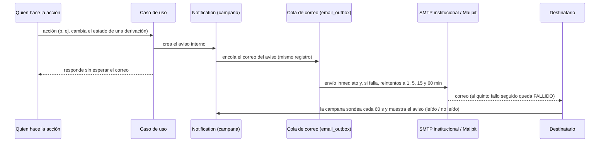
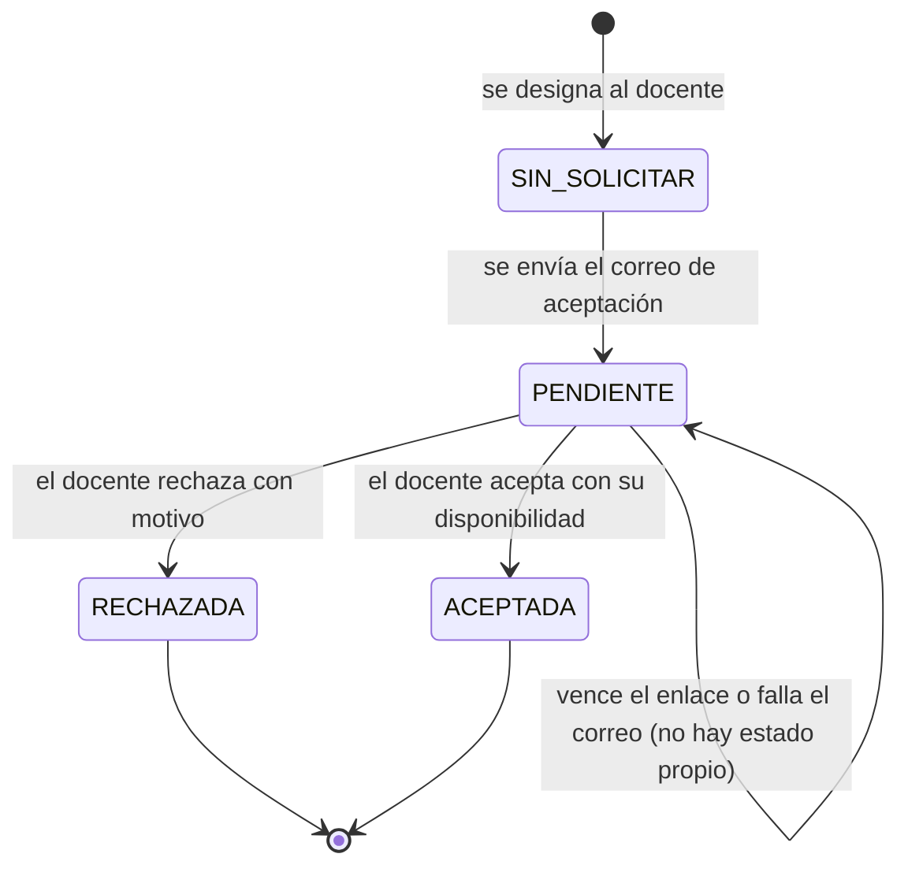

# Matriz de eventos, avisos y correos — sistema actual y huecos

Corte `c2e0460`. Cada fila se marca **IMPLEMENTADO** (verificado en el código citado), **PROPUESTO** (idea del equipo, no existe) o **PENDIENTE DE DECISIÓN** (depende de una pregunta). Fuente única de la matriz de eventos: este archivo (entregable 4 del levantamiento); la documentación integral del informe debe referenciarla. Etiquetas y convenciones: [README](README.md).

Se distinguen tres cosas, como pide el encargo: **actualización de datos** (la vista muestra el dato nuevo al consultarla), **aviso dentro del sistema** (campana, `Notification`) y **correo**.

## 1. Eventos implementados

Formato: evento → quién lo realiza → quién puede verlo → destinatario del aviso → canal → siguiente acción.

| N.° | Evento | Realiza | Puede verlo | Destinatario del aviso | Canal | Siguiente acción | Evidencia |
|---|---|---|---|---|---|---|---|
| E01 | Derivación creada (`REFERRAL_CREATED`) | Docente tutor o Administrador DBU | DBU, el tutor que la emitió y el servicio destino | Profesionales **activos** del servicio elegido (rol Profesional de Servicio con ese `service`) | Aviso + correo | El servicio la recibe y la atiende | `CreateReferralUseCase.ts`; `objectAccess.test.ts` |
| E02 | Cambio de estado de la derivación (`REFERRAL_STATUS_CHANGED`) | Administrador DBU o el servicio destino | Igual que E01 | El tutor que la emitió (`referredById`); **no** se exponen las notas de atención | Aviso + correo | El tutor consulta el estado | `UpdateReferralStatusUseCase.ts` |
| E03 | Solicitud de tutoría creada (`TUTORING_REQUEST_CREATED`) | El estudiante, o su tutor / su coordinación a su nombre | Destinatario de la solicitud, coordinación de la escuela y DBU | El destinatario resuelto (`routedToId`: tutor → coordinación → DBU) | Aviso + correo | Atender: programar sesión o derivar | `CreateTutoringRequestUseCase.ts`; `TutoringRequestRouter.ts` |
| E04 | Solicitud recibida (`TUTORING_REQUEST_RECEIVED`) | (consecuencia de E03) | El estudiante | El estudiante, si tiene cuenta de portal vinculada | Aviso + correo | Esperar la atención | `CreateTutoringRequestUseCase.ts` |
| E05 | Estado de la solicitud cambia (`TUTORING_REQUEST_UPDATED`) | Tutor, coordinación o DBU | El estudiante y quienes la gestionan | El estudiante | Aviso + correo | Ver la respuesta o la cita | `UpdateTutoringRequestStatusUseCase.ts` |
| E06 | Solicitud vinculada a una sesión o derivación (`TUTORING_REQUEST_UPDATED`) | Tutor, coordinación o DBU | Igual que E05 | El estudiante (sin decir a qué servicio fue la derivación: información reservada) | Aviso + correo | Ver la cita o esperar al servicio | `TutoringRequestLinker.ts` |
| E07 | Sesión programada, reprogramada o cancelada (`SESSION_*`) | Docente tutor (programa, reprograma y cancela; la DBU también puede programar desde una solicitud) | Tutor, coordinación, DBU y los estudiantes participantes | Estudiantes participantes **con cuenta de portal**. Sin cuenta: no hay aviso y se informa a **quien hizo el cambio** para que lo comunique por otro medio | Aviso + correo | Asistir, o ver la nueva cita | `SessionNotifier.ts`; `sessionNotices.test.ts` |
| E08 | Designación del docente tutor por ciclo | Coordinación o DBU (`students:write`) | Coordinación y DBU | El docente designado | **Solo correo** con enlace personal de un solo uso (no hay aviso interno) | El docente acepta o rechaza | `CycleTutorUseCases.ts`; `TutorAcceptanceUseCases.ts` |
| E09 | Aceptación del docente | El docente (por el enlace) | Coordinación y DBU (Pendientes y asignación por ciclo) | **Nadie**: solo queda en la bitácora (`CYCLE_TUTOR_ACCEPTED`). Si la cuenta es nueva, la respuesta trae la ruta para crear su contraseña | Ninguno | Activar la cuenta si es nueva | `TutorAcceptanceUseCases.ts` |
| E10 | Rechazo del docente | El docente | Coordinación y DBU | La **coordinación de la escuela**, si existe | **Solo correo**. Si el envío falla, queda **solo en el registro del servidor** (sin estado visible); el rechazo sí aparece en Pendientes | Reasignar o cubrir el ciclo | `TutorAcceptanceUseCases.ts` (`notifyCoordinator`) |
| E11 | Invitación de acceso o restablecimiento de contraseña | Administrador DBU / la propia persona | El interesado | La persona dueña de la cuenta | **Solo correo** (enlace de un solo uso; vigencia por defecto 72 h) | Activar o cambiar la contraseña | `IssueInvitationUseCase.ts`; `accountInvitation.test.ts` |
| E12 | Pedido de lista a la escuela | Coordinación o DBU | Quien lo pidió y la DBU (la coordinación solo los de sus escuelas) | El correo de pedido de la escuela, con copia y «responder a» la persona que pide | **Solo correo**; estado `ENVIADO` (aceptado por el servidor de correo) o `FALLIDO` con reenvío | La escuela responde el correo; una persona marca «recibido» y carga el archivo | `DataRequestUseCases.ts` |

## 2. Cómo viajan un aviso y su correo (implementado)

*Mapa a la documentación integral:* corresponde a DOC-D06 (secuencia de avisos). Figura **actual**; su fuente editable es este bloque Mermaid.

**Tiempos observados en el código (no son objetivos aprobados):** el cliente sondea cada **60 s**; los reintentos del correo son a 1, 5, 15 y 60 minutos y al quinto fallo seguido el correo queda fallido; el correo **nunca retrasa ni hace fallar** la acción del usuario.

**Estados de la designación del docente (implementado):**

*Mapa:* DOC-D07 (estados). Los estados «sin respuesta» y «correo no entregado» **no existen** como valores; son una decisión pendiente (`DECISIONES_DBU…` §1).

## 3. Huecos frente a lo pedido

| N.° | Evento o característica | Estado | Nota |
|---|---|---|---|
| H01 | Política por evento: cuáles llevan correo además de aviso | **PENDIENTE DE DECISIÓN** (Q07) | Hoy todo aviso interno genera correo |
| H02 | Aviso a la coordinación cuando el docente **acepta** | **PENDIENTE DE DECISIÓN** (Q08) | Hoy solo el rechazo avisa |
| H03 | Aviso por **cambio de disponibilidad** del docente | **PENDIENTE DE DECISIÓN** (Q08, Q16) | La disponibilidad no se puede editar hoy |
| H04 | Presentación y revisión de **informes** semestrales | **PENDIENTE DE DECISIÓN** (Q10) | El informe no tiene estados |
| H05 | Aprobación, firma y entrega de **certificados** | **PENDIENTE DE DECISIÓN** (Q20–Q24) | La función no existe |
| H06 | Fallo del correo de **rechazo** visible en el sistema | **PROPUESTO** (ver [05](05_REQUISITOS_SIN_DEPENDENCIAS.md)) | Hoy solo queda en el registro del servidor |
| H07 | Aviso para la persona que programa una sesión cuando el estudiante **no tiene cuenta** | **IMPLEMENTADO** (se le informa a quien hizo el cambio) | Ver E07 |
| H08 | Notificar acciones **denegadas** (HU-04 lo pide) | Discrepancia documentada (X2 de [03](03_CONTRASTE_PROTOCOLO_Y_BACKLOG.md)) | El servidor responde 403 sin aviso |

## 3 bis. Eventos propuestos por las decisiones de trabajo (no implementados)

Todos **PROPUESTOS**; la política de correo por evento sigue **pendiente de decisión** (Q07), por lo que cada fila indica solo el **aviso interno** y el correo sin datos del caso, como los avisos actuales. Detalle en las especificaciones citadas.

| N.° | Evento propuesto | Realiza | Destinatario | Canal | Especificación | Bloqueado por |
|---|---|---|---|---|---|---|
| N01 | Lugar final distinto de la propuesta del solicitante | Docente tutor al programar | Solicitante (estudiante con cuenta) | Aviso (+ correo sin lugar) | [13](13_ESPECIFICACION_LUGAR_DE_LA_TUTORIA.md) R31 | Aprobación de RF/HU |
| N02 | Cambio de lugar o modalidad de una sesión ya programada (`SESSION_PLACE_CHANGED`) | Docente tutor | Solicitante y participantes con cuenta | Aviso (+ correo sin lugar ni motivo) | [13](13_ESPECIFICACION_LUGAR_DE_LA_TUTORIA.md) R32 | Aprobación de RF/HU |
| N03 | Pedido de lista recibido, en revisión, cargado, observado o vencido | Coordinación o DBU | Quien pidió; Pendientes institucionales para vencidos | Aviso interno | [12](12_ESPECIFICACION_PEDIDO_DE_LISTAS.md) R21 | Q11 (DBU, escuelas), Q12 |
| N04 | Concesión o retiro de rol, permiso o alcance; intento rechazado | Administrador | La persona afectada (aviso) y la bitácora | Aviso + bitácora | [11](11_ESPECIFICACION_ROLES_PERMISOS_ALCANCE.md) R13, R18 | RF/HU de roles |
| N05 | Trámite de certificado iniciado, observado, aprobado, generado, pendiente de firma, firmado incorporado, entregado, anulado o reemitido | Funciones del proceso | Quien debe actuar y el docente al entregarse | Aviso (correo según Q07) | [14](14_ESPECIFICACION_CERTIFICACION.md) §9 | **Q20 a Q22** (quién actúa) |
| N06 | Aceptación del docente / cambio de su disponibilidad | Docente | Coordinación | Pendiente | H02, H03 | Q08, Q16 |

## 4. Lo que no cubre esta matriz

Las alertas calculadas del panel de inicio (inasistencias y riesgo) y la pestaña de Pendientes institucionales son consultas, no avisos; su audiencia exacta no se verificó en esta fase. La matriz no mide tiempos reales de entrega de correo ni cubre el SMTP institucional (depende de TI, Q13).
