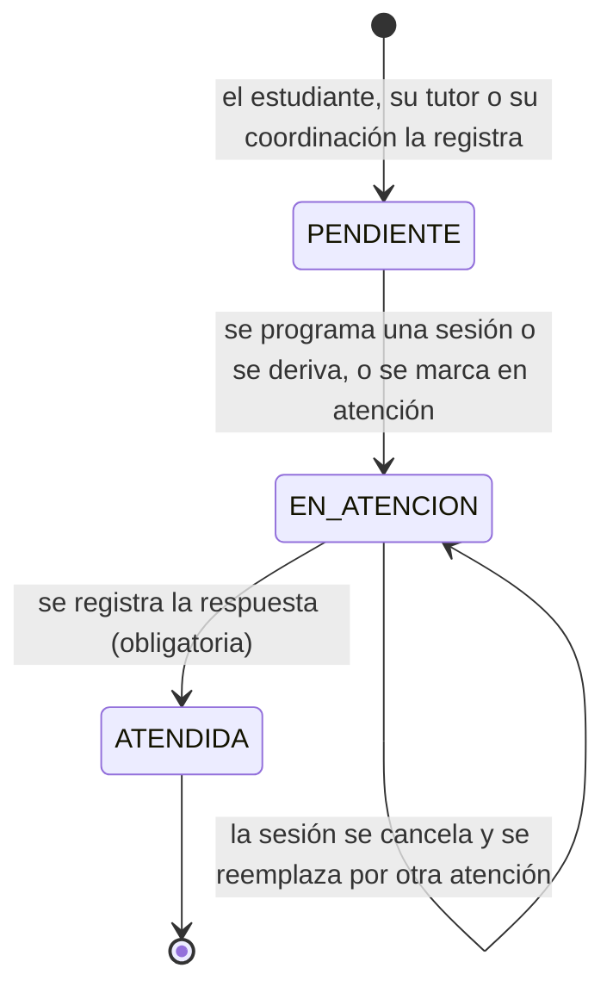
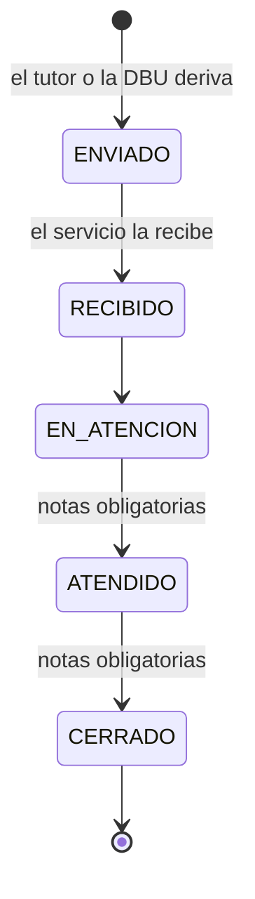

# Estados vigentes de la solicitud de tutoría, la derivación y la designación del docente

**Estado: IMPLEMENTADO** (lo que hace el código hoy, corte `c2e0460`). Cubre el diagrama de estados del plan de documentación integral (DOC-D07) **solo para lo vigente**; el estado del certificado propuesto **no** se dibuja aquí porque depende de decisiones. Fuente única de estos estados: este archivo; el informe debe referenciarlo. Etiquetas: [README](README.md).

## 1. Solicitud de tutoría

Estados: `PENDIENTE` → `EN_ATENCION` → `ATENDIDA`. **Solo avanzan** (no retroceden). Para marcar `ATENDIDA` hay que escribir una **respuesta** que verá el estudiante. Una solicitud se atiende con **una sesión o una derivación, no con ambas**; si la sesión se cancela, se puede **reemplazar** por otra atención. Cada cambio avisa al estudiante con cuenta de portal.

Fuentes: `UpdateTutoringRequestStatusUseCase.ts`, `TutoringRequestLinker.ts`, `server/src/domain/entities/TutoringRequest.ts`; pruebas `tutoringRequestFollowUp.test.ts`, `tutoringRequestCircuit.test.ts`.

**Quién cambia el estado:** tutor, coordinación de la escuela y DBU (en alcance). **Quién la ve:** el destinatario, la coordinación, la DBU y el propio estudiante. **A quién llega:** tutor, y si no hay o no puede, coordinación, y si no, un administrador DBU (`TutoringRequestRouter.ts`); desde el PR #158 no se enruta a una cuenta desactivada ni a una coordinación inactiva.

## 2. Derivación a un servicio

Estados: `ENVIADO` → `RECIBIDO` → `EN_ATENCION` → `ATENDIDO` → `CERRADO`. Solo avanzan hacia adelante (la regla no obliga a pasar por cada estado intermedio, solo a no retroceder); **marcar `ATENDIDO` o `CERRADO` exige notas**; una derivación `CERRADO` ya no cambia; las notas de atención son de uso interno del servicio y **no las ve el tutor emisor**. Cada cambio avisa al tutor que emitió la derivación. La solicitud vinculada a una derivación no revela al estudiante el servicio (información reservada).

Fuentes: `UpdateReferralStatusUseCase.ts`, `referralAccess.ts` (`isForwardTransition`); `objectAccess.test.ts`.

**Quién cambia el estado:** el Administrador DBU y el servicio destino (el tutor emisor **consulta**, no gestiona). **Quién la ve:** DBU, el tutor emisor y el servicio destino; ningún otro rol.

## 3. Designación del docente por ciclo

Estados de la aceptación: `SIN_SOLICITAR` → `PENDIENTE` → `ACEPTADA` o `RECHAZADA`. El vencimiento del enlace y el fallo del correo **no tienen estado propio** (la designación sigue `PENDIENTE` y se ve en Pendientes institucionales). Ver el diagrama en [07](07_MATRIZ_EVENTOS_ACTUAL.md). La designación se aplica a los estudiantes **al designar**, no al aceptar: decisión institucional pendiente.

## 4. Lo que está fuera de estos diagramas

La sesión (programada, reprogramada, cancelada, con asistencia) y el informe semestral no se dibujan: la sesión tiene sus eventos en [07](07_MATRIZ_EVENTOS_ACTUAL.md) y el informe semestral **no tiene estados** (LEV-D26). **Pendiente de decisión:** estados de la designación («sin respuesta», «correo no entregado»), del informe y del certificado.
