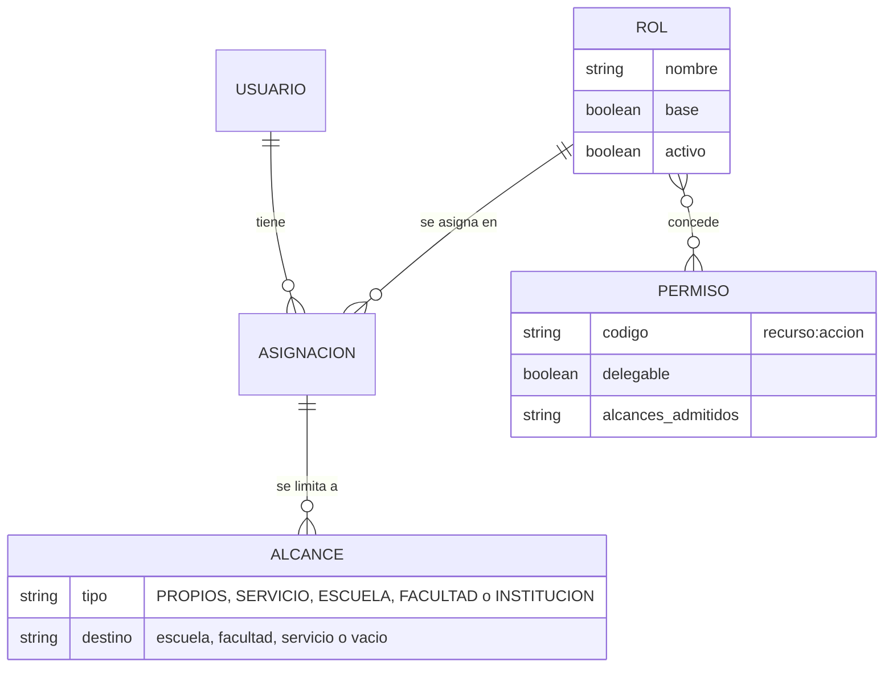
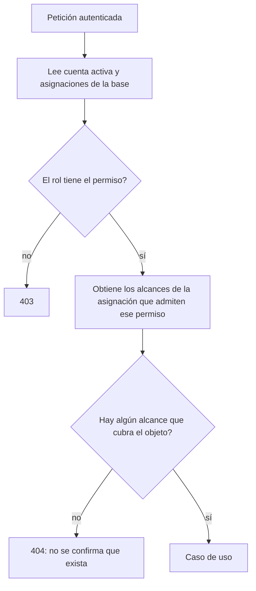
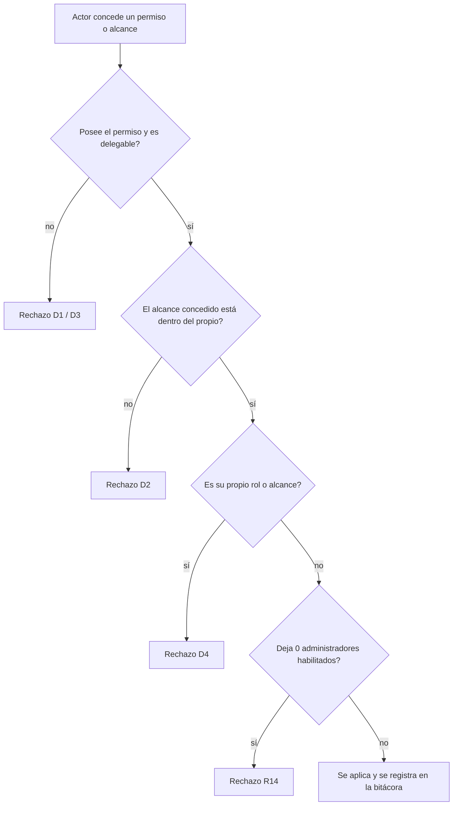

# Especificación: roles configurables, permisos, alcance y delegación

**Estado: PROPUESTO** (nada de esto está implementado). Parte de la decisión de trabajo **Q01 = B** y **Q05 = A** ([10](10_REGISTRO_DE_DECISIONES.md)). **Aprobación pendiente:** cambio de RF/HU (RF-04 y HU-04 hablan de roles fijos; la estimación original cubre solo la autorización por permisos) por el Product Owner; y, de la DBU, qué roles existen institucionalmente y quién los administra. **Bloqueado:** los roles institucionales definitivos (Q02) y el conjunto de permisos no delegables (valor propuesto, a confirmar). Describe el sistema actual en [06](06_MATRIZ_ROLES_PERMISOS_ACTUAL.md); no repite esa matriz. Etiquetas: [README](README.md). Identificadores `LEV-R10…R19`: provisionales, no pertenecen al backlog aprobado.

## 1. Punto de partida (implementado)

- Los permisos se leen de la base y se comprueban en cada ruta; hay 36 códigos `recurso:acción` y el **catálogo ya es de código** (los crea la seed).
- **El alcance no es un dato:** sale del nombre del rol (`StudentAccessGuard.scopeFor`) y de datos sueltos (`School.coordinatorId`, `Student.tutorId`, `User.schoolId`, `User.facultyId`, `User.service`). Hay cinco mecanismos de alcance repartidos: el guardia de estudiantes se usa en 16 módulos; el alcance por escuela está en planes de trabajo (7 archivos) y evaluación (4); por facultad en amonestaciones, informes consolidados y otros; por servicio en derivaciones (5 archivos).
- Hay **43 comprobaciones por nombre de rol en 22 archivos del servidor** y 19 archivos del cliente con un mapa fijo de siete nombres ([01](01_DIAGNOSTICO_ACTUAL.md)).
- **No basta con reemplazar esas comparaciones:** si solo se sustituye «¿el rol se llama X?» por «¿tiene el permiso Y?», se pierde **a qué datos** puede aplicarse. Por eso la especificación define el **alcance como dato de la asignación**.

## 2. Modelo propuesto

*Mapa a la documentación integral:* corresponde a DOC-D03/D04 (clases y entidad-relación). Figura **PROPUESTA**; el modelo actual de roles y usuarios es otro.

- **Permiso:** código `recurso:acción`, del **catálogo definido por el sistema** (los usuarios no crean permisos). Cada permiso declara si es **delegable** y **qué tipos de alcance admite**.
- **Rol:** conjunto de permisos con nombre, descripción y estado (activo/inactivo). Los **roles base** están protegidos (R11).
- **Asignación:** un usuario con un rol **y uno o más alcances**. El permiso efectivo es *los permisos del rol, restringidos a los alcances de la asignación*.
- **Alcance:** tipo y destino. `PROPIOS` (los que la persona tiene asignados), `SERVICIO` (derivaciones de un servicio), `ESCUELA`, `FACULTAD`, `INSTITUCION`. Contención: `INSTITUCION ⊃ FACULTAD ⊃ ESCUELA ⊃ PROPIOS`; `SERVICIO` es independiente (una dimensión distinta).
- **Neutralidad (Q02 pendiente):** el modelo no presupone qué cargos existen; sirve igual si se mantienen los siete roles actuales o si se agregan otros.

## 3. Requisitos

### LEV-R10 · Catálogo de permisos definido por el sistema

| Campo | Contenido |
|---|---|
| Descripción | Lista cerrada de permisos con vocabulario uniforme de acciones: **consultar, registrar, modificar, aprobar, emitir, firmar, descargar, administrar**, según el recurso. Los 36 códigos actuales se **conservan** (compatibilidad) y se completan con códigos nuevos solo cuando una función lo requiere |
| Actor | Sistema (lo define el código; se versiona con la seed y las migraciones) |
| Prioridad (propuesta) | Alta (base de todo lo demás) |
| Origen | Encargo A; decisión Q01 = B; LEV-D02 |
| Datos | Código, recurso, acción, descripción, `delegable`, alcances admitidos |
| Reglas | (1) Un permiso no se edita desde la aplicación. (2) Equivalencias de vocabulario con los códigos actuales: `read` → consultar; `write` → registrar y modificar (hoy son uno solo; separarlos es opcional y se decide permiso a permiso); `delete` → desactivar (baja lógica); `import` → registrar por carga masiva; `export` → descargar; `manage`/`system` → administrar; `respond`/`self` → registrar sobre lo propio. (3) Los permisos de aprobar, emitir y firmar **no existen todavía** y solo se agregan con la certificación |
| Permisos | Solo lectura para el Administrador (`roles:consultar`, nombre propuesto) |
| Criterios de aceptación | (1) Cada permiso tiene exactamente una fila en el catálogo. (2) Ninguna ruta usa un código que no esté en el catálogo (prueba automática). (3) Un cambio del catálogo exige migración y pasa por revisión |
| Casos límite | Permiso retirado del catálogo que un rol aún tiene (la migración lo quita y lo registra) |
| Dependencias | Ninguna. Estado: **Propuesto** |

### LEV-R11 · Roles configurables con roles base protegidos

| Campo | Contenido |
|---|---|
| Descripción | El Administrador crea, edita, **desactiva** y asigna roles, y define sus permisos tomándolos del catálogo. Los **roles base** (los siete sembrados mientras Q02 siga pendiente) están protegidos |
| Actor | Administrador con el permiso de administrar roles (nombre propuesto `roles:administrar`) |
| Prioridad (propuesta) | Alta |
| Origen | Encargo A; Q01 = B; LEV-D04, LEV-D05 |
| Datos | Nombre único, descripción, estado, indicador `base`, permisos, quién y cuándo |
| Reglas | (1) **Roles base:** no se eliminan; se pueden desactivar solo si queda cubierto el núcleo de administración (R14); mientras el código compare nombres de rol, **no se renombran**. (2) Un rol sin permisos no concede nada. (3) **Desactivar un rol** con usuarios asignados exige reasignarlos o bloquea la desactivación y lo informa. (4) Un rol nuevo **no obtiene acceso por defecto**: solo lo que sus permisos y alcances concedan. (5) Se puede **crear un rol a partir de otro** (plantilla de permisos, R17) |
| Permisos | `roles:administrar` (no delegable por defecto, ver R13) |
| Criterios de aceptación | (1) Crear un rol sin permisos y asignarlo a un usuario no le da acceso a ningún dato. (2) Intentar borrar o vaciar un rol base se rechaza con motivo. (3) Todo cambio queda en la bitácora (R18). (4) Pruebas de integración de los cuatro casos |
| Casos límite | Nombre duplicado con distinto formato de mayúsculas; dos administradores editando el mismo rol a la vez (gana el primero y el segundo recibe un conflicto) |
| Dependencias | R10; R12 (alcance); R14 |
| Estado | **Propuesto.** Cambio de RF/HU por aprobar; roles institucionales definitivos pendientes (Q02) |

### LEV-R12 · Alcance como dato de la asignación (por usuario, escuela o facultad)

| Campo | Contenido |
|---|---|
| Descripción | Cada asignación de rol lleva sus alcances explícitos. El servidor calcula con ellos **a qué datos** se aplica cada permiso, en lugar de deducirlo del nombre del rol |
| Actor | Administrador con permiso de asignar roles y alcances; el sistema al calcular |
| Prioridad (propuesta) | Alta |
| Origen | Encargo A («alcance por usuario, escuela o facultad»); decisión Q01 («no basta con reemplazar comparaciones por nombre de rol»); LEV-D07 |
| Datos | Usuario, rol, tipo de alcance, destino (escuela, facultad, servicio o ninguno), quién lo asignó y cuándo |
| Reglas | (1) **Permiso sin alcance asignado = sin acceso** a datos con alcance (comportamiento actual de los roles no listados). (2) Un permiso solo acepta los tipos de alcance que declara. (3) Un mismo usuario puede tener varios alcances (p. ej. dos escuelas). (4) Contención: un alcance de facultad cubre sus escuelas; uno de institución cubre todo. (5) `PROPIOS` mantiene la regla actual de «los asignados». (6) **Equivalencias de arranque** (migración, sin cambiar el comportamiento): Administrador DBU → `INSTITUCION`; Coordinador → `ESCUELA` de las escuelas con su `coordinatorId`; Docente Tutor → `PROPIOS`; Profesional de Servicio → `SERVICIO` de su `service`; Decano → `FACULTAD` de su `facultyId` |
| Permisos | Los de asignar roles (R13) |
| Criterios de aceptación | (1) Con alcance `ESCUELA` X, una consulta devuelve solo datos de X y los demás objetos responden «no encontrado». (2) Una persona sin alcance en un permiso con alcance no ve nada. (3) **Prueba de paridad:** para cada rol base, el acceso con alcances migrados coincide con el de hoy en las matrices existentes (`accessMatrix`, `objectAccess`) |
| Casos límite | Escuela que cambia de facultad (los alcances de facultad la siguen; los de escuela, no); coordinador que deja de serlo (se retira su alcance y queda auditado); usuario con alcance a una escuela desactivada |
| Dependencias | R10, R11. Estado: **Propuesto**; el catálogo de tipos de alcance por permiso se completa permiso a permiso |

### LEV-R13 · Delegación: qué puede otorgar cada administrador

Sustituye la regla «nadie asigna un rol de mayor privilegio que el suyo» por reglas precisas, porque **«mayor privilegio» no es una jerarquía**: dos roles pueden tener permisos distintos sin que uno contenga al otro.

| Campo | Contenido |
|---|---|
| Descripción | Para crear un rol, cambiar sus permisos, asignarlo o fijar un alcance, quien actúa solo puede conceder **lo que él mismo puede conceder** |
| Actor | Cualquier persona con permiso de administrar roles o de asignarlos |
| Prioridad (propuesta) | Alta (seguridad) |
| Origen | Encargo A («impedir el escalamiento de privilegios»); decisión Q05 |
| Reglas | **D1 · Permisos incluidos:** solo puede incluir en un rol, o conceder, permisos que **posee** y que están marcados **delegables**. **D2 · Alcances incluidos:** el alcance concedido debe estar **contenido** en el propio para ese permiso (quien tiene `ESCUELA` X no concede `FACULTAD` ni `ESCUELA` Y). **D3 · Permisos no delegables** (propuesta inicial, **a confirmar con la DBU/TI**): los de administrar roles y usuarios y los de la bitácora y la configuración del sistema; solo los poseen los roles que la institución designe. **D4 · Sin autoelevación:** nadie cambia su propio rol, los permisos de su rol ni sus propios alcances. **D5 · Roles base:** solo se modifican según R11. **D6 · Sobre el último administrador:** aplica R14. **D7 ·** Toda concesión o retiro queda en la bitácora con quién, a quién, qué y con qué alcance |
| Criterios de aceptación | (1) Un administrador con alcance `FACULTAD` A no puede asignar un alcance de la facultad B ni de institución. (2) Un administrador no puede añadir a un rol un permiso que no posee. (3) Un permiso no delegable no se puede incluir en un rol creado por quien no lo tiene. (4) No se puede modificar el propio rol. (5) Una prueba de integración por cada regla D1 a D4 |
| Casos límite | Dos roles con permisos distintos que se solapan (la regla es por permiso, no por «nivel»); permiso retirado al actor mientras edita un rol (se valida al guardar, no al abrir) |
| Dependencias | R10 a R12. Estado: **Propuesto**; la lista de no delegables es un **valor pendiente** |

### LEV-R14 · Proteger al último administrador activo (Q05 = A)

Reemplaza y amplía **LEV-R02** de [05](05_REQUISITOS_SIN_DEPENDENCIAS.md) con una definición basada en permisos, porque «Administrador DBU» deja de ser el único rol que puede administrar.

| Campo | Contenido |
|---|---|
| Descripción | El sistema siempre conserva al menos **un administrador habilitado**: una cuenta **activa** cuyo rol efectivo contiene el **núcleo de administración** (propuesta: administrar el sistema, administrar usuarios y administrar roles) |
| Actor | Administrador |
| Reglas | (1) Se rechaza toda operación que deje 0 cuentas habilitadas: desactivar una cuenta, cambiar su rol, retirar permisos del núcleo a un rol, retirar un alcance necesario, desactivar o borrar un rol. (2) Nadie puede desactivarse si es el único. (3) La comprobación y el cambio van en **una sola transacción** (si dos administradores se desactivan a la vez, falla el segundo). (4) El mínimo es **1** por decisión de trabajo (Q05 = A). (5) El rechazo indica el motivo y qué hacer |
| Criterios de aceptación | Los de LEV-R02 más: retirar el núcleo de administración a un rol se rechaza si ese rol es el último que lo concede |
| Dependencias | R10, R11. Estado: **Propuesto** (decisión de trabajo). Número mínimo mayor que 1: pendiente de DBU/TI |

### LEV-R15 · Comportamiento ante cambios con sesión iniciada

| Campo | Contenido |
|---|---|
| Descripción | Un cambio de rol, permiso o alcance se aplica a la persona con sesión iniciada **en su siguiente petición**; el cliente se actualiza sin reiniciar sesión |
| Reglas | (1) **Hoy:** la cuenta y el rol se leen de la base en cada petición y los permisos del rol tienen una caché de 30 s (implementado). (2) **Propuesto:** la caché también se invalida al editar un rol, y los alcances se leen en cada petición. (3) El cliente consulta sus permisos y alcances vigentes al iniciar sesión, al renovar el token y ante una respuesta 403, y oculta o muestra opciones según ellos. (4) No se cierran las sesiones al cambiar un rol, salvo decisión posterior (Q06) |
| Criterios de aceptación | (1) Retirar un permiso a un rol impide la acción en la siguiente petición (≤ la caché, o inmediata si se invalida). (2) El menú del cliente cambia al renovar. (3) Prueba de integración del caso |
| Dependencias | R16. Estado: **Propuesto**; el efecto inmediato (Q06) no es P0 |

### LEV-R16 · El cliente decide por permisos y alcances, no por nombres de rol

| Campo | Contenido |
|---|---|
| Descripción | El servidor expone los permisos y alcances efectivos de la sesión; el menú, las guardas de ruta y los botones del cliente se basan en ellos y se elimina el mapa fijo de siete nombres (`ROLE_CODES`) |
| Origen | HU-04 / T-1.24 (guardas «por permiso» en el frontend, hoy incumplidas: LEV-D08 / X2) |
| Reglas | El nombre del rol queda solo como etiqueta visible. Las 19 comprobaciones del cliente se reemplazan por consultas de permiso |
| Criterios de aceptación | (1) Ningún archivo del cliente compara nombres de rol (comprobable con el comando documentado en [01](01_DIAGNOSTICO_ACTUAL.md)). (2) Las pruebas de menú por rol siguen pasando con roles base. (3) Un rol nuevo con pocos permisos ve un menú acorde |
| Dependencias | R10, R12. Estado: **Propuesto** |

### LEV-R17 · Plantillas de permisos

| Campo | Contenido |
|---|---|
| Descripción | Crear un rol copiando los permisos de otro (base o propio), para facilitar la configuración |
| Reglas | La copia respeta D1 y D2 (solo se copia lo que el actor puede conceder). **«Acceso total» y «acceso medio»** no se definen aquí: **no figuran en ningún documento** y solo se crearán como plantillas cuando la DBU nombre los conjuntos de permisos (Q04) |
| Estado | **Propuesto** (copiar desde un rol); plantillas con nombre institucional **bloqueadas** (Q04) |

### LEV-R18 · Bitácora de roles, permisos y alcances

| Campo | Contenido |
|---|---|
| Descripción | Registrar toda creación, edición, desactivación de roles, cambios de permisos de un rol, asignaciones y retiros de rol y alcance |
| Datos | Acción (`ROLE_CREATED`, `ROLE_UPDATED`, `ROLE_DEACTIVATED`, `ROLE_PERMISSIONS_CHANGED`, `ASSIGNMENT_GRANTED`, `ASSIGNMENT_REVOKED`, `SCOPE_GRANTED`, `SCOPE_REVOKED`), quién, a quién o qué rol, antes y después, IP |
| Reglas | Se amplía el interceptor de auditoría (hoy solo cubre `User`, `Faculty`, `School`, `AcademicPeriod` y `CatalogItem`) y se agregan etiquetas legibles; incluye **LEV-R01**. Un intento rechazado por D1 a D4 o R14 también se registra |
| Dependencias | R11 a R14. Estado: **Propuesto** |

### LEV-R19 · Pruebas de no regresión del acceso

| Campo | Contenido |
|---|---|
| Descripción | Antes de cambiar cualquier comprobación, congelar el comportamiento actual con pruebas de **caracterización**; después, demostrar que no cambió |
| Reglas | Las matrices existentes (`accessMatrix`, `objectAccess`, `sensitiveAccessAudit`, `tutoringRequestCircuit`) deben pasar **sin modificarse** con los roles base migrados. Se agregan pruebas de un rol nuevo sin permisos (acceso ninguno), de delegación (D1 a D4) y del último administrador |
| Estado | **Propuesto** |

## 4. Etapas de implementación propuestas (sin estimaciones)

| Etapa | Contenido | Depende de |
|---|---|---|
| E1 | R19 (caracterización) y R10 (catálogo, sin cambiar comportamiento) | — |
| E2 | R12: tabla de alcances y **migración con comprobación de paridad** (los accesos de hoy no cambian) | E1 |
| E3 | Sustituir las 43 comprobaciones del servidor por permiso + alcance, módulo por módulo, con R19 en verde en cada paso | E2 |
| E4 | R14 (último administrador) y R13 (delegación), que ya pueden hacerse sobre E2 | E2 |
| E5 | R11, R17, R18 y la pantalla de roles | E3, E4 |
| E6 | R15 y R16: el cliente por permisos | E3 |

Las estimaciones se harán en la Fase 4, declaradas como **propuestas con sus supuestos**; las horas originales del proyecto (323 h) no incluyen nada de esto.

## 5. Diagramas

*DOC-D05/D06. Figura PROPUESTA: reemplaza el `switch` por nombre de rol de `StudentAccessGuard`.*

*DOC-D05. Figura PROPUESTA.*

## 6. Lo que sigue bloqueado

| Parte | Bloquea |
|---|---|
| Qué roles institucionales existen y cómo se llaman | Q02 (DBU, Vicerrectorado, facultades) |
| Qué permisos son no delegables | Valor a confirmar con la DBU/TI |
| «Acceso total» y «acceso medio» como plantillas | Q04 |
| Efecto inmediato obligatorio de los cambios (cierre de sesiones) | Q06 |
| Modificación de RF-04 / HU-04 y su estimación | Aprobación del Product Owner |
