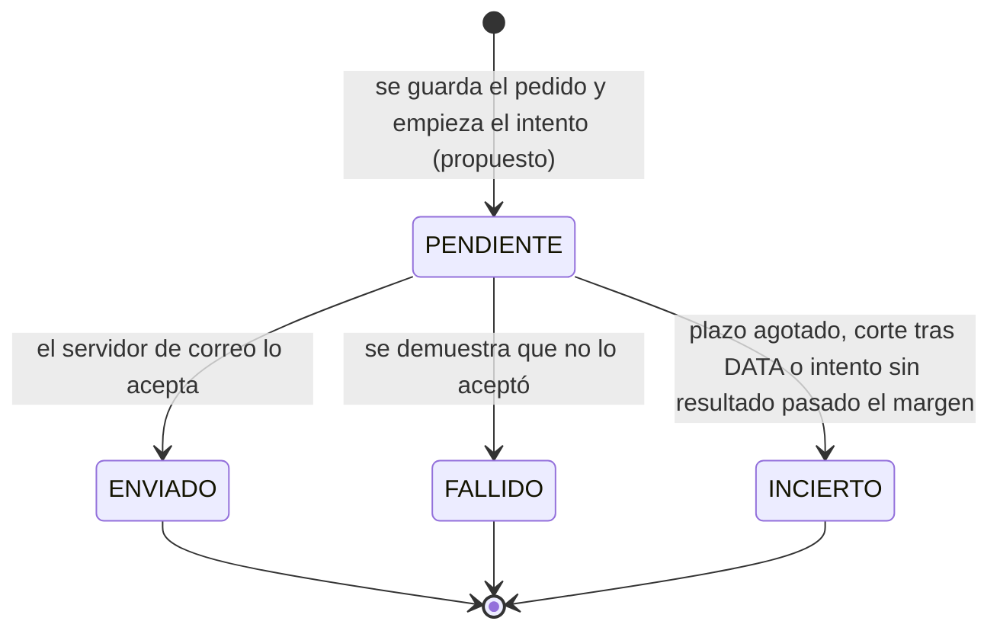
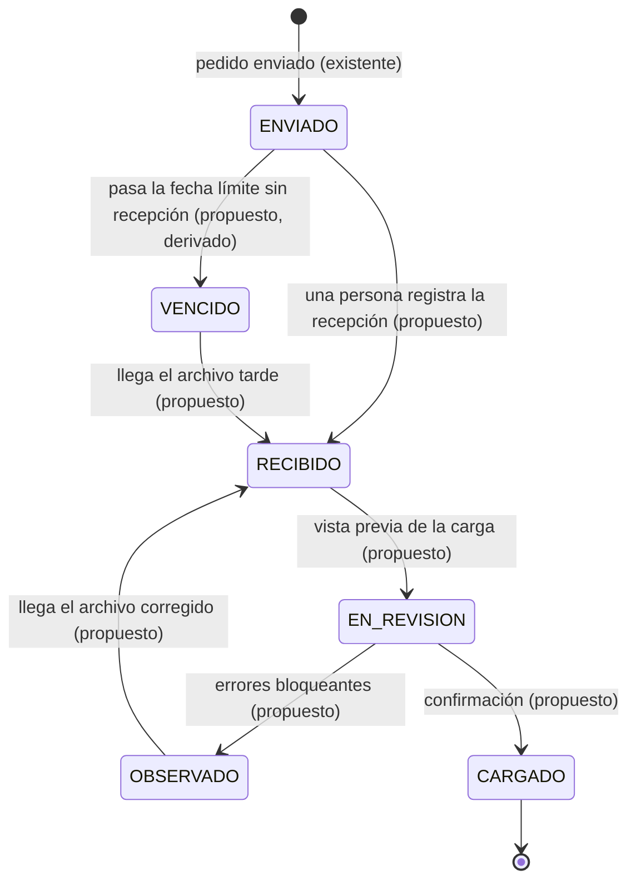
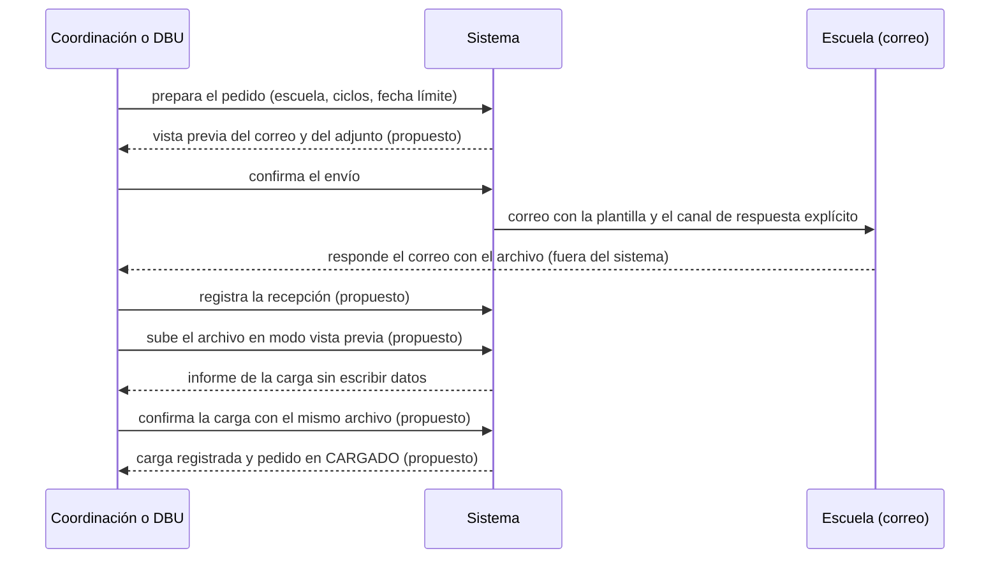

# Especificación: pedido de listas, respuesta con archivo y carga supervisada

**Estado: PROPUESTO** salvo donde se indica **IMPLEMENTADO**. Parte de la decisión de trabajo **Q11 = A** ([10](10_REGISTRO_DE_DECISIONES.md)): pedido por correo, respuesta con archivo y **carga supervisada**, con **vista previa, fecha límite y canal de respuesta explícito**. **Aprobación pendiente:** DBU y escuelas (que el canal les sirva) y TI (correo real, Q13); el formato institucional del oficio y la obligatoriedad de la fecha límite por tipo de pedido siguen en Q12. **Bloqueado:** los canales B (enlace de subida) y C (cuenta de escuela). El correo y su plantilla actuales: [08](08_CATALOGO_PLANTILLAS_CORREO_ACTUAL.md) (P13). Etiquetas: [README](README.md).

## 1. Qué existe hoy (IMPLEMENTADO)

| Pieza | Hoy | Evidencia |
|---|---|---|
| Pedido formal por correo | Escuela, facultad, periodo, ciclos, observaciones, columnas requeridas y plantilla Excel; copia y «responder a» la persona que pide | `dataRequestEmail.ts`, `DataRequestUseCases.ts` |
| Estados del pedido | `ENVIADO` («aceptado por el servidor de correo») y `FALLIDO` (con reenvío); recepción marcada a mano (`receivedAt`) | `schema.prisma` (`DataRequest`) |
| Correo de pedido por escuela | Uno solo, configurado por la coordinación o la DBU | `SetSchoolRequestEmailUseCase` |
| Carga de la lista | **Un solo paso:** la persona sube el Excel a la carga masiva y el sistema crea o actualiza y devuelve un informe; **no hay vista previa ni vínculo con el pedido** | `ImportStudentsUseCase.ts`, `POST /students/import/report` |
| Vista previa, fecha límite, canal explícito, doble envío | **No existen** (LEV-D32, LEV-D34) | — |

## 2. Requisitos

Los requisitos **LEV-R03**, **LEV-R04** y **LEV-R06** están en [05](05_REQUISITOS_SIN_DEPENDENCIAS.md) y **siguen vigentes**; aquí se completan y se agregan R20 a R23. Fuente única de cada requisito: la indicada.

### LEV-R06 (ajustado por Q11 = A) · Fecha y hora límite

La decisión de trabajo incluye la **fecha límite** en el pedido. Cambia el requisito de [05](05_REQUISITOS_SIN_DEPENDENCIAS.md): deja de ser solo «opcional» y pasa a formar parte del pedido; si es **obligatoria u omisible con motivo, por tipo de pedido**, sigue pendiente (Q12). Se mantiene: validación como fecha futura dentro de un máximo razonable (valor a confirmar), zona horaria explícita, aparición en la vista previa y en el correo, sin recordatorios automáticos.

### LEV-R20 · Canal de respuesta explícito en el pedido

| Campo | Contenido |
|---|---|
| Descripción | El correo del pedido dice sin ambigüedad **cómo y hasta cuándo responder**: responder **a ese mismo correo**, adjuntando el archivo Excel con la plantilla adjunta, a más tardar en la fecha límite, y a quién escribir si hay dudas |
| Actor | Sistema (texto de la plantilla) |
| Prioridad (propuesta) | Alta (es lo que hace «explícito» el canal) |
| Origen | Decisión Q11 = A; LEV-D35 |
| Datos | Dirección de respuesta (la del solicitante, ya en «responder a»), fecha y hora límite con zona horaria, nombre del archivo esperado, formato (.xlsx con los encabezados de la plantilla), contacto |
| Reglas | (1) El texto indica **un solo canal** (respuesta al correo); no inventa otros medios. (2) Dice qué ocurre si el archivo no cumple la plantilla (se devuelve con observaciones). (3) No promete entrega ni plazo de procesamiento. (4) Cualquier otro canal (enlace de subida, cuenta de escuela) queda **fuera** hasta que se apruebe (Q11 B/C) |
| Criterios de aceptación | (1) El correo contiene la dirección a la que responder, la fecha límite y el formato esperado. (2) La vista previa (R03) muestra exactamente ese texto. (3) Una prueba de la plantilla lo comprueba |
| Casos límite | Solicitante sin correo válido (no se envía); fecha límite ya pasada (se rechaza) |
| Dependencias | R03, R06. Estado: **Propuesto**; texto final sujeto a la aprobación de la DBU |

### LEV-R21 · Recepción registrada y seguimiento del pedido

| Campo | Contenido |
|---|---|
| Descripción | El pedido sigue un ciclo visible: enviado → recibido → en revisión → cargado u observado, y se marca **vencido** si pasa la fecha límite sin recepción |
| Actor | Coordinación o DBU (quien pidió o tiene alcance sobre la escuela) |
| Prioridad (propuesta) | Media |
| Origen | Decisión Q11 = A («carga supervisada»); LEV-D33; escenario «escuela sin correo configurado o que falla» |
| Estados (nuevos marcados) | **Dos ejes separados.** (A) **Envío**: `ENVIADO` · `FALLIDO` *(existentes)* · **`PENDIENTE`** · **`INCIERTO`** *(propuestos en LEV-R04, [05](05_REQUISITOS_SIN_DEPENDENCIAS.md); describen solo el envío del correo)*. (B) **Seguimiento de la lista**, que solo existe para un pedido `ENVIADO`: **`RECIBIDO`** *(hoy solo `receivedAt`; pasa a ser estado)* · **`EN_REVISION`** · **`CARGADO`** · **`OBSERVADO`** · **`VENCIDO`** *(derivado de la fecha límite)*. Un estado de envío nunca implica recepción, revisión ni carga |
| Reglas | (0) `PENDIENTE` e `INCIERTO` **no** son estados de seguimiento y no pasan a `RECIBIDO` por sí solos. Si una persona podrá registrar la recepción de un pedido `INCIERTO` (la escuela respondió) **queda por definir** al aprobar este requisito; hoy el cliente ofrece «Marcar como recibido» solo para `ENVIADO`. (1) `RECIBIDO` lo registra una persona con alcance, al recibir el archivo por correo; no es automático. (2) `VENCIDO` se calcula al consultar; **no envía recordatorios** ni cambia datos. (3) `OBSERVADO` conserva el motivo y permite pedir la corrección por el mismo canal. (4) Un pedido `FALLIDO` no puede pasar a `RECIBIDO`; uno `PENDIENTE` tampoco. (5) Los estados `FALLIDO` y `VENCIDO` aparecen en Pendientes institucionales |
| Criterios de aceptación | (1) La lista de pedidos muestra el estado y la fecha límite. (2) Marcar recibido registra quién y cuándo. (3) Un pedido vencido aparece en Pendientes sin generar correos |
| Dependencias | R06, R20. Estado: **Propuesto**. Migración: `receivedAt` se conserva y se traduce a `RECIBIDO` |

### LEV-R22 · Vista previa de la carga y confirmación (carga supervisada)

| Campo | Contenido |
|---|---|
| Descripción | Antes de escribir datos, la persona ve el **informe de la carga** (cuántos se crearían, cuántos continúan, cuántos se omiten, errores por fila) y **confirma**. Quien confirma queda registrado |
| Actor | Coordinación o DBU, con el permiso de carga masiva (`students:import`) y alcance sobre las escuelas del archivo |
| Prioridad (propuesta) | Alta (hoy la carga escribe en el primer paso) |
| Origen | Decisión Q11 = A («carga supervisada»); LEV-D32; informe existente (HU-09) |
| Datos | Escuela, periodo, archivo (nombre y `sha256`), informe previo, quién previsualizó y quién confirmó, fechas, vínculo opcional con el pedido |
| Reglas | (1) La vista previa **no escribe** nada. (2) Confirmar exige que sea **el mismo archivo** (mismo `sha256`) que se previsualizó. (3) Se rechazan las filas de escuelas fuera del alcance de quien carga (como hoy). (4) Si hay errores bloqueantes el sistema lo indica y no permite confirmar hasta corregir o aceptar omitirlos explícitamente. (5) **El archivo original no se guarda**; se guardan el informe y el `sha256` (retención del archivo con datos personales, pendiente de definir) |
| Permisos | `students:import`; si se decide separar quién confirma de quién previsualiza, un permiso propio (a confirmar con la DBU) |
| Criterios de aceptación | (1) La vista previa de un archivo con errores muestra los errores y no cambia la base. (2) Confirmar un archivo distinto al previsualizado se rechaza. (3) Una carga confirmada queda con quién, cuándo, escuela, periodo, hash y conteos. (4) Pruebas de integración de los tres casos |
| Casos límite | Archivo con filas de dos escuelas, solo una dentro del alcance; confirmación hecha dos veces (idempotente: la segunda no duplica); estudiante que ya existe en otro periodo (se «continúa», como hoy) |
| Dependencias | R12 para el alcance configurable (mientras tanto, el guardia actual). Estado: **Propuesto** |

### LEV-R23 · Trazabilidad de la carga con el pedido

| Campo | Contenido |
|---|---|
| Descripción | Una carga confirmada puede vincularse al pedido que la originó; el pedido pasa a `CARGADO` |
| Reglas | (1) El vínculo es opcional (hay cargas sin pedido). (2) Un pedido admite varias cargas (p. ej. una corrección). (3) No se infiere el vínculo por nombre de archivo: lo elige la persona |
| Criterios de aceptación | (1) El detalle del pedido lista sus cargas. (2) El detalle de la carga muestra el pedido. (3) La bitácora registra el vínculo |
| Dependencias | R21, R22. Estado: **Propuesto** |

## 3. Diagramas

Eje A, **estado del envío** (LEV-R04, propuesto salvo ENVIADO y FALLIDO):

*Un reenvío es siempre un pedido NUEVO (otra operación), no un cambio de estado de este. En los datos existentes, «reenvío» significaba volver a pedir.*

Eje B, **seguimiento de la lista** (solo para pedidos `ENVIADO`):

*DOC-D07 (estados), dos figuras (A y B). Mezclan estados existentes y propuestos, **marcados en cada flecha**; no son figuras del sistema actual.*

*DOC-D06 (secuencia). Los pasos «(propuesto)» no existen hoy; el envío y la respuesta por correo sí.*

## 4. Lo que sigue bloqueado

| Parte | Bloquea |
|---|---|
| Canales B (enlace de subida) y C (cuenta de escuela) | Q11 B/C: DBU, escuelas, TI |
| Obligatoriedad de la fecha límite y campos por tipo de pedido; formato institucional del oficio | Q12 |
| SMTP institucional y dominios admitidos | Q13 (TI) |
| Conservación del archivo recibido con datos personales | Decisión de la DBU y asesoría legal (Ley N.° 29733 como referencia) |
| Modificar HU-08 / HU-09 (la carga masiva) | Aprobación del Product Owner |
