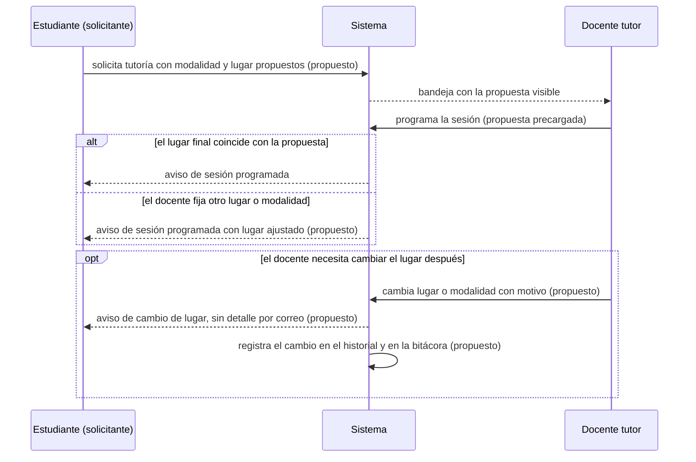

# Especificación: el solicitante propone el lugar y el docente lo confirma

**Estado: PROPUESTO** (nada está implementado). Parte de la decisión de trabajo **Q17 = A** ([10](10_REGISTRO_DE_DECISIONES.md)): el **solicitante propone** el lugar y el **docente lo confirma**; si necesita cambiarlo, **el cambio queda registrado y se notifica** al solicitante. **Aprobación pendiente:** **cambio de RF/HU** (RF-21 y HU-20 asignan el lugar al docente tutor; también toca RF-18 / HU-17, la solicitud) por el Product Owner; y la **DBU y las coordinaciones o direcciones de escuela** para el proceso. **Bloqueado:** el catálogo de lugares y la validación de choques de lugar (Q18) y la contrapropuesta o negociación (Q19). Etiquetas: [README](README.md).

## 1. Qué existe hoy (IMPLEMENTADO)

| Pieza | Hoy | Evidencia |
|---|---|---|
| Solicitud de tutoría | Guarda tipo de caso y motivo; **sin lugar, modalidad ni fecha preferida** | `schema.prisma` (`TutoringRequest`) |
| Lugar de la sesión | Lo escribe quien **programa** (el docente; la DBU también puede programar desde una solicitud): presencial exige lugar; virtual lleva enlace | `ScheduleSessionUseCase.ts` (`location`, `meetingLink`, `modality`) |
| Cambios posteriores | Solo se puede **reprogramar** (fecha y hora, con motivo) o **cancelar**. **El lugar y la modalidad no se pueden cambiar después de programar**; el historial guarda solo `RESCHEDULE` y `CANCEL` con la fecha anterior y la nueva | `RescheduleSessionUseCase.ts`; `SessionChangeHistory` |
| Disponibilidad del docente | Solo días y horas (el servidor aún acepta un campo opcional `place`; el formulario ya no lo pide) | `CAMBIOS_USUARIO_TT103.md` |
| Avisos de sesión | Programada, reprogramada y cancelada, a estudiantes con cuenta; el correo **no lleva fecha, lugar ni motivo** | `SessionNotifier.ts`; [08](08_CATALOGO_PLANTILLAS_CORREO_ACTUAL.md) |

## 2. Requisitos

### LEV-R30 · Propuesta de modalidad y lugar al solicitar

| Campo | Contenido |
|---|---|
| Descripción | Al registrar una solicitud de tutoría, el solicitante puede indicar su **modalidad preferida** y, si es presencial, un **lugar propuesto**. Es una **propuesta**: no reserva nada |
| Actor | El estudiante (cuenta de portal) o, a su nombre, su tutor o su coordinación |
| Prioridad (propuesta) | Media |
| Origen | Encargo E; decisión Q17 = A; LEV-D50 |
| Datos | `modalidad preferida`: presencial, virtual o sin preferencia (valor por omisión); `lugar propuesto`: texto de hasta 120 caracteres, solo si la modalidad preferida es presencial |
| Reglas | (1) Ambos campos son **opcionales**. (2) El estudiante **no propone un enlace virtual** (lo aporta quien atiende). (3) El texto se limpia y se limita en el servidor, igual que el lugar de la disponibilidad hoy (120 caracteres). (4) La propuesta se muestra a quien atiende en la bandeja y en el detalle de la solicitud. (5) Una solicitud registrada por otra persona **a nombre del estudiante** guarda quién la propuso |
| Permisos | Los de crear solicitudes (`tutoring-requests:write` o `tutoring-requests:self`) |
| Criterios de aceptación | (1) Se puede registrar una solicitud sin lugar (comportamiento actual). (2) Con lugar propuesto y modalidad virtual se rechaza o se ignora el lugar con mensaje. (3) El destinatario ve la propuesta. (4) Pruebas de servidor y de formulario |
| Casos límite | Solicitud antigua sin estos campos (se muestra «sin propuesta»); texto con caracteres especiales (se escapa al mostrarlo) |
| Dependencias | Cambio de RF-18/HU-17 por aprobar. Estado: **Propuesto** |

### LEV-R31 · Confirmación por el docente al programar

| Campo | Contenido |
|---|---|
| Descripción | Al programar la sesión desde la solicitud, el formulario **precarga** la modalidad y el lugar propuestos; el docente los **confirma** o **fija otros**. La sesión guarda el lugar final |
| Actor | Docente tutor (o la DBU, que también puede programar desde una solicitud) |
| Prioridad (propuesta) | Media |
| Origen | Decisión Q17 = A; HU-20 (regla vigente: presencial registra el lugar) |
| Reglas | (1) La regla actual se mantiene: **presencial exige lugar** y **virtual lleva enlace**. (2) La **propuesta original no se sobrescribe** en la solicitud: se conserva para el historial. (3) Si el lugar o la modalidad **finales difieren de la propuesta**, se notifica al solicitante (R32). (4) Si coinciden, el aviso de sesión programada basta |
| Criterios de aceptación | (1) El formulario de programar muestra la propuesta precargada y editable. (2) La solicitud conserva la propuesta aunque la sesión use otro lugar. (3) Sin propuesta, el formulario se comporta como hoy |
| Casos límite | Propuesta presencial y el docente programa virtual (cambia de modalidad: se avisa); varios participantes en una sesión grupal con propuestas distintas (el docente fija uno y se avisa a todos) |
| Dependencias | R30. Estado: **Propuesto** |

### LEV-R32 · Cambio de lugar o modalidad: registrado y notificado

| Campo | Contenido |
|---|---|
| Descripción | Si el docente necesita cambiar el lugar o la modalidad de una sesión ya programada, el cambio **queda registrado** (quién, cuándo, valor anterior y nuevo, motivo) y **se notifica** al solicitante y a los participantes |
| Actor | Docente tutor (quien puede reprogramar la sesión) |
| Prioridad (propuesta) | Alta (hoy no existe: solo se puede reprogramar la fecha o cancelar) |
| Origen | Decisión Q17 = A («el cambio debe quedar registrado y notificarse al solicitante») |
| Datos | Tipo de cambio nuevo (`RELOCATE`) en el historial de la sesión, con lugar y modalidad anteriores y nuevos, y motivo obligatorio; aviso nuevo `SESSION_PLACE_CHANGED` |
| Reglas | (1) Solo para sesiones **no canceladas** y **futuras**. (2) **Motivo obligatorio** (como en reprogramar). (3) Cambiar de presencial a virtual exige enlace; de virtual a presencial, lugar. (4) El aviso va a los estudiantes participantes con cuenta; sin cuenta, se informa a quien hizo el cambio para que lo comunique (como hoy). (5) El **correo del aviso no incluye el lugar ni el motivo** (igual que las demás sesiones: confidencialidad); el detalle está en «Mis sesiones». (6) Queda en la bitácora |
| Permisos | Los de reprogramar sesiones; alcance del docente sobre la sesión |
| Criterios de aceptación | (1) Cambiar el lugar crea una entrada en el historial con anterior, nuevo, motivo y autor. (2) El estudiante recibe el aviso y ve el lugar nuevo. (3) Una sesión cancelada o pasada rechaza el cambio. (4) Pruebas de integración, incluida la confidencialidad del correo |
| Casos límite | Dos cambios seguidos (cada uno queda registrado); cambio y reprogramación a la vez (requiere control de concurrencia, a definir en el diseño); participante sin cuenta |
| Dependencias | R31. Estado: **Propuesto**. Requiere cambio de esquema (tipo de cambio y campos del historial) y un aviso nuevo |

### LEV-R33 · Si el docente no puede atender en el lugar propuesto

| Campo | Contenido |
|---|---|
| Descripción | El docente que no puede atender en el lugar propuesto **fija una alternativa** al programar (R31) y el solicitante es avisado del ajuste. **No hay negociación** en esta versión |
| Reglas | (1) El solicitante **no tiene poder de veto** ni contrapropone dentro del sistema; si no le sirve el lugar, lo conversa con quien atiende o pide reprogramar. (2) Si el docente no puede atender en absoluto, se aplican los flujos que ya existen: reprogramar, cancelar y reemplazar, o derivar |
| Estado | **Propuesto**. La **contrapropuesta o negociación** queda **bloqueada** (Q19) |

### LEV-R34 · Cambios de requisitos a aprobar (redacción propuesta, no aprobada)

El Product Owner debe aprobar estos cambios **antes** de implementar. **No se modifican los documentos originales**; esto es solo una redacción propuesta.

| Requisito | Hoy | Redacción propuesta |
|---|---|---|
| HU-20 / RF-21 | «Presencial registra el lugar; virtual, el enlace»; historia «como docente tutor quiero indicar la modalidad de cada sesión» | Añadir: «El solicitante puede proponer modalidad y lugar al pedir la tutoría; el docente tutor los confirma o fija otros al programar; todo cambio posterior de lugar o modalidad queda registrado y se notifica al solicitante» |
| HU-17 / RF-18 | «El estudiante solicita indicando el motivo» | Añadir: «Opcionalmente indica modalidad preferida y lugar propuesto» |

## 3. Cambios técnicos que implicaría (sin estimaciones)

| Capa | Cambio |
|---|---|
| Datos | `TutoringRequest`: dos campos opcionales (modalidad preferida, lugar propuesto); `SessionChangeHistory`: tipo `RELOCATE` y campos para lugar y modalidad anteriores y nuevos |
| Servidor | Casos de uso de crear solicitud y programar sesión; nuevo caso de uso de cambio de lugar; aviso `SESSION_PLACE_CHANGED` y su asunto y texto de correo |
| Cliente | Formulario de solicitud (dos campos), formulario de programar (precarga), acción «Cambiar lugar» con motivo, «Mis sesiones» |
| Pruebas | Servidor (casos de uso), integración (alcance, confidencialidad del correo), cliente (formularios) |

## 4. Diagrama

*DOC-D06 (secuencia). Todo lo marcado «(propuesto)» no existe hoy; la solicitud, la programación y el aviso de sesión programada sí.*

## 5. Lo que sigue bloqueado

| Parte | Bloquea |
|---|---|
| Catálogo de lugares por sede o escuela, quién lo administra, validar que el lugar esté libre y evitar choques de lugar | Q18 (DBU y escuelas) |
| Contrapropuesta o negociación entre solicitante y docente | Q19 |
| Aprobar el cambio de RF-18/HU-17 y RF-21/HU-20 | Product Owner |
| Corregir el texto del correo de aceptación que pide el lugar al docente | **No bloqueada**: es **LEV-R07** (corrección acotada, implementación posterior) |
