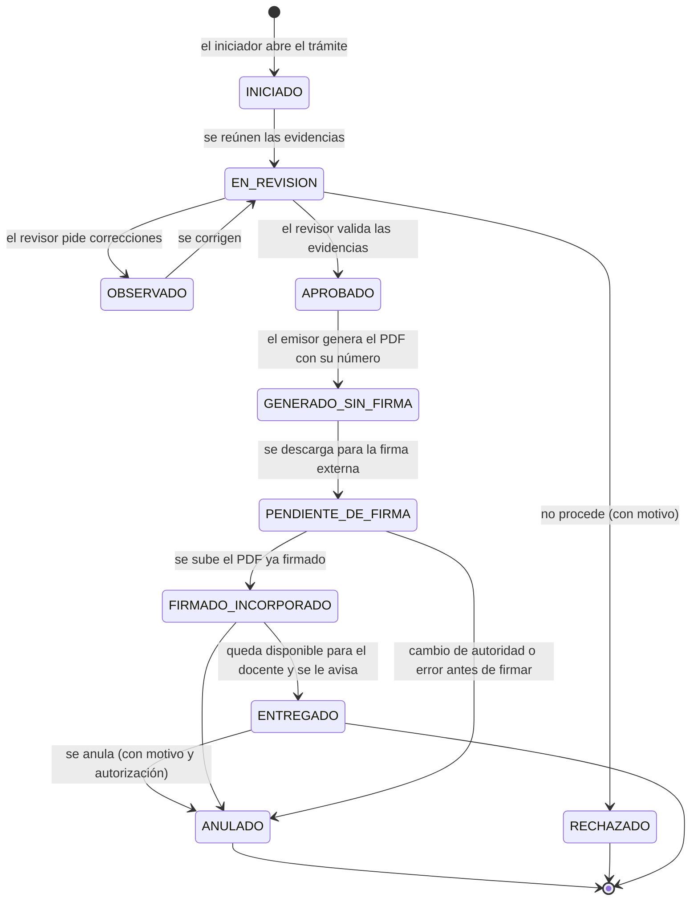
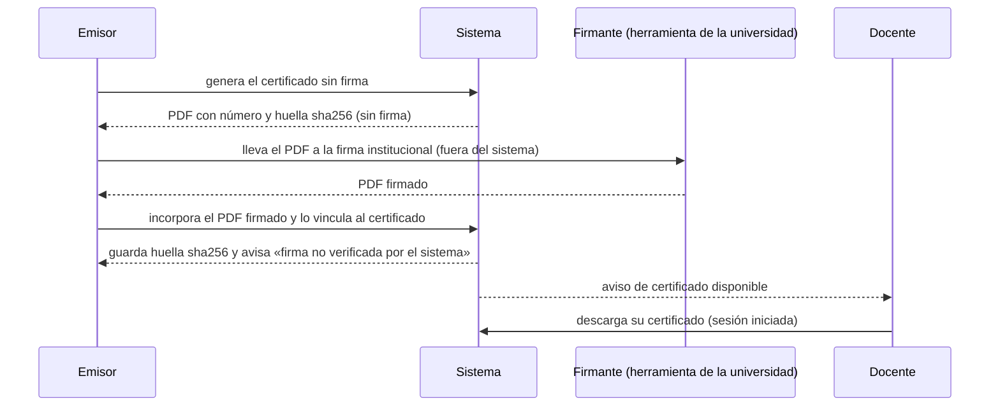

# Especificación: certificación del docente tutor (esqueleto del proceso, con las partes institucionales como parámetros)

**Estado: PROPUESTO y PARCIALMENTE BLOQUEADO.** No existe ninguna función de certificados (LEV-D60). Este documento especifica **lo que las decisiones de trabajo permiten** ([10](10_REGISTRO_DE_DECISIONES.md)): **Q23 = A** (propuesta técnica: generar sin firma, firma externa institucional, incorporar el PDF firmado, sin claves privadas) y **Q24 = A preferida / B sujeta a aprobación** (plantilla de demostración con datos ficticios mientras llega el formato oficial, que **no debe emitirse como certificado válido**). Las preguntas **Q20, Q21 y Q22 siguen pendientes institucionales**: quién emite, qué acredita y quién revisa las evidencias. **Por eso el proceso las trata como parámetros y no las resuelve**, y **no se convierte el certificado de cumplimiento en una constancia de participación para simplificarlo.** Etiquetas: [README](README.md). Identificadores `LEV-C`: provisionales.

**Sobre el ejemplo del encargo.** La descripción de su contenido (director de Escuela, Resolución de Decanato, docente, escuela, facultad, semestre, ciudad, fecha y número de registro) es una **observación visual hecha por Codex y relatada por el usuario**; no la verifiqué ni validé la firma. Los campos de la plantilla de demostración (sección 6) se toman de esa observación y **se confirman con la plantilla oficial**.

## 1. Principios (derivados de las decisiones)

1. El documento que se especifica es un **certificado de cumplimiento**: el sistema **no escribe «cumplió correctamente»** porque haya actividad registrada. Esa afirmación la valida una persona, con evidencias, que **la institución designa** (Q22).
2. El sistema **genera sin firma**; la firma la pone una **autoridad con la herramienta de la universidad, fuera del sistema** (Q23 = A); el sistema **incorpora el PDF ya firmado**. **No custodia claves privadas ni certificados.**
3. **No se edita el ejemplo firmado** para cambiar el nombre. Cada certificado se genera desde la plantilla sin firmar y recibe su propia firma.
4. Hasta que exista el formato oficial, solo existe la **plantilla de demostración** con datos ficticios, marcada como **sin valor** y con numeración separada.
5. Todo paso queda en la bitácora; la confidencialidad y la Ley N.° 29733 se tratan como referencia, sin declarar cumplimiento.

## 2. Parámetros que decide la institución (el proceso no los resuelve)

| Parámetro | Pregunta | Quién decide | Mientras tanto |
|---|---|---|---|
| Quién **emite** | Q20 | Facultad (decanato), DBU, Vicerrectorado | Rol «Emisor» abstracto |
| Qué **acredita** y con qué criterios | Q21 | Facultad, dirección de escuela | **Sin criterios por defecto, sin umbrales** |
| Quién **revisa las evidencias** | Q22 | Facultad, dirección de escuela | Rol «Revisor de evidencias» abstracto |
| Formato y ámbito del **número de registro** | Q25 | Secretaría de la facultad / DBU | Numeración única interna sin formato oficial |
| Certificación **por lote** | Q26 | Facultad | Solo individual |
| **Consulta de autenticidad** | Q27 | Facultad / Vicerrectorado | No se especifica |
| **Validación criptográfica** de la firma | Q28 | TI | El sistema no valida la firma y lo dice |
| Datos personales y **conservación** | Q29 | DBU / asesoría legal | Sin declarar cumplimiento |
| Qué eventos llevan **correo** | Q07 | DBU | Aviso interno; correo sin datos del caso |

## 3. Roles y permisos del proceso (abstractos)

Los roles son **funciones** que la institución asignará a cargos concretos (Q20, Q22). Los permisos usan el vocabulario de [11](11_ESPECIFICACION_ROLES_PERMISOS_ALCANCE.md) y el modelo de alcance (escuela o facultad).

| Función | Qué hace | Permiso propuesto | Alcance |
|---|---|---|---|
| Iniciador | Abre el trámite de un docente y reúne la solicitud | `certificados:registrar` | Escuela o facultad |
| Revisor de evidencias | Revisa las evidencias y aprueba, observa o rechaza | `certificados:aprobar` | Escuela o facultad |
| Emisor | Genera el certificado sin firma y asigna el número | `certificados:emitir` | Escuela o facultad |
| Registrador de la firma | Incorpora el PDF **ya firmado fuera del sistema** | `certificados:firmar` (significa *incorporar el firmado*; el sistema **no firma**; nombre alternativo `certificados:incorporar-firmado` a decidir) | Escuela o facultad |
| Administrador | Anula, reemite y administra plantillas | `certificados:administrar` | Institución |
| Consulta | Ve los trámites | `certificados:consultar` | Según alcance |
| Descarga | Descarga el PDF | `certificados:descargar` | Según alcance; el docente ve y descarga **el suyo** |
| Docente | Recibe y descarga su certificado | (propios) | Propios |

*Un mismo cargo puede tener varias funciones; si se exige **separar** funciones (por ejemplo, que quien revisa no emita), es una regla institucional pendiente.* El firmante puede **no ser usuario del sistema**.

## 4. Proceso y estados

*DOC-D07 (estados), figura **PROPUESTA**. Los nombres de estado son de trabajo.* **Quién** ejecuta cada paso depende de Q20 a Q22; **qué** se exige en `EN_REVISION` es el criterio pendiente (Q21).

### Reglas de transición

| Transición | Quién (función) | Condiciones |
|---|---|---|
| Iniciar | Iniciador | El docente existe, está activo y pertenece al alcance de quien inicia |
| `EN_REVISION` → `APROBADO` | Revisor de evidencias | **Todas las evidencias registradas están en «conforme»** según el criterio vigente (Q21) y el revisor deja su nombre y fecha. El sistema **no aprueba solo** |
| `APROBADO` → `GENERADO_SIN_FIRMA` | Emisor | Existe plantilla vigente; se asigna el número (sección 5); se guarda el `sha256` del PDF sin firma |
| `PENDIENTE_DE_FIRMA` → `FIRMADO_INCORPORADO` | Registrador de la firma | PDF válido, tamaño dentro del límite, `sha256`, vinculado a **ese** certificado; se informa si trae un campo de firma (solo estructura) y se muestra «**firma no verificada por el sistema**» (Q28) |
| `FIRMADO_INCORPORADO` → `ENTREGADO` | Registrador de la firma o el sistema | El docente está activo; se envía un aviso sin datos del certificado por correo |
| Cualquiera → `ANULADO` | Administrador (o quien la institución designe) | Motivo obligatorio; el número **no se reutiliza**; queda el rastro |

## 5. Evidencias, numeración y plantillas

**Evidencias.** Cada trámite tiene una lista de evidencias: tipo, referencia al registro del sistema o al documento (designación y aceptación, sesiones, informe semestral, evaluación agregada, resolución adjunta), quién la revisó, resultado (conforme u observada) y comentario. El sistema **muestra los hechos que conoce** (por ejemplo, cuántas sesiones constan) **solo como información** para el revisor; **no las convierte en aprobación automática ni en umbral** (Q21 pendiente).

**Numeración.** (1) Se asigna al generar el PDF sin firma. (2) Es **única** (restricción en la base) y **no se reutiliza**, ni siquiera al anular. (3) La asignación es transaccional (dos emisiones simultáneas no repiten número). (4) El **formato y el ámbito** (escuela, facultad, año) son pendientes (Q25). (5) Los certificados de demostración usan un prefijo propio (`DEMO-`) y una secuencia separada.

**Plantilla.** Campos de la plantilla de demostración (observados por Codex, a confirmar con la oficial): nombre y grado académico del docente, departamento académico, escuela, facultad, participación en la comisión de tutoría, resolución de decanato (número y fecha), semestre académico, ciudad y fecha de emisión, nombre y cargo de la autoridad firmante y número de registro. Logotipos y textos: **pendientes de la institución** (Q24); la plantilla de demostración usa **marcadores de posición**, no logotipos oficiales.

## 6. Modo de demostración (Q24)

| Regla | Contenido |
|---|---|
| Datos | Solo **datos ficticios**; nunca personas reales |
| Marca | Marca de agua «DEMOSTRACIÓN — SIN VALOR» en todas las páginas y numeración `DEMO-…` |
| Límites | Un certificado de demostración **no puede** pasar a `FIRMADO_INCORPORADO` ni a `ENTREGADO`, no se envía por correo a direcciones reales y no cuenta en la numeración oficial |
| Alcance | Disponible en desarrollo y pruebas; en producción se activa solo con un parámetro explícito y queda en la bitácora |
| Reemplazo | Cuando llegue el formato oficial se carga como plantilla vigente; el modo de demostración queda como herramienta de prueba |

## 7. Firma externa e incorporación del PDF firmado (Q23 = A)

*DOC-D06 (secuencia), figura **PROPUESTA**; apoya en el patrón existente de documentos firmados (`SignedDocument`: archivo, tamaño, `sha256`, quién lo subió), que hoy no verifica firmas.*

**Reglas.** (1) El sistema **no recibe ni guarda claves privadas ni certificados de firma.** (2) La entrega es **por descarga con sesión iniciada**, sin enlaces públicos. (3) Se guarda la huella de lo que se generó y de lo que se incorporó, de modo que un PDF **modificado después** de guardarse se detecte al descargarlo. (4) Si luego se decide validar la firma criptográficamente (Q28), es un requisito aparte.

## 8. Correcciones, reemisión y anulación

| Caso | Tratamiento |
|---|---|
| Error antes de firmar | `ANULADO` y nuevo trámite o regeneración con **número nuevo**; el anterior queda anulado |
| Error después de firmar | `ANULADO` y **reemisión**: nuevo certificado enlazado al anulado, con motivo |
| Cambio de autoridad antes de firmar | El trámite permanece en `PENDIENTE_DE_FIRMA`; se anula y se reemite con el nuevo firmante (el PDF sin firmar no debe quedar firmado por quien ya no corresponde) |
| Anulación | Motivo y autorización registrados; el certificado deja de aparecer como válido para el docente |
| Docente que cambia de escuela o se inactiva durante el trámite | El trámite se bloquea y se informa; no se genera hasta aclarar el alcance |

## 9. Eventos y avisos (propuestos)

Eventos del proceso: iniciado, observado, aprobado, generado, pendiente de firma, firmado incorporado, entregado, anulado, reemitido. **Aviso interno** a los responsables de la siguiente acción y al docente al entregarse. **Correo:** política por evento pendiente (Q07); el correo, como los demás avisos, **no incluye datos del certificado** y lleva al sistema. Ver la matriz en [07](07_MATRIZ_EVENTOS_ACTUAL.md) (eventos propuestos).

## 10. Escenarios obligatorios del encargo

| Escenario | Tratamiento propuesto | Estado |
|---|---|---|
| Informe pendiente y solicitud de certificado | **No se puede especificar** hasta que Q21 diga si el informe es evidencia exigida | **Bloqueado** (Q21) |
| Autoridad sin permiso o fuera de su escuela o facultad | Se rechaza por permiso y alcance (R12, R13); responde «no encontrado» fuera del alcance | Propuesto |
| Cambio de autoridad antes de firmar | Sección 8 | Propuesto |
| Certificado ya emitido, corregido o anulado | Secciones 4 y 8 | Propuesto |
| Enlace vencido | No hay enlaces: la entrega es por descarga autenticada | Propuesto |
| Firma inválida o PDF modificado después de firmar | PDF modificado: se detecta por huella. Firma inválida: **no la valida el sistema** | Parcial; **bloqueado** (Q28) |

## 11. Qué sigue bloqueado y qué se puede avanzar

| Parte | Estado |
|---|---|
| Quién emite, qué acredita, quién revisa, criterios y umbrales | **Bloqueado** (Q20, Q21, Q22) |
| Formato oficial de la plantilla, logotipos y textos | **Bloqueado** (Q24 A) o aprobación del diseño (Q24 B) |
| Formato del número de registro, lote, consulta de autenticidad, validación criptográfica, conservación | **Bloqueado** (Q25 a Q29) |
| Estructura del proceso y estados, generación sin firma, incorporación del PDF firmado con huellas, anulación y reemisión, plantilla de demostración, permisos y alcance | **Se puede especificar** (este documento) y, tras las aprobaciones, diseñar |
| Aprobación del Product Owner | Función nueva: requiere RF/HU nuevos |

## 12. Requisitos (para trazabilidad)

Todos **PROPUESTOS**. La certificación es una **función nueva**: no tiene RF, HU ni estimación, así que **antes de implementar se requieren RF/HU nuevos aprobados por el Product Owner**. La columna «Parte bloqueada» indica solo lo que depende de una decisión institucional pendiente; el resto del requisito se puede diseñar.

| Id | Requisito | Origen | Criterio de aceptación (resumen) | Dependencias | Parte bloqueada | Prueba propuesta |
|---|---|---|---|---|---|---|
| LEV-R40 | Trámite con estados y transiciones válidas (sección 4) | Encargo D; Q23, Q24 | (1) Solo se permiten las transiciones del diagrama. (2) Cada paso registra quién y cuándo. (3) Fuera del alcance responde «no encontrado» | R10 a R12 (permisos y alcance) | **Quién** ejecuta cada paso (Q20) | Unitarias de la máquina de estados; integración de permiso y alcance |
| LEV-R41 | Evidencias con revisión humana; el sistema no escribe «cumplió» | Encargo D; Q21, Q22 | (1) Aprobar exige todas las evidencias en «conforme» y el nombre del revisor. (2) El sistema nunca aprueba solo | R40 | **Criterios, umbrales y revisor** (Q21, Q22); sin ellos no se codifica ninguna regla de elegibilidad | Integración: intento de aprobar con una evidencia observada se rechaza |
| LEV-R42 | Número de registro único, transaccional y no reutilizable (sección 5) | Encargo D | (1) Dos emisiones simultáneas no repiten número. (2) El número de un certificado anulado no se reutiliza | R40 | **Formato y ámbito oficial** (Q25); mientras tanto, numeración interna | Integración con peticiones concurrentes; restricción única en la base |
| LEV-R43 | Generación del PDF sin firma desde una plantilla vigente, con huella `sha256` | Q23 = A; Q24 | (1) El PDF sin firma se genera con número y huella. (2) No se edita un PDF firmado | R40, R42, plantilla | **Plantilla, logotipos y textos oficiales** (Q24); mientras tanto, solo la de demostración | Unitaria del generador con datos ficticios; integración de la huella |
| LEV-R44 | Modo de demostración sin valor (sección 6) | Q24 (plantilla de demostración) | (1) Marca de agua y numeración `DEMO-` en todas las páginas. (2) Un certificado de demostración no puede llegar a `FIRMADO_INCORPORADO` ni `ENTREGADO` ni enviarse a direcciones reales. (3) En producción solo con parámetro explícito y bitácora | R43 | Ninguna | Integración de cada prohibición; revisión visual de la marca de agua |
| LEV-R45 | Incorporación del PDF firmado fuera del sistema (sección 7) | Q23 = A | (1) Se guarda el PDF firmado con `sha256`, vinculado a **ese** certificado. (2) Se muestra «firma no verificada por el sistema». (3) Un PDF modificado después se detecta al descargarlo. (4) No se guardan claves ni certificados de firma | R43, patrón `SignedDocument` | **Qué firma y con qué herramienta** (Vicerrectorado, TI); **validación criptográfica** (Q28) queda fuera | Integración de carga, vínculo y detección de modificación |
| LEV-R46 | Corrección, anulación y reemisión (sección 8) | Encargo D (escenarios) | (1) Anular exige motivo y autorización. (2) La reemisión enlaza al anulado con número nuevo. (3) Docente inactivo o que cambia de escuela bloquea el trámite | R40, R42 | **Quién autoriza** la anulación (Q20) | Integración de los cuatro casos de la tabla de la sección 8 |
| LEV-R47 | Bitácora y avisos del proceso (sección 9) | Encargo D; Q07 | (1) Cada transición queda en la bitácora. (2) Los avisos no llevan datos del certificado | R40, R18 | **Política de correo por evento** (Q07); mientras tanto, solo aviso interno | Integración de bitácora; prueba de la plantilla de correo |
